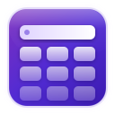
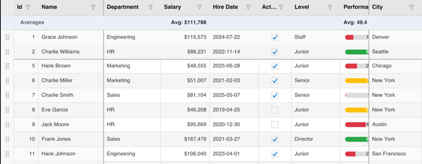
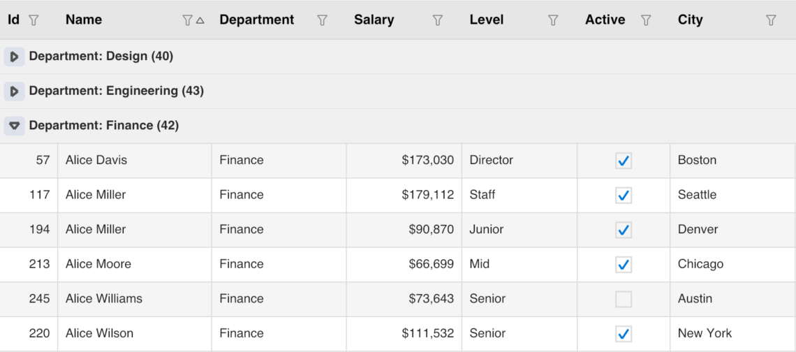
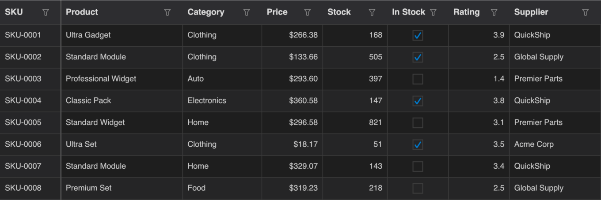
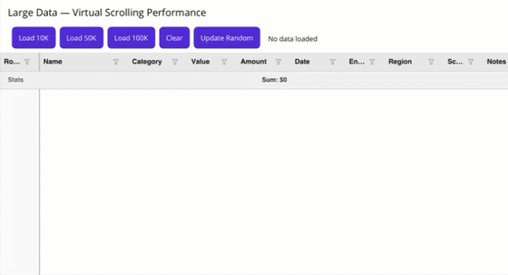

<p align="center">
  
  <h1 align="center">KumikoUI DataGrid</h1>
  <p align="center">
    A canvas-drawn DataGrid for .NET MAUI and the Uno Platform: one SkiaSharp engine, the same grid on every head.
  </p>
  <p align="center">
    <a href="#getting-started">Getting Started</a> ·
    <a href="#columns">Columns</a> ·
    <a href="#sorting-and-filtering">Sorting &amp; Filtering</a> ·
    <a href="#grouping">Grouping</a> ·
    <a href="#editing">Editing</a> ·
    <a href="#theming-and-styling">Theming</a> ·
    <a href="#keyboard">Keyboard</a> ·
    <a href="#faq">FAQ</a>
  </p>
  <p align="center">
    
    
    
    
    
    <a href="https://scorecard.dev/viewer/?uri=github.com/TheEightBot/KumikoUI"></a>
  </p>
  <p align="center">
    <a href="https://www.nuget.org/packages/KumikoUI.Maui"></a>
    <a href="https://www.nuget.org/packages/KumikoUI.Uno"></a>
    <a href="https://www.nuget.org/packages/KumikoUI.SkiaSharp"></a>
    <a href="https://www.nuget.org/packages/KumikoUI.Core"></a>
  </p>
</p>

---

Each grid is one SkiaSharp canvas. Cells, headers, editors, the filter popup, pickers and the grouping panel are drawn by `KumikoUI.Core`, so a grid looks the same on every platform. The host controls add what a canvas can't do: a hidden native text field that receives keyboard and soft-keyboard input, the platform's pointer and gesture events, and the mouse cursor. The grid draws no scrollbars; it scrolls by touch, mouse wheel, trackpad and keyboard.

<p align="center">
  
</p>

## Contents

- [Features](#features)
- [Packages](#packages)
- [Supported platforms](#supported-platforms)
- [Getting Started](#getting-started)
- [Columns](#columns)
- [Action Button Columns](#action-button-columns)
- [Sorting and Filtering](#sorting-and-filtering)
- [Grouping](#grouping)
- [Summaries](#summaries)
- [Editing](#editing)
- [Validation](#validation)
- [Localization](#localization)
- [Selection](#selection)
- [Keyboard](#keyboard)
- [Row Drag and Drop](#row-drag-and-drop)
- [Theming and Styling](#theming-and-styling)
- [Host Properties, Commands & Events](#host-properties-commands--events)
- [Custom Fonts](#custom-fonts)
- [Icons](#icons)
- [Scrolling](#scrolling)
- [Performance](#performance)
- [Live Data](#live-data)
- [Native AOT and Trimming](#native-aot-and-trimming)
- [Accessibility](#accessibility)
- [FAQ](#faq)
- [Architecture](#architecture)
- [Sample Applications](#sample-applications)
- [Contributing](#contributing)
- [License](#license)

---

## Features

| Area | What you get |
|---|---|
| Hosts | `KumikoDataGrid` for .NET MAUI and for the Uno Platform, with the same properties, commands and events |
| Rendering | Only visible rows and columns are drawn; steady-state frames allocate nothing in the managed render loop ([Performance](#performance)) |
| Column types | Text, Numeric, Boolean (optionally three-state), Date, ComboBox, Picker, Image, ProgressBar, Template (custom renderers such as the built-in action buttons) |
| Column layout | Fixed, Star and Auto (fitted to content) sizing; headers fit unless you set a width; resize by dragging or double-click auto-fit; wrapping text cells; drag a header to reorder; freeze columns left or right and rows at the top; save and restore the layout as JSON |
| Sorting | Header tap cycles through a type-aware first direction, the opposite direction and none; Shift or Ctrl adds columns to a multi-column sort |
| Filtering | Filter popup per column with search, a value checklist, sort rows and OK / Cancel / Clear; programmatic predicate and column filters |
| Grouping | Nested groups, expand and collapse, sticky group headers, a grouping panel with chips |
| Summaries | Table (top or bottom, bottom pinned as a footer by default), group and caption summaries: Sum, Average, Count, Min, Max, Custom |
| Editing | Text, numeric, date, combo box, picker and custom editors; edit triggers per grid and per column; typed conversion and validation with messages |
| Selection | None, Single, Multiple, Extended; item-based, so it survives sort, filter and regrouping; MVVM-bindable |
| Rows | Drag and drop reorder by handle or by row |
| Scrolling | Touch, wheel, trackpad and keyboard; `ScrollToRow`, `ScrollToItem` and `ScrollToColumn`; bindable `VerticalOffset` and `HorizontalOffset`; a `Scrolled` event |
| Clipboard | Ctrl/Cmd+C copies the selected rows as tab-separated text; copy, cut and paste work in editors |
| Theming | Light, Dark and HighContrast presets, bindable, following the system light/dark setting by default; every color, font and size on `KumikoStyle`; per-cell and per-row style resolvers |
| Icons | Every built-in glyph (sort arrows, filter buttons, chevrons, check marks, editor buttons) drawn by a replaceable icon provider: the built-in vector set, an icon font such as Material Icons, or your own drawing ([Icons](#icons)) |
| Localization | `KumikoStrings` for every built-in text, `Culture` for formatting, parsing and ordering |
| Data | `ObservableCollection` and `INotifyPropertyChanged`, nested property paths, heterogeneous item types |
| AOT | Packages are `IsAotCompatible`; source-generated accessors (`[KumikoGridItem]`) or per-column delegates |

---

## Packages

| Package | Contains | Install it when |
|---|---|---|
| [`KumikoUI.Maui`](https://www.nuget.org/packages/KumikoUI.Maui) | `KumikoDataGrid` for .NET MAUI, `UseKumikoUI()`, `MauiActionButtonDefinition` | you build a .NET MAUI app |
| [`KumikoUI.Uno`](https://www.nuget.org/packages/KumikoUI.Uno) | `KumikoDataGrid` for the Uno Platform (WinUI API), `UnoActionButtonDefinition`, `KumikoFonts` | you build an Uno Platform app |
| [`KumikoUI.SkiaSharp`](https://www.nuget.org/packages/KumikoUI.SkiaSharp) | `SkiaDrawingContext`, `SkiaResourceCache`, `SkiaFontRegistrar` | you host the engine on your own SkiaSharp surface (the host packages reference it) |
| [`KumikoUI.Core`](https://www.nuget.org/packages/KumikoUI.Core) | Data, layout, rendering, input and editing engine; models and themes; the `[KumikoGridItem]` source generator | always (the other packages reference it); it has no UI framework or SkiaSharp dependency |

All four packages share one version. Release notes are in the [CHANGELOG](CHANGELOG.md).

---

## Supported platforms

All packages target **.NET 10** and **SkiaSharp 4.153.1**.

| Package | Platform (target framework) | Minimum OS | App build host | Verification |
|---|---|---|---|---|
| KumikoUI.Core, KumikoUI.SkiaSharp | any .NET 10 runtime (`net10.0`) | — | any OS | unit tests in CI |
| KumikoUI.Maui | iOS (`net10.0-ios`) | 17.0 | macOS (Xcode) | CI build |
| KumikoUI.Maui | Mac Catalyst (`net10.0-maccatalyst`) | 17.0 (macOS 14+) | macOS (Xcode) | CI build; sample launch checked on macOS 27 (#121) |
| KumikoUI.Maui | Android (`net10.0-android`) | API 24 (Android 7.0) | any OS | CI build |
| KumikoUI.Maui | Windows (`net10.0-windows10.0.19041.0`) | 10.0.19041 | Windows | CI build |
| KumikoUI.Uno | Desktop: Windows, macOS, Linux (`net10.0-desktop`) | as .NET 10 | any OS | CI build; sample run on macOS |
| KumikoUI.Uno | WebAssembly (`net10.0-browserwasm`) | current evergreen browsers | any OS (`wasm-tools` workload) | CI build |
| KumikoUI.Uno | iOS (`net10.0-ios`) | 17.0 | macOS (Xcode) | CI build |
| KumikoUI.Uno | Android (`net10.0-android`) | API 24 (Android 7.0) | any OS | CI build |
| KumikoUI.Uno | Windows App SDK (`net10.0-windows10.0.26100`) | 10.0.19041 | Windows | CI build |

"App build host" is where an app for that head can be built; the libraries themselves are compiled and packed for every head on Windows in CI. "CI build" means compiled and packed in CI; interactive device testing for each head is tracked in #67. KumikoUI.Uno has no Mac Catalyst head: Uno serves macOS through the desktop head.

**Minimum OS versions** are defined once in `Directory.Build.props` (`KumikoMin*Version`) and apply to every library, sample and head. They are re-baselined at each .NET major release, and every change is called out as breaking in the [CHANGELOG](CHANGELOG.md).

---

## Getting Started

The grid, its columns and its options are the same on both hosts. What differs is the package, the startup code and the XAML namespace:

| | .NET MAUI | Uno Platform |
|---|---|---|
| Package | `KumikoUI.Maui` | `KumikoUI.Uno` |
| Startup | `builder.UseKumikoUI()` in `MauiProgram` (required: it registers SkiaSharp's MAUI handlers and passes `ConfigureFonts` aliases to the grid) | no startup call |
| App project | — | `<SkiaSharpVersion>4.153.1</SkiaSharpVersion>` and the `SkiaRenderer` Uno feature |
| Control namespace | `clr-namespace:KumikoUI.Maui;assembly=KumikoUI.Maui` | `using:KumikoUI.Uno` |
| Models namespace | `clr-namespace:KumikoUI.Core.Models;assembly=KumikoUI.Core` | `using:KumikoUI.Core.Models` |
| Two-way bindings | default for the selection properties | set `Mode=TwoWay` explicitly (WinUI bindings default to one-way) |
| Custom fonts | `ConfigureFonts` aliases, or `SkiaFontRegistrar` | `KumikoFonts` (wraps `SkiaFontRegistrar`) |

### .NET MAUI

1. Add the package (it brings in `KumikoUI.Core` and `KumikoUI.SkiaSharp`):

   ```shell
   dotnet add package KumikoUI.Maui
   ```

2. Register KumikoUI in `MauiProgram.cs`:

   <!-- snippet: maui -->
   ```csharp
   using KumikoUI.Maui;

   public static class MauiProgram
   {
       public static MauiApp CreateMauiApp()
       {
           var builder = MauiApp.CreateBuilder();
           builder
               .UseMauiApp<App>()
               .UseKumikoUI(); // registers the SkiaSharp handlers the grid's canvas needs

           return builder.Build();
       }
   }
   ```

   A `KumikoDataGrid` attached to a handler without this call throws an exception that says so. `UseSkiaKumikoUI()` from earlier versions is obsolete and calls `UseKumikoUI()`.

3. Declare the grid. The XAML is the same as on Uno once the `kumiko` and `core` prefixes are declared:

   ```xml
   <ContentPage xmlns="http://schemas.microsoft.com/dotnet/2021/maui"
                xmlns:x="http://schemas.microsoft.com/winfx/2009/xaml"
                xmlns:kumiko="clr-namespace:KumikoUI.Maui;assembly=KumikoUI.Maui"
                xmlns:core="clr-namespace:KumikoUI.Core.Models;assembly=KumikoUI.Core">

       <kumiko:KumikoDataGrid x:Name="kumiko"
                              ItemsSource="{Binding Employees}"
                              RowHeight="36"
                              HeaderHeight="40">
           <core:KumikoColumn Header="Name" PropertyName="Name" Width="180" />
           <core:KumikoColumn Header="Age" PropertyName="Age" Width="80"
                              ColumnType="Numeric" TextAlignment="Right" />
           <core:KumikoColumn Header="Active" PropertyName="IsActive" Width="80"
                              ColumnType="Boolean" />
       </kumiko:KumikoDataGrid>

   </ContentPage>
   ```

> **iOS and Mac Catalyst:** current Apple OS versions (macOS 27 and iOS 27 with the Xcode 27 toolchain) terminate an app at launch if it has not adopted the UIScene lifecycle. New .NET MAUI templates already include it: a `UIApplicationSceneManifest` in `Platforms/iOS/Info.plist` and `Platforms/MacCatalyst/Info.plist`, and a `SceneDelegate` class deriving from `MauiUISceneDelegate`. If your app was created from an older template, copy these from a fresh `dotnet new maui`. See `samples/SampleApp.Maui/Platforms` for a working setup.

### Uno Platform

1. Add the package:

   ```shell
   dotnet add package KumikoUI.Uno
   ```

2. In the app project, make Uno use the SkiaSharp major KumikoUI is built with, and turn on the SkiaSharp canvas (Uno.Sdk defaults to SkiaSharp 3.x, and the app must resolve one SkiaSharp major):

   <!-- snippet: skip project file fragment, not C# or XAML -->
   ```xml
   <PropertyGroup>
     <SkiaSharpVersion>4.153.1</SkiaSharpVersion>
     <UnoFeatures>
       SkiaRenderer;
     </UnoFeatures>
   </PropertyGroup>

   <!-- Windows App SDK head only: the SkiaRenderer feature does not add the WinUI SkiaSharp views -->
   <ItemGroup Condition="$(TargetFramework.Contains('-windows'))">
     <PackageReference Include="SkiaSharp.Views.WinUI" Version="4.153.1" />
   </ItemGroup>
   ```

   `samples/SampleApp.Uno/SampleApp.Uno.csproj` is a complete, working project file.

3. Declare the grid. Uno needs no startup call:

   ```xml
   <Page xmlns="http://schemas.microsoft.com/winfx/2006/xaml/presentation"
         xmlns:x="http://schemas.microsoft.com/winfx/2006/xaml"
         xmlns:kumiko="using:KumikoUI.Uno"
         xmlns:core="using:KumikoUI.Core.Models">

       <kumiko:KumikoDataGrid x:Name="kumiko"
                              ItemsSource="{Binding Employees}"
                              RowHeight="36"
                              HeaderHeight="40">
           <core:KumikoColumn Header="Name" PropertyName="Name" Width="180" />
           <core:KumikoColumn Header="Age" PropertyName="Age" Width="80"
                              ColumnType="Numeric" TextAlignment="Right" />
           <core:KumikoColumn Header="Active" PropertyName="IsActive" Width="80"
                              ColumnType="Boolean" />
       </kumiko:KumikoDataGrid>

   </Page>
   ```

### Code samples in this README

From here on, XAML uses the `kumiko` prefix for the host's namespace (as above) plus `core` for `KumikoUI.Core.Models` and `render` for `KumikoUI.Core.Rendering`, so a snippet works on both hosts unless it says otherwise. C# snippets assume these `using` directives and a grid named `kumiko`:

<!-- snippet: usings -->
```csharp
using System.Collections.ObjectModel;
using System.Globalization;
using KumikoUI.Core.Components;
using KumikoUI.Core.Editing;
using KumikoUI.Core.Input;
using KumikoUI.Core.Models;
using KumikoUI.Core.Rendering;
using KumikoUI.Maui; // or KumikoUI.Uno
```

The grid can also be built in code:

```csharp
kumiko.Columns.Add(new KumikoColumn { Header = "Name", PropertyName = "Name", Width = 180 });
kumiko.Columns.Add(new KumikoColumn
{
    Header = "Salary",
    PropertyName = "Salary",
    ColumnType = KumikoColumnType.Numeric,
    Format = "C0",
    TextAlignment = KumikoTextAlignment.Right,
});
kumiko.ItemsSource = employees;
```

---

## Columns

Each column is a `KumikoColumn`. Its `ColumnType` picks the cell renderer and the editor.

| `ColumnType` | Cell | Editor | Notes |
|---|---|---|---|
| `Text` (default) | Text | `DrawnTextBox` | |
| `Numeric` | Formatted number | `DrawnTextBox` that accepts numbers only | Set `Format` (for example `"C0"`, `"N2"`) and usually `TextAlignment="Right"` |
| `Boolean` | Check box | none: toggled in place | Checked or unchecked; with `IsThreeState="True"` a tap, Space or Enter cycles unchecked, checked and indeterminate (`null`, drawn as a dash), and the property must be a `bool?` |
| `Date` | Formatted date | `DrawnDatePicker` (opens its calendar) | `DateTime`, `DateTimeOffset` and `DateOnly` values |
| `ComboBox` | Text | `DrawnComboBox` (opens its list) | Items from `EditorItems` or `EditorItemsString`; `EditorDisplayMemberPath` / `EditorValueMemberPath` or the selector delegates for objects; `EditorIsFilterable` makes the list searchable |
| `Picker` | Text | `DrawnScrollPicker` (scroll wheel) | Items from `EditorItems` or `EditorItemsString` |
| `Image` | Image, centered in a square | none | A URL, file or asset name, bytes, a stream or a host image source, loaded off the UI thread; see [Images](#images) |
| `ProgressBar` | Progress bar | none (read-only) | A number between `ProgressMinimum` (default 0) and `ProgressMaximum` (default 100); see [Progress bars](#progress-bars) |
| `Template` | `CustomCellRenderer` (text if none) | `EditorFactory`, `CustomEditorFactory`, `EditorDescriptor`, an `ICellEditorProvider` renderer, or a text box | For action buttons and your own renderers |

```xml
<core:KumikoColumn Header="Department" PropertyName="Department" Width="140"
                   ColumnType="ComboBox"
                   EditorItemsString="Engineering,Marketing,Sales,HR,Finance" />

<core:KumikoColumn Header="Salary" PropertyName="Salary" Width="120"
                   ColumnType="Numeric" Format="C0" TextAlignment="Right" />

<core:KumikoColumn Header="Id" PropertyName="Id"
                   IsReadOnly="True" AllowTabStop="False" />
```

Column settings can be changed from code at any time: `KumikoColumn` raises `PropertyChanged` and the grid repaints and lays out again without `Refresh()`. Sort and filter state (`SortDirection`, `SortOrder`, `ActiveFilter`) belongs to the data source and is read-only on the column. Other per-column switches: `IsVisible`, `AllowSorting`, `AllowFiltering`, `AllowResize`, `AllowReorder`, `CustomComparer`, `CellStyle` and `HeaderCellStyle` (a `KumikoCellStyle`).

### Text wrapping

A Text, Numeric or Date cell shows one line and cuts it with an ellipsis; a line break in the value draws as a space. Set `TextWrap` on the column to `Word` or `Character` to wrap the text onto as many lines as fit the row height, with an ellipsis at the end of the last line when there is more. Rows keep the grid's `RowHeight`, so raise it to show more lines (variable row height is tracked in #102). The ellipsis never splits an emoji or a letter with combining marks.

```xml
<core:KumikoColumn Header="Notes" PropertyName="Notes" Width="220" TextWrap="Word" />
```

### Progress bars

A `ProgressBar` column draws a number as a read-only bar. `ProgressMinimum` (0) and `ProgressMaximum` (100) are the values at the empty and full ends, `ProgressShowText` (true) draws the value over the bar formatted with `Format` (`N0` when unset), and `ProgressFillColor` sets the fill (default: the style's `AccentColor`). The column sorts and filters as numbers.

```xml
<core:KumikoColumn Header="Performance" PropertyName="Performance" Width="140"
                   ColumnType="ProgressBar" ProgressMaximum="100" Format="N0" />
```

For a per-value fill color or a different track, use a `Template` column with a `ProgressBarCellRenderer`:

```xml
<core:KumikoColumn Header="Performance" PropertyName="Performance" Width="140"
                   ColumnType="Template" IsReadOnly="True">
    <core:KumikoColumn.CustomCellRenderer>
        <render:ProgressBarCellRenderer Minimum="0" Maximum="100"
                                        TrackHeight="12" CornerRadius="6"
                                        ShowText="True" TextFormat="N0" />
    </core:KumikoColumn.CustomCellRenderer>
</core:KumikoColumn>
```

`FillColor` sets one fill color and `ColorSelector` picks it per value.

### Images

An `Image` column draws its value as a picture, fitted into a square centered in the cell. The grid loads and decodes the image off the UI thread, draws nothing while it loads, and redraws when it is ready. A value can be:

| Value | Loaded from |
|---|---|
| A URL (`string` or `Uri`) with `http`, `https`, `file` or `data` | The web (through one shared `HttpClient`), the file system, or the data URI itself |
| A file name or path | An absolute path; otherwise an app package file: on .NET MAUI a `MauiAsset` (for example under `Resources/Raw`) or a `MauiImage`; on Uno an `ms-appx:///` path (`Assets/Photos/a.png`) |
| `ImageSource` (.NET MAUI) | `FileImageSource`, `UriImageSource` and `StreamImageSource` |
| `Uri` with `ms-appx` or `ms-appdata`, or a `BitmapImage` with a `UriSource` (Uno) | The app package or app data, or the bitmap's URI |
| `byte[]`, `Stream`, `Func<Stream>` or `Func<CancellationToken, Task<Stream>>` | The encoded bytes (PNG, JPEG, WebP, GIF, BMP, ICO) |
| `SKImage` or `SKBitmap` | Drawn as it is; you own and dispose it |

```xml
<core:KumikoColumn Header="Photo" PropertyName="PhotoUrl" Width="60" ColumnType="Image" />
```

Each grid keeps the decoded images in its `ImageCache` (a `KumikoImageCache` from KumikoUI.SkiaSharp), keyed by the URL, file name or object, so rows showing the same picture share one image and scrolling back draws it without loading it again. The cache is bounded: it keeps at most `MaxCount` images (default 256) and `MaxBytes` of decoded pixels (default 64 MiB), disposes the least recently drawn image when it needs room, cancels the download of an image evicted before it arrives, and disposes everything when the grid is unloaded or disconnected from its handler. Images are decoded at most `MaxDecodedSize` pixels (default 256) on their longer side. Keep `MaxCount` above the number of image cells on screen:

```csharp
kumiko.ImageCache.MaxCount = 500;
kumiko.ImageCache.MaxBytes = 128L * 1024 * 1024;
kumiko.ImageCache.MaxDecodedSize = 128;
```

A value nothing can load, such as a `FontImageSource`, draws nothing and is reported once per type through `System.Diagnostics.Trace`, as is the first failed load of each kind. To load another kind of value, implement `IKumikoImageLoader`: `TryGetCacheKey` runs for every visible image cell on every frame, so it returns an object the value already holds without allocating, and `OpenAsync` runs on a worker thread:

<!-- snippet: shared -->
```csharp
public sealed record Photo(int Id);

public sealed class PhotoLoader : KumikoUI.SkiaSharp.IKumikoImageLoader
{
    public bool TryGetCacheKey(object source,
        [System.Diagnostics.CodeAnalysis.NotNullWhen(true)] out object? key)
    {
        key = source as Photo; // a record: equal ids share one cached image
        return key is not null;
    }

    public Task<Stream?> OpenAsync(object key, CancellationToken cancellationToken) =>
        Task.FromResult<Stream?>(File.OpenRead(
            Path.Combine(AppContext.BaseDirectory, "photos", $"{((Photo)key).Id}.jpg")));
}
```

```csharp
kumiko.ImageCache.Loaders.Insert(0, new PhotoLoader());
```

`ImageCellRenderer.ImageResolver` maps a cell value to the value to load (for example an id to a URL). A custom cell renderer draws images the same way through `cell.ImageResolver`.

### Custom cell renderers

Implement `ICellRenderer` and set it as the column's `CustomCellRenderer`. The grid calls `Render` for every visible cell of the column on every frame, passing a `CellRenderContext` by reference:

| Member | Meaning |
|---|---|
| `Bounds` | The rectangle to draw in (the cell minus its horizontal padding) |
| `Row` | The visible row index |
| `Value`, `DisplayText` | The raw value, and its text formatted with the column's `Format` in the source's culture |
| `Column`, `Style` | The column and the grid style |
| `CellStyle` | The cell's effective style overrides (column style merged with the resolvers'), or `null` |
| `IsSelected` | Whether the row is selected |
| `Paints` | The grid's shared `PaintCache` (cell text, checkbox, grid line, selection paints and more) |
| `TextPaint`, `TextAlignment` | The paint and alignment for the cell's text, with the cell style's overrides applied |
| `ImageResolver` | The grid's image cache: `Resolve(value, out image)` returns `Ready` with an image for `ctx.DrawImage`, or `Pending` while it loads (see [Images](#images)) |

```csharp
public sealed class StatusDotRenderer : ICellRenderer
{
    // Created once and reused: only the color changes per cell
    private readonly KumikoPaint _dot = new() { IsAntiAlias = true };

    public void Render(IDrawingContext ctx, in CellRenderContext cell)
    {
        _dot.Color = cell.Value is true ? new KumikoColor(40, 167, 70) : new KumikoColor(220, 53, 69);
        var b = cell.Bounds;
        ctx.FillRoundRect(new KumikoRect(b.X, b.Y + b.Height / 2 - 5, 10, 10), 5, _dot);
        ctx.DrawTextInRect(cell.DisplayText, new KumikoRect(b.X + 16, b.Y, b.Width - 16, b.Height),
            cell.TextPaint, cell.TextAlignment, KumikoVerticalAlignment.Center);
    }
}
```

Keep `Render` free of allocations, as the built-in renderers are: draw with `cell.Paints` and `cell.TextPaint`, or with paints and fonts the renderer creates once, and don't create a `KumikoPaint`, `KumikoFont` or string per call. The context's `CellStyle`, `TextPaint` and `Paints` may be reused for the next cell, so read them during the call and don't keep or modify them.

A renderer that also implements `ICellEditorProvider` supplies the editor of its `Template` column; one that implements `IInteractiveCellRenderer` handles taps itself, as the action buttons do.

### Column sizing

| `SizeMode` | Behavior |
|---|---|
| `Fixed` (default) | The width set with `Width` |
| `Auto` | Fitted to its header and its widest cell (`ContentFitWidth`), within `MinWidth` and `MaxWidth`. Cells are sampled (the rows on screen plus the first and last 100 rows) on the first frame and again after the data or the view changes; scrolling alone never changes the width |
| `Star` | A weighted share (`StarWeight`, default `1`) of the width that Fixed and Auto columns leave, within `MinWidth` and `MaxWidth` |

```xml
<core:KumikoColumn Header="Notes" PropertyName="Notes" SizeMode="Star" StarWeight="2" />
```

**Headers fit unless you set a width.** A column whose `Width` was never set is at least wide enough to show its whole header (`KumikoColumn.HeaderFitWidth`): the header text in the header font, the header padding on both sides, room for the sort arrow when the column can be sorted and for the filter icon when it can be filtered, and a small margin. Fixed and Auto columns without a `Width` are `KumikoColumn.DefaultWidth` (120) or their header-fit width when that is wider; Star columns never shrink below it.

```xml
<!-- No Width: at least wide enough for "Customer Account Number" -->
<core:KumikoColumn Header="Customer Account Number" PropertyName="Account" />

<!-- Explicit Width: kept as set; the header is truncated with an ellipsis if it doesn't fit -->
<core:KumikoColumn Header="Customer Account Number" PropertyName="Account" Width="100" />

<!-- A smaller MaxWidth also wins over the header fit -->
<core:KumikoColumn Header="Customer Account Number" PropertyName="Account" MaxWidth="100" />
```

- Setting `Width` in code or XAML, dragging the column's resize grip, or auto-fitting it makes the width explicit (`HasExplicitWidth`); from then on a Fixed column keeps its width, even below the header-fit width.
- For Star and Auto columns `Width` is an output of layout. Dragging the resize grip of a Star or Auto column, or auto-fitting it, switches it to `Fixed` at the chosen width so the width persists; set `SizeMode` back to `Star` or `Auto` to share or measure it again.
- A Star column whose share is below its minimum (its `MinWidth` and header-fit width) or above its `MaxWidth` is held there, and the other Star columns share what is left. When the viewport is too narrow for every column's minimum, the grid scrolls horizontally instead of truncating headers.
- Header widths are measured once per header text and font and cached; changing a column's `Header`, its `HeaderCellStyle.Font` or the grid's `HeaderFont` measures it again.

### Resizing and hover cursors

Drag the right edge of a column header to resize the column, or double-click it to auto-fit the column to its header and its widest sampled cell (`AutoFitColumnRequested`, answered by `KumikoRenderer.AutoFitColumn`). The edge is a resize grip only when the column has `AllowResize` set (the default) and room to change (`MaxWidth` above `MinWidth`). `ColumnResized` reports a resize.

With a mouse, the cursor shows what a click does:

| Over | Cursor |
|---|---|
| A column resize grip, and for the whole of a resize drag | Left-right resize |
| A filter icon, a group chevron, a grouping chip or its remove button, the row drag handle, an editable check box, an enabled action button | Hand |
| Anything else | Arrow |

`InputController.Cursor` holds the current cursor (`KumikoCursor`) and `InputController.CursorChanged` (an `EventHandler<KumikoCursor>`) reports changes. The Uno control applies it on the Windows, desktop and WebAssembly heads, and the MAUI control on Windows and Mac Catalyst; touch platforms ignore it. Moving the mouse with no button pressed never scrolls or selects.

### Reordering columns

Drag a column header sideways to move the column. A drag that starts on a header and moves more horizontally than vertically reorders instead of scrolling; set `AllowReorder="False"` on a column to keep it in place. The dragged header follows the pointer, and on release the column lands between the two columns on either side of the pointer: before the first column whose middle is right of it, or after the last one.

A column moves only within its own pane: left-frozen columns among the left-frozen ones, scrolling columns among the scrolling ones and right-frozen columns among the right-frozen ones. A drop over another pane or over the row drag handle lands at the near end of the column's own pane, and a scrolling column hidden under a frozen pane is never the target. To move a column to another pane, change its `FreezeMode`.

The grid moves the column in both `DataSource.Columns` and its own `Columns` collection, then raises `ColumnReordered`. `OldIndex` and `NewIndex` are positions in `Columns` (the definition order, hidden columns included): the column is removed at `OldIndex` and inserted at `NewIndex`, so `NewIndex` is its index after the move. The on-screen position is its display index: left-frozen columns first, then scrolling, then right-frozen columns, each in `Columns` order, without hidden ones (`DataSource.DisplayColumns`).

```csharp
kumiko.ColumnReordered += (_, e) =>
{
    // e.Column moved from Columns[e.OldIndex] to Columns[e.NewIndex]
    int onScreen = kumiko.DataSource.GetDisplayIndex(e.Column);
    Console.WriteLine($"{e.Column.Header} is now column {onScreen + 1} on screen");
};
```

Move a column in code by display index; the index is kept within the column's pane and `Columns` follows:

```csharp
var total = kumiko.Columns.First(c => c.PropertyName == "Total");
kumiko.DataSource.SetDisplayIndex(total, 0); // first in its pane
```

### Saving and restoring the layout

`GetLayoutState()` takes what the user can change: column order, width, visibility and freeze mode, the sort, the column filters and the grouping. `KumikoLayoutState.ToJson()` turns it into a string to keep in a file or in preferences (MAUI's `Preferences`, Uno's `ApplicationData.Current.LocalSettings`), and `ApplyLayoutState` puts it back:

```csharp
string layoutPath = Path.Combine(
    Environment.GetFolderPath(Environment.SpecialFolder.LocalApplicationData), "orders-grid-layout.json");

// Save, for example when the page closes
File.WriteAllText(layoutPath, kumiko.GetLayoutState().ToJson());

// Restore, after the columns are set up
if (File.Exists(layoutPath))
    kumiko.ApplyLayoutState(KumikoLayoutState.FromJson(File.ReadAllText(layoutPath)));
```

The JSON comes from a System.Text.Json source generator, so it works with Native AOT and full trimming. `FromJson` ignores properties it does not know and throws a `JsonException` for text that is not a layout.

Columns are matched by name: `KumikoColumn.Key` when you set it, otherwise `PropertyName`. Give a column a `Key` when it has no property name (a template or action column) or when two columns show the same property; a column with neither is not saved. Saved layouts survive changes to the columns: a saved column the grid no longer has is ignored, and a column the layout does not mention keeps its place and settings. The sort and the grouping are replaced as a whole. Restoring is one change (one rebuild); it raises the sort and filter events. A predicate set with `DataSource.SetFilter`, delegates such as `GroupDescription.KeySelector` and which groups are expanded are not saved; a saved group whose property is already grouped by keeps your `GroupDescription` with its selectors. Without a host control, `KumikoLayoutState.Capture(source)` and `state.ApplyTo(source)` do the same on a `KumikoSource`.

### Frozen columns and rows

```xml
<!-- Pinned to the left -->
<core:KumikoColumn Header="Id" PropertyName="Id" IsFrozen="True" />

<!-- Pinned to the right -->
<core:KumikoColumn Header="Total" PropertyName="Total" FreezeMode="Right" />
```

On a narrow screen the frozen columns can take too much of the width. When the columns do not all fit and the frozen ones together are wider than `KumikoStyle.MaxFrozenColumnsWidthRatio` of the grid (two thirds by default, less the row drag handle), the grid unpins columns until they fit: right-frozen columns first, starting with the one next to the scrolling columns, then left-frozen columns from the rightmost. An unpinned column scrolls with the others in the same on-screen order and is pinned again when the grid is wide enough; its `FreezeMode` does not change. So the two panes never overlap and every column can be scrolled to, tapped and reached with the keyboard.

Pin the first rows so they stay visible while the rest scroll:

```xml
<kumiko:KumikoDataGrid FrozenRowCount="2" />
```

---

## Action Button Columns

Action button columns draw a row of pill buttons in every cell; the buttons share the cell's width equally. A button runs an `ICommand`, an `Action` callback, or both. This answers the most common question about the grid: how to put a button bound to a view model command in each row (#2).

An action column is a `Template` column whose `CustomCellRenderer` is an `ActionButtonsCellRenderer`. Set `PropertyName=""` so the whole row item is the cell value. The renderer is an *interactive cell* (`IInteractiveCellRenderer`): a tap runs the button under the finger directly, without opening an editor. A tap raises no `CellBeginEdit`, `CellEndEdit` or `CellValueChanged`, and no view change, and it works in a read-only column. `EditTriggers` does not apply to it.

- **`CanExecute`.** A button whose `Command.CanExecute(parameter)` is false is drawn disabled (the style's `ActionButtonDisabledBackgroundColor` and `ActionButtonDisabledTextColor`) and does nothing when tapped. The parameter is `CommandParameter`, or the row item when that is not set. The renderer listens to `CanExecuteChanged` and the grid redraws; the listener holds the renderer weakly, and `ActionButtonsCellRenderer.Dispose()` removes it. A button with only an `Action` is always enabled.
- **Keyboard.** Enter on the current action cell runs its first button when that button is enabled. Tab stops at the column like any other editable column; give it `AllowTabStop="False"` to skip it.
- **Safe commands.** A command may remove the row it was run for, even the last one.
- A column with its own `EditorFactory`, `CustomEditorFactory` or `EditorDescriptor` is not interactive: the editor wins.

### XAML with bound commands (.NET MAUI)

`MauiActionButtonDefinition` is a `BindableObject`, so every property, including `Command`, can be bound. It is not in the visual tree and does not inherit `BindingContext`, so point bindings at a source with `x:Reference` or `RelativeSource`:

<!-- snippet: maui -->
```xml
<kumiko:KumikoDataGrid x:Name="actionsGrid" ItemsSource="{Binding Employees}">
    <core:KumikoColumn Header="Actions" PropertyName="" ColumnType="Template" Width="200"
                       AllowSorting="False" AllowFiltering="False">
        <core:KumikoColumn.CustomCellRenderer>
            <render:ActionButtonsCellRenderer>
                <render:ActionButtonsCellRenderer.Buttons>
                    <kumiko:MauiActionButtonDefinition
                        Label="Details"
                        BackgroundColor="13,110,253"
                        Command="{Binding Path=BindingContext.ViewDetailsCommand, Source={x:Reference actionsGrid}}" />
                    <kumiko:MauiActionButtonDefinition
                        Label="Delete"
                        BackgroundColor="220,53,69"
                        Command="{Binding Path=BindingContext.DeleteCommand, Source={x:Reference actionsGrid}}" />
                </render:ActionButtonsCellRenderer.Buttons>
            </render:ActionButtonsCellRenderer>
        </core:KumikoColumn.CustomCellRenderer>
    </core:KumikoColumn>
</kumiko:KumikoDataGrid>
```

### XAML with bound commands (Uno)

`UnoActionButtonDefinition` is a `DependencyObject`, so every property, including `Command`, can be bound. It is not in the visual tree, so it cannot inherit `DataContext`; the grid gives it its own `DataContext` (the page's view model unless the grid sets one), so a plain `{Binding}` works. Its colors are `Color` values, like the grid's other color properties:

<!-- snippet: uno -->
```xml
<kumiko:KumikoDataGrid x:Name="actionsGrid" ItemsSource="{Binding Employees}">
    <core:KumikoColumn Header="Actions" PropertyName="" ColumnType="Template" Width="200"
                       AllowSorting="False" AllowFiltering="False">
        <core:KumikoColumn.CustomCellRenderer>
            <render:ActionButtonsCellRenderer>
                <render:ActionButtonsCellRenderer.Buttons>
                    <kumiko:UnoActionButtonDefinition
                        Label="Details"
                        BackgroundColor="#FF0D6EFD"
                        Command="{Binding ViewDetailsCommand}" />
                    <kumiko:UnoActionButtonDefinition
                        Label="Delete"
                        BackgroundColor="#FFDC3545"
                        Command="{Binding DeleteCommand}" />
                </render:ActionButtonsCellRenderer.Buttons>
            </render:ActionButtonsCellRenderer>
        </core:KumikoColumn.CustomCellRenderer>
    </core:KumikoColumn>
</kumiko:KumikoDataGrid>
```

### Code (both hosts)

To build the buttons in code, use `ActionButtonDefinition` from `KumikoUI.Core` (it works on both hosts):

```csharp
var actionsColumn = new KumikoColumn
{
    Header = "Actions",
    PropertyName = "",              // the row item is the cell value
    ColumnType = KumikoColumnType.Template,
    Width = 200,
    AllowSorting = false,
    AllowFiltering = false,
    CustomCellRenderer = new ActionButtonsCellRenderer
    {
        Buttons =
        {
            new ActionButtonDefinition
            {
                Label = "Edit",
                BackgroundColor = new KumikoColor(13, 110, 253),
                Command = vm.EditCommand,     // the row item is the CommandParameter by default
            },
            new ActionButtonDefinition
            {
                Label = "Delete",
                BackgroundColor = new KumikoColor(220, 53, 69),
                Command = vm.DeleteCommand,   // CanExecute false draws it disabled
            },
        },
    },
};
kumiko.Columns.Add(actionsColumn);
```

| Button property | Type | Meaning |
|---|---|---|
| `Label` | `string` | Text on the button |
| `BackgroundColor` | `KumikoColor` | Pill color (`R,G,B`, `R,G,B,A`, `#RGB`, `#RRGGBB`, `#AARRGGBB` or a color name in XAML) |
| `TextColor` | `KumikoColor` | Label color (default: white) |
| `Command` | `ICommand?` | Executed on tap; the row item is the default parameter |
| `CommandParameter` | `object?` | Overrides the row item as the parameter |
| `Action` | `Action?` | Code-behind callback; runs in addition to `Command` when both are set |

`ActionButtonsCellRenderer` also has `CornerRadius` (default 5), `ButtonSpacing` (6) and `CellPadding` (4). To open the buttons as an editor instead, set `CustomEditorFactory` to create a `DrawnActionButtons` with the same `Buttons`; that editor raises the edit events.

---

## Sorting and Filtering

### Sorting

Tap a column header to sort. The first tap depends on the column type: Boolean columns sort checked rows first and Date columns newest first (both `Descending`); text, numeric, ComboBox and Picker columns sort ascending. The next tap sorts the other way, and the third removes the sort. Set `KumikoColumn.InitialSortDirection` to choose a column's first direction; `KumikoColumn.FirstSortDirection` reports the one in effect.

Shift-tap or Ctrl-tap a header to add it to a multi-column sort (the header shows each column's place in the chain). Template and Image columns, and columns with neither a `PropertyName` nor a `ValueAccessor`, are not sortable unless you set `AllowSorting`.

Sort state belongs to the data source (a column's `SortDirection` and `SortOrder` are read-only):

```csharp
// One column:
kumiko.DataSource.SetSort(lastNameColumn, KumikoSortDirection.Ascending);

// Several: the order is the column's place in the chain (1 = primary).
kumiko.DataSource.SetSort(departmentColumn, KumikoSortDirection.Ascending, 1);
kumiko.DataSource.SetSort(lastNameColumn, KumikoSortDirection.Descending, 2);

// Remove one column from the sort, or clear it:
kumiko.DataSource.SetSort(departmentColumn, KumikoSortDirection.None);
kumiko.DataSource.ClearSort();
```

Batch changes so the view is rebuilt and repainted once. `BeginUpdate()` returns a scope that calls `EndUpdate()` when disposed; collection changes inside the batch are coalesced too:

```csharp
using (kumiko.DataSource.BeginUpdate())
{
    kumiko.DataSource.SetSort(lastNameColumn, KumikoSortDirection.Ascending);
    kumiko.DataSource.SetFilter(item => ((Employee)item).IsActive);
    kumiko.DataSource.AddGroupDescription(new GroupDescription("Department"));
}
```

Sorting, grouping, filtering and Min/Max summaries share one comparer (`KumikoSource.Comparer`) that never throws: nulls come first, numbers compare by value across numeric types, dates and times chronologically, other values of one type through `IComparable`, and anything else by its text. Sorting is stable. Text compares in the source's culture, ignoring case by default:

```csharp
kumiko.DataSource.Culture = CultureInfo.GetCultureInfo("de-DE"); // formatting, text order, parsing (default: current culture)
kumiko.DataSource.StringCompareOptions = CompareOptions.Ordinal;  // case-sensitive (default: IgnoreCase)
```

A column's `CustomComparer` replaces the comparer for that column's sort and grouping. `SortChanging` and `SortChanged` report sort changes, and `SortChangedCommand` runs on each one.

### Filtering

Each column header with `AllowFiltering` (the default) shows a filter icon. Tapping it opens the filter popup:

- two sort rows whose text follows the column type (A to Z, smallest to largest, newest to oldest, checked first), the first being the header's first-tap direction;
- a search box that narrows the value list;
- **Select All** and **Deselect All**, and a checklist of the column's distinct values;
- **OK** applies the checked values as the column's filter, **Cancel** (or a tap outside the popup) closes it without changes, and **Clear** removes the column's filter.

The value list scrolls by drag, mouse wheel, its scrollbar, and Up/Down, Page Up/Page Down, Space, Enter and Escape. Filters on several columns combine. The filter icon is drawn in `FilterActiveIconColor` while the column has a filter.

From code, filter by predicate or per column:

```csharp
// Any rule over the item; combined with the column filters
kumiko.DataSource.SetFilter(item => ((Employee)item).Salary > 50_000m);

// A column filter: a set of display values and/or up to two conditions
var filter = new FilterDescription(departmentColumn)
{
    SelectedValues = new HashSet<string> { "Engineering", "Sales" },
};
kumiko.DataSource.SetColumnFilter(departmentColumn, filter);

// Remove filters
kumiko.DataSource.SetFilter(null);
kumiko.DataSource.ClearAllFilters();
```

`FilterChanging` and `FilterChanged` report filter changes.

---

## Grouping

Add `GroupDescription`s to group rows, outermost first. Groups can be nested and expanded or collapsed. While grouping is active, a panel above the header shows one chip per level: tapping a chip flips that level's group order, and its remove button removes the level.

Declare grouping in XAML (both hosts); the collection is kept in sync with the data source and can change at runtime:

```xml
<kumiko:KumikoDataGrid ItemsSource="{Binding Employees}">
    <kumiko:KumikoDataGrid.GroupDescriptions>
        <core:GroupDescription PropertyName="Department" />
        <core:GroupDescription PropertyName="Level" />
    </kumiko:KumikoDataGrid.GroupDescriptions>
</kumiko:KumikoDataGrid>
```

or in code, through the collection or the data source:

```csharp
kumiko.GroupDescriptions.Add(new GroupDescription("Department"));
```

```csharp
kumiko.DataSource.AddGroupDescription(new GroupDescription("Level"));
kumiko.DataSource.ExpandAllGroups();
kumiko.DataSource.CollapseAllGroups();
kumiko.DataSource.ClearGroupDescriptions();
```

The grid's `GroupDescriptions` and `GroupSummaryRows` replace whatever grouping was set on `DataSource` directly, so use one or the other. `GroupDescription` also has `Header`, `KeySelector` (group by a computed key), `DisplayTextSelector` and `GroupSortDirection`. Groups are ordered by their key (1, 2, 10; dates chronologically) and expanded by default. `GroupExpanding` and `GroupExpandedChanged` report expand and collapse. Dragging a row doesn't reorder it while grouping is active.

### Sticky group headers

While a grouped grid scrolls, the header of the group the top rows belong to stays pinned at the top of the data area, so you always see which group you are in. With nested grouping, each level's header stacks below the one outside it. As the next group's header scrolls up, it pushes the pinned header out of the way.

A pinned header works like the real one: tapping it (or its chevron) expands or collapses that group, and collapsing it keeps the header where it was pinned. Keyboard navigation keeps the current row below the pinned headers. Sticky headers are on by default; to let group headers scroll away with their rows:

```csharp
var style = kumiko.GridStyle;
style.StickyGroupHeaders = false;
kumiko.GridStyle = style;
```

---

## Summaries

| Kind | Where | How |
|---|---|---|
| Table summary | One or more rows at the top or bottom of the grid | `TableSummaryRows` on the grid, or `DataSource.AddTableSummaryRow` |
| Group summary | A row after each group | `GroupSummaryRows` on the grid, or `DataSource.AddGroupSummaryRow` |
| Caption summary | Inside each group header | `DataSource.CaptionSummary` |

Summary types: `Sum`, `Average`, `Count`, `Min`, `Max`, and `Custom` (with `SummaryColumnDescription.CustomAggregate`, which receives the values).

### Table summaries

```xml
<kumiko:KumikoDataGrid.TableSummaryRows>
    <core:TableSummaryRow Name="Totals" Position="Bottom" Title="Totals">
        <core:TableSummaryRow.Columns>
            <core:SummaryColumnDescription PropertyName="Salary" SummaryType="Sum" Format="C0" />
            <core:SummaryColumnDescription PropertyName="Id" SummaryType="Count" Label="Rows: " />
            <core:SummaryColumnDescription PropertyName="Salary" SummaryType="Average" Format="C0"
                                           Label="Avg: " />
        </core:TableSummaryRow.Columns>
    </core:TableSummaryRow>
</kumiko:KumikoDataGrid.TableSummaryRows>
```

**Bottom rows are pinned.** `Position="Bottom"` rows are drawn as a footer fixed to the bottom of the viewport while the data scrolls (`KumikoStyle.PinBottomSummaryRows`, default `true`). Taps on the footer don't reach the rows behind it, and keyboard navigation keeps the current row above it. To draw them after the last row instead, as a totals row that scrolls with the data:

```csharp
var style = kumiko.GridStyle;
style.PinBottomSummaryRows = false;
kumiko.GridStyle = style;
```

Several aggregates of one property share that property's cell, in declaration order (`Sum: $1,300  |  Avg: $163`); the summary row stays one line high, so make the column wide enough. A property with no column, or a hidden one, can still be aggregated, and property names match case-insensitively.

### Group summaries

```csharp
kumiko.DataSource.AddGroupSummaryRow(new GroupSummaryRow("Totals")
{
    Title = "Total",
    Levels = GroupSummaryLevels.All, // after every group level; Innermost (the default) only after the innermost
    Columns =
    {
        new SummaryColumnDescription { PropertyName = "Salary", SummaryType = SummaryType.Sum, Format = "C0" },
        new SummaryColumnDescription { PropertyName = "Salary", SummaryType = SummaryType.Average, Format = "C0", Label = "Avg: " },
    },
});
```

With `Levels = All` each group, outer or inner, gets a summary of all the rows beneath it.

### Caption summaries

```csharp
kumiko.DataSource.CaptionSummary = new CaptionSummaryDescription
{
    Columns = { new SummaryColumnDescription("Salary", SummaryType.Sum, "C0") },
};
```

### Values

`Sum` and `Average` of `decimal` values are exact (a `decimal` result); integers and floating-point numbers give a `double`. Values that are not numbers (text, dates, booleans, nulls) are skipped. `Min` and `Max` use the grid's comparer. Summary values are formatted in `DataSource.Culture`. Read computed values with `DataSource.ComputedTopSummaries`, `ComputedBottomSummaries` and `GetGroupSummaries(groupPath)`: `Values` (text) and `RawValues` are keyed by property, and `Aggregates` / `GetRawValue(property, type)` give each aggregate when a property has several.

---

## Editing

### Edit triggers

`EditTriggers` chooses which gestures and keys open the editor. The default is `DoubleTap`, `F2Key` and `Typing`.

```xml
<kumiko:KumikoDataGrid EditTriggers="DoubleTap,F2Key,Typing"
                       EditTextSelectionMode="SelectAll"
                       DismissKeyboardOnEnter="True" />
```

| `EditTrigger` | Opens the editor on |
|---|---|
| `SingleTap` | A tap on the cell |
| `DoubleTap` | A double-tap |
| `LongPress` | A long press |
| `F2Key` | F2, or Enter outside an edit |
| `Typing` | A typed character, which replaces the cell's text |
| `None` | Nothing: the column can't be edited by gesture or key, but isn't read-only |

`EditTextSelectionMode` is `SelectAll` (default) or `CursorAtEnd`. `DismissKeyboardOnEnter` (default `true`) ends editing on Enter; when false, Enter commits and opens the editor of the cell below.

### Per-column edit triggers

A column's `EditTriggers` overrides the grid's (#6); `null`, the default, inherits it:

```xml
<kumiko:KumikoDataGrid EditTriggers="DoubleTap,F2Key,Typing">
    <!-- Single tap, F2 or typing -->
    <core:KumikoColumn Header="Name" PropertyName="Name" EditTriggers="SingleTap,F2Key,Typing" />

    <!-- Double-tap or F2 only: no accidental typing edits -->
    <core:KumikoColumn Header="Department" PropertyName="Department" ColumnType="ComboBox"
                       EditorItemsString="Engineering,Marketing,Finance,HR"
                       EditTriggers="DoubleTap,F2Key" />

    <!-- Keyboard only -->
    <core:KumikoColumn Header="Salary" PropertyName="Salary" ColumnType="Numeric" Format="C0"
                       EditTriggers="F2Key" />
</kumiko:KumikoDataGrid>
```

Read-only columns (`IsReadOnly="True"`) never open an editor or toggle.

### Boolean cells

A Boolean cell toggles in place:

- a tap on the check box toggles it; a tap elsewhere in the cell only selects, unless the column has the `SingleTap` trigger;
- a double-tap toggles once (the second tap toggles with the `DoubleTap` trigger only when the first didn't);
- a long press toggles with the `LongPress` trigger, and Space, Enter or F2 toggle the current Boolean cell;
- a read-only column, or one with `EditTriggers="None"`, never toggles.

A toggle goes through the same validation as an edit. With `IsThreeState="True"` a toggle cycles unchecked, checked and indeterminate (a `null` value, drawn as a dash) instead of flipping between two states.

### Editor behavior

While a cell is being edited, the open editor sees every key first. In an open ComboBox dropdown, Up/Down (and Page Up/Down, Home, End) move the selection, Enter picks the item and commits it, Escape closes the dropdown and restores the value it opened with, and a typed letter jumps to the next item starting with it, or narrows the list when the column sets `EditorIsFilterable`. The dropdown scrolls by drag, mouse wheel and scrollbar. A key the editor does not use goes to the grid's edit keys (Enter, Escape, Tab and the arrows commit or cancel as above) and otherwise stops there: typing never restarts the edit, and Space never toggles the row's selection inside an editor.

The Picker's scroll wheel coasts and snaps, and confirms an item on Enter, on a tap on the centered item, or when it settles on one.

The date picker and the numeric up/down are culture-aware and accept typed entry, validated through the edit session. The calendar follows the culture's first day of the week, month and day names and date order; the date shows in the culture's short date format. Held +/- buttons and the arrow keys repeat with acceleration, and minimum and maximum limits are enforced (disabled days draw dimmed).

Editors draw with the grid's cell font (or the column's `CellStyle` font). ComboBox dropdowns, calendars and the filter popup open above the cell when there is no room below, and slide into the viewport; a dropdown shrinks and scrolls in a short grid.

### Committing and canceling

- **Enter**: commit and move down.
- **Tab / Shift+Tab**: commit and move to the next or previous tab stop; past the last (or before the first), commit and let focus leave the grid.
- **Escape**: cancel and restore the original value.
- Tapping another cell, sorting, filtering, toggling a group or starting a drag commits first; when the value is refused, the gesture is ignored and the editor stays open with its message.

An open edit belongs to its item and column, not a row number. If rows move underneath it (a collection change, a sort or a filter from code), the commit still writes to that item; if the item is filtered out, collapsed or removed, the edit is canceled. The editor follows its cell while the grid scrolls and hides while the cell is out of view.

`CellBeginEdit`, `CellEndEdit` and `CellValueChanged` report an edit; `CellValueChanged` is raised after `CellEndEdit`, and only for a value that was written.

### Custom editors

For a `Template` column, an `EditorDescriptor` describes the editor:

```csharp
var rating = new KumikoColumn
{
    Header = "Rating",
    PropertyName = "Rating",
    ColumnType = KumikoColumnType.Template,
    EditorDescriptor = new NumericUpDownEditorDescriptor { Minimum = 0, Maximum = 10, Step = 1 },
};
```

To create the editor yourself, set `EditorFactory`. Its `CellEditorContext` carries the value, the cell bounds, the grid's culture and the character typed to open the edit (`InitialCharacter`, null for a double-tap or F2):

```csharp
var notes = new KumikoColumn
{
    Header = "Notes",
    PropertyName = "Notes",
    ColumnType = KumikoColumnType.Template,
    EditorFactory = context => new DrawnTextBox
    {
        Bounds = context.Bounds,
        Text = context.InitialCharacter?.ToString() ?? context.Value?.ToString() ?? "",
        MaxLength = 200,
    },
};
```

A custom editor's value is committed when it implements `IValueEditor` (`Value`, `HasValue`, `IsDirty`); all built-in editors do.

---

## Validation

An edit is written only when the user changed the value. Opening an editor and leaving it never touches the cell: a combo box or picker whose cell value isn't in its list opens with nothing selected, and a date picker opens empty on an empty cell and keeps the cell's time of day when a new date is picked.

When a changed value is committed (Enter, Tab, leaving the cell), it goes through four steps:

1. **Conversion** to the property's type, in `DataSource.Culture`: every numeric type (whole numbers only for integer types, and in range), `decimal` at full precision, `bool`, `char`, `Guid`, enums (by name, or by a defined number), `DateTime`, `DateTimeOffset`, `DateOnly`, `TimeOnly`, `TimeSpan`, `string`, and the nullable form of each. Blank text clears a nullable property and is an error for a non-nullable one. Text that doesn't convert is an error ("Enter a number.", "Enter a whole number.", "Enter a valid date.", ...). The conversion is `KumikoValueConverter.TryConvert`, which you can call yourself.
2. **The grid's validator**, `CellValidator` (a host property, also on `EditSession`), with the converted value.
3. **The write.** A setter that throws is an error, and its exception message is shown.
4. **The item's own validation.** `IDataErrorInfo` and `INotifyDataErrorInfo` are checked with the new value in place; an error writes the original value back.

```csharp
kumiko.CellValidator = (row, column, value) => value switch
{
    int quantity when quantity > 100 => CellValidationResult.Error("At most 100."),
    int quantity when quantity > 50 => CellValidationResult.Warning("That's a large order."),
    _ => CellValidationResult.Valid,
};

kumiko.ValidationFailed += (_, e) =>
    Console.WriteLine($"{e.Column.Header}: {e.Message} ({e.Severity}, committed: {e.Committed})");
```

| Result | Editor | Item | `ValidationFailed` |
|---|---|---|---|
| Error | stays open, with a red outline, an icon and the message under the cell | unchanged | raised, `Committed = false` |
| Warning, first commit | stays open, with an orange outline and the message | unchanged | raised, `Committed = false` |
| Warning, same value committed again | closes | written | raised, `Committed = true` |
| Info (`Severity = ValidationSeverity.Info`) | closes | written | raised, `Committed = true` |

Changing the value in the editor clears the message. While a value is refused, the gestures that would end the edit (sorting, filtering, grouping, a tap or long press on another cell, Tab, Enter, the navigation keys) are ignored and the editor stays focused. The editor shows numbers and dates in the grid's culture (`3,5` under `de-DE`), so the text parses back to the same value. `DataSource.SetCellValue` converts the same way and returns whether the value was written.

---

## Localization

Two settings on the data source localize the grid:

```csharp
var source = kumiko.DataSource;

// Numbers, dates, text order, and the date picker's month names, day names and AM/PM
source.Culture = CultureInfo.GetCultureInfo("de-DE");

// Every piece of text the grid draws or reports on its own
source.Strings = KumikoStrings.Default with
{
    GroupPanelLabel = "Gruppiert nach:",
    BlankGroupText = "(Leer)",
    SummarySum = "Summe: ",
    FilterSelectAll = "Alle auswählen",
    FilterOk = "Übernehmen",
    FilterCancel = "Abbrechen",
    SortTextAscending = "A bis Z sortieren",
    SortNumericAscending = "Aufsteigend sortieren",
    EnterNumber = "Geben Sie eine Zahl ein.",
};
```

`KumikoStrings` is a record: start from `KumikoStrings.Default` (English) and replace what you need. It covers the grouping panel label and the group for empty values, the default summary labels, the filter popup (including its type-aware sort rows) and the validation messages. A message with `{0}` is a format string; keep the placeholder. Setting `Strings` or `Culture` rebuilds the view, so group headers and summaries follow.

---

## Selection

```xml
<kumiko:KumikoDataGrid GridSelectionMode="Multiple" />
```

| `KumikoSelectionMode` | Behavior |
|---|---|
| `None` | Nothing is selected; the current cell still moves |
| `Single` | One item at a time |
| `Multiple` | Each tap toggles the item |
| `Extended` (default) | A tap selects one item, Shift extends a range, Ctrl toggles |

Selection is by row and tracks **items**, not row numbers: after a sort, filter, regroup or collection change the same items stay selected (items that are filtered out or removed leave the selection), and the current cell stays on its item and column. Group header and summary rows are never selected. Cell selection is planned for 1.x (#108).

A tap on the empty part of the rows area (below the last row or right of the last column) commits an open edit and clears the selection and the current cell. Set `ClearSelectionOnEmptyAreaTap="False"` to keep them.

### Selection in code

```csharp
var selection = kumiko.Selection;
IReadOnlySet<object> items = selection.SelectedItems; // the selected data items
IReadOnlySet<int> rows = selection.SelectedRows;      // their visible rows right now
object? current = selection.CurrentItem;              // the current cell's item

selection.Select(employee);   // or Deselect(employee)
selection.SelectRange(0, 9);  // visible rows 0 to 9 (data rows only)
selection.SelectAll();
selection.Clear();

selection.SelectionChanged += (_, e) =>
{
    // e.AddedItems, e.RemovedItems, e.SelectedRows, e.CurrentCell
};
```

### Selection in MVVM

Both hosts expose the selection as bindable properties:

```xml
<kumiko:KumikoDataGrid ItemsSource="{Binding Employees}"
                       SelectedItem="{Binding SelectedEmployee, Mode=TwoWay}"
                       SelectedItems="{Binding SelectedEmployees, Mode=OneWay}"
                       SelectedIndex="{Binding SelectedRow, Mode=TwoWay}"
                       SelectionChangedCommand="{Binding SelectionChangedCommand}" />
```

| Property / event | Meaning |
|---|---|
| `SelectedItem` (two-way) | The primary selected item: the current cell's item while it is selected, otherwise the item selected last; null when nothing is selected. Setting it selects only that item and moves the current cell to it. |
| `SelectedItems` (`IList`) | The selected items. By default an `ObservableCollection<object>` the grid owns and keeps in sync. Bind your own list to have the grid select its items and keep it updated; if it implements `INotifyCollectionChanged`, adding or removing items selects and deselects in the grid. Set null to go back to the owned collection. |
| `SelectedIndex` (two-way) | The visible row of `SelectedItem`, or -1; it follows the item through sort and filter. Setting it selects the item at that row. |
| `CurrentCell` (two-way) | The keyboard-focus cell as a `CellPosition` (visible row and column). |
| `SelectionChanged` | `KumikoSelectionChangedEventArgs` with `AddedItems` and `RemovedItems`; the properties above are already up to date. |
| `SelectionChangedCommand` | Executed on every selection change with `SelectionChangedCommandParameter`, or the event arguments when that is null. |

Setting `SelectedItem` to an item that is not visible, or any value in `None` mode, leaves the selection empty. A change made on one side is applied to the other without echoing back, so two-way bindings do not loop.

---

## Keyboard

### What each key does

The keys are handled in `KumikoUI.Core`, the same way on every host. Which keys reach the grid depends on the host and platform; see [Keys per platform](#keys-per-platform).

| Key | Outside an edit | While editing |
|---|---|---|
| Arrow keys | Move the current cell (Shift extends the row selection). On a group header, Right expands and Left collapses | Move the caret; a key the editor doesn't use commits and moves |
| Home / End | First / last cell in the row; with Ctrl, first / last cell in the grid | Caret to the start / end |
| Page Up / Page Down | Move one page of rows | Commit and move |
| Tab / Shift+Tab | Next / previous tab stop, opening its editor when the column's triggers allow; past the last (first) one, the key is left to the page so focus moves on | Commit and move to the next / previous tab stop |
| Enter | Run the first action button of an action cell, toggle a Boolean cell, toggle a group header, or open the editor (`F2Key` trigger); otherwise left to the page | Commit and move down (and keep editing when `DismissKeyboardOnEnter` is false) |
| F2 | Toggle a Boolean cell or open the editor (`F2Key` trigger) | |
| Escape | Clear the selection and the current cell; with nothing to clear, left to the page | Cancel the edit |
| Space | Toggle a Boolean cell, toggle a group header, or toggle the current row's selection | Types a space |
| Ctrl+A | Select all rows | Select all text |
| Ctrl/Cmd+C | Copy the selected rows (see [Copying rows](#copying-rows)) | Copy the selected text |
| Ctrl/Cmd+X, Ctrl/Cmd+V | | Cut, paste |
| Ctrl+Z, Ctrl+Shift+Z, Ctrl+Y | | Undo, redo (a word at a time) |
| A character | Open the editor with that character (`Typing` trigger) | Type it |

Tab stops at every visible column that isn't read-only, whatever its type, unless the column sets `AllowTabStop="False"`. Tab and Shift+Tab never trap focus: with no current cell, or no further tab stop, the grid leaves the key unhandled and the host moves focus to the next control. The current cell is always scrolled fully into view, clear of the grouping panel, header, top summaries, frozen rows and columns, sticky group headers and the pinned footer. The filter popup handles its own keys while it is open.

### Keys per platform

Each host captures the keyboard through a native input view, and that decides which keys arrive: a hidden `TextBox` on Uno, a `UITextInput` responder on MAUI for iOS and Mac Catalyst, an input view on MAUI for Android, and the grid's own platform view on MAUI for Windows. This table is derived from the host code (`KumikoUI.Uno/Input/InputMapping.cs`, `KumikoUI.Maui/KeyInputResponder.cs`, `KumikoUI.Maui/AndroidTextInputMapper.cs` and `KumikoUI.Maui/Input/WindowsKeyInput.cs`); device-by-device verification is tracked in #67.

| Key | Uno, every head (hardware keyboard) | MAUI on iOS and Mac Catalyst | MAUI on Android (hardware keyboard) | MAUI on Windows |
|---|---|---|---|---|
| Characters, Space, Backspace, Enter | Yes | Yes | Yes | Yes |
| Arrow keys (with Shift) | Yes | Yes | Yes | No |
| Home, End, Page Up, Page Down | Yes | Yes | Yes | No |
| Tab, Shift+Tab | Yes | Yes | Yes; past the last tab stop Android moves focus on | Yes |
| Escape, F2, Delete | Yes | Yes | Yes | Yes |
| Ctrl+A, editor undo / redo | Yes; Cmd works as Ctrl on macOS, iOS and WebAssembly | Yes, with Cmd | Yes (Ctrl or Meta) | Yes |
| Ctrl/Cmd+C, X, V | Yes | Yes | Yes | Yes |

On Android, pressing the grid gives it keyboard focus, so a hardware keyboard navigates it without opening an editor. The soft keyboard appears only while a cell editor or the filter popup's search box is open.

The MAUI control drives the editors through `ITextInputSession` on every platform: a native text-input client (`UITextInput`) on iOS and Mac Catalyst, an `InputConnection` on Android, and the Windows text services (`CoreTextEditContext`) on Windows. So input-method composition (Japanese, Chinese, Korean, Gboard word suggestions), the emoji keyboard, dictation, voice and swipe input reach the editor whole. On Windows the text services compose in place where the system offers them to desktop apps; elsewhere, characters and text committed by an input method's own window arrive through WinUI's `CharacterReceived`, and Ctrl+Alt (AltGr) types characters, not shortcuts. The Uno host passes committed characters to the editors and doesn't drive composition yet (#43).

To keep the edited cell visible above the soft keyboard on Android, set the activity's `WindowSoftInputMode` ([docs/TEXT-INPUT.md](docs/TEXT-INPUT.md#android)).

### Copying rows

Ctrl/Cmd+C copies the selected rows to the clipboard as tab-separated text that Excel and other spreadsheets paste into cells: one line per row, the visible columns in their on-screen order, values formatted as the cells show them. Set `ClipboardCopyIncludesHeaders` to start the text with a row of column headers. Copy, cut, paste and select-all also work inside cell editors and the filter popup's search box. A cut deletes the text only after the clipboard accepted it. The on-screen keyboard has no Ctrl key, so there is no copy from touch alone.

`Clipboard` (an `IKumikoClipboard`) defaults to the platform clipboard; assign another implementation to redirect copy and paste, or `null` to turn them off:

```csharp
kumiko.ClipboardCopyIncludesHeaders = true;
```

---

## Row Drag and Drop

Rows can be reordered by dragging. Both switches are bindable on the grid, `RowReordered` reports a move, and `RowReorderRejected` reports a drop the grid refused:

```xml
<kumiko:KumikoDataGrid ShowRowDragHandle="True" AllowRowDragDrop="False" />
```

- **Drag handle** (`ShowRowDragHandle`): a handle column on each row; a vertical drag that starts on a handle moves the row. `KumikoStyle.RowDragHandlePosition` puts it on the `Left` (default) or `Right`, and `RowDragHandleWidth` sets its width.
- **Whole row** (`AllowRowDragDrop`): on touch, a swipe on a row scrolls the grid and a long press starts the drag (a column whose edit triggers include `LongPress` edits on a long press instead). With a mouse or pen, a mostly vertical drag past a few pixels starts it. The handle starts on a small movement in any direction, on every device.
- **Autoscroll:** dragging within `ScrollSettings.AutoScrollEdgeSize` (40) of the top or bottom of the scrolling rows scrolls the grid, faster toward the edge up to `AutoScrollMaxSpeed` (1,200 px/s).

A drop moves the item in `ItemsSource`, and the view is rebuilt. Rows move within their group: a drop that would cross groups is refused. A drop is also refused while a sort is active (the sort would put the row back) and when `ItemsSource` is not a writable, resizable `IList` (an array, for example). A refused drop changes nothing and raises `RowReorderRejected`, whose `Result` says why (`KumikoReorderResult`: `NotSupportedSorted`, `NotSupportedSource`, `NotSupportedAcrossGroups` or `OutOfRange`). `RowReordered` is raised once, after a move that happened.

```csharp
kumiko.RowReordered += (_, e) =>
    Console.WriteLine($"{e.DataItem} moved from row {e.OldIndex} to row {e.NewIndex}");

kumiko.RowReorderRejected += (_, e) =>
    Console.WriteLine($"Row {e.OldIndex} was not moved: {e.Result}");
```

When you reorder in code, `DataSource.ReorderRow` returns the same `KumikoReorderResult`.

---

## Theming and Styling

### Built-in themes

```csharp
kumiko.Theme = KumikoThemeMode.Dark; // Light (default), Dark or HighContrast
```

`Theme` replaces `GridStyle` with `KumikoTheme.Create(mode)`. `Theme`, `GridStyle` and `ScrollSettings` are bindable on both hosts, so XAML can set or bind them:

```xml
<kumiko:KumikoDataGrid Theme="Dark" />
```

On .NET MAUI the theme can follow the app's theme binding:

<!-- snippet: maui -->
```xml
<kumiko:KumikoDataGrid Theme="{AppThemeBinding Light=Light, Dark=Dark}" />
```

**Following the system theme.** `FollowSystemTheme` is on by default until you set `Theme` or `GridStyle`: the grid then shows the Light or Dark preset to match the operating system or app theme, and switches when it changes, so a default grid is dark in a dark app. Assigning `Theme` or `GridStyle` turns following off, unless you also set `FollowSystemTheme` yourself. The grid never switches to `HighContrast` by itself.

### Custom style

Every color, font, size and line width is a property of `KumikoStyle`. Change the style and assign it back, which repaints the grid and re-applies the host properties you set explicitly (see [Precedence](#precedence-explicit-properties-versus-style-and-theme)):

```csharp
var style = KumikoTheme.Create(KumikoThemeMode.Light); // or kumiko.GridStyle

style.BackgroundColor = new KumikoColor(242, 242, 247);
style.AlternateRowColor = new KumikoColor(230, 230, 237);
style.HeaderBackgroundColor = new KumikoColor(51, 102, 204);
style.HeaderTextColor = KumikoColor.White;
style.SelectionColor = new KumikoColor(51, 102, 204, 60);
style.GridLineColor = new KumikoColor(204, 204, 204);
style.FrozenColumnDividerColor = new KumikoColor(102, 102, 102);

style.HeaderFont = new KumikoFont("Default", 14, bold: true);
style.CellFont = new KumikoFont("Default", 13);

style.ShowHorizontalGridLines = true;
style.ShowVerticalGridLines = false;

kumiko.GridStyle = style;
```

`KumikoColor` takes bytes (`R`, `G`, `B` and an optional `A`) and has named colors such as `White`, `Black` and `Transparent`. In XAML, a `KumikoColor` property accepts `R,G,B`, `R,G,B,A`, `#RGB`, `#ARGB`, `#RRGGBB`, `#AARRGGBB` (alpha first, as in XAML and MAUI), any CSS color name (`Orange`, `CornflowerBlue`, `SlateGray`, ... in any case) and `Transparent`; text it cannot read throws a `FormatException` that names it. `KumikoFont` is a value (a `readonly record struct`): two fonts with the same content are equal, and you change one with `with` (`style.CellFont = style.CellFont with { Size = 16 }`). It has `Family` (`"Default"` is the platform font, or a family you registered, see [Custom Fonts](#custom-fonts)), `Size`, `IsBold` and `IsItalic`.

### Per-cell and per-row styles

`CellStyleResolver` and `RowStyleResolver` on the style return overrides for one cell or row at draw time:

```csharp
var style = kumiko.GridStyle;
style.CellStyleResolver = (item, column) =>
    column.PropertyName == "Salary" && item is Employee e && e.Salary > 100_000m
        ? new KumikoCellStyle { TextColor = new KumikoColor(204, 26, 26), Font = new KumikoFont("Default", 13, bold: true) }
        : null;
style.RowStyleResolver = item =>
    item is Employee { IsActive: false } ? new KumikoRowStyle { TextColor = KumikoColor.Gray } : null;
kumiko.GridStyle = style;
```

`KumikoCellStyle` has `BackgroundColor`, `TextColor`, `Font`, `Padding` and `TextAlignment`; `KumikoRowStyle` has `BackgroundColor`, `TextColor` and `Font` (every row has the grid's `RowHeight`; variable row height is tracked in #102). Every member is nullable, and null means "no override". A cell's style is composed from the cell resolver, then the column's `CellStyle`, then the row resolver's text color and font, then the grid style; the row resolver's background is drawn behind unselected rows. Resolvers run for every visible cell on every frame, so return cached instances rather than allocating new ones where you can.

### KumikoStyle reference

Every settable member of `KumikoStyle` (`KumikoUI.Core.Models`), with its value in the Light theme (the default). `KumikoTheme.CreateDark()` and `CreateHighContrast()` change the colors. Sizes are in device-independent pixels. `Version` (read-only) counts changes; the renderer rebuilds its paints only when the style instance or its `Version` changes.

| Sizing | Type | Light | Meaning |
|---|---|---|---|
| `HeaderHeight` | `float` | 40 | Height of the header row (also the grid's `HeaderHeight`) |
| `RowHeight` | `float` | 36 | Height of each data row (also the grid's `RowHeight`) |
| `CellPadding` | `float` | 8 | Horizontal padding inside data cells |

| Colors | Type | Light | Meaning |
|---|---|---|---|
| `BackgroundColor` | `KumikoColor` | White | Background of the grid canvas |
| `HeaderBackgroundColor` | `KumikoColor` | 230, 230, 230 | Background of the header row |
| `HeaderTextColor` | `KumikoColor` | Black | Header text |
| `CellTextColor` | `KumikoColor` | 30, 30, 30 | Data cell text |
| `GridLineColor` | `KumikoColor` | 220, 220, 220 | Horizontal and vertical grid lines |
| `CheckBoxBorderColor` | `KumikoColor?` | `null` (`GridLineColor`) | Outline of a Boolean cell's check box |
| `SelectionColor` | `KumikoColor` | 0, 120, 215, 60 | Fill of selected rows |
| `SelectionTextColor` | `KumikoColor` | 255, 255, 255 | Text of selected cells, for custom renderers. Not used by the built-in drawing |
| `FocusedRowColor` | `KumikoColor` | 0, 120, 215, 30 | Highlight of the current row |
| `AlternateRowColor` | `KumikoColor` | 245, 245, 245 | Background of every second row |
| `SortIndicatorColor` | `KumikoColor` | 100, 100, 100 | Sort arrow in the header |
| `CurrentCellBorderColor` | `KumikoColor` | 0, 120, 215 | Border of the current cell |
| `CurrentCellBorderWidth` | `float` | 2 | Width of the current cell border |
| `AccentColor` | `KumikoColor` | 0, 120, 215 | Accent for interactive elements such as check marks |

| Fonts | Type | Light | Meaning |
|---|---|---|---|
| `HeaderFont` | `KumikoFont` | 14, bold | Header text |
| `CellFont` | `KumikoFont` | 13 | Data cell text |

| Header | Type | Light | Meaning |
|---|---|---|---|
| `HeaderBorderColor` | `KumikoColor` | 200, 200, 200 | Line below the header row |
| `HeaderPadding` | `float` | 8 | Padding inside header cells (instead of `CellPadding`) |

| Grid lines and alternate rows | Type | Light | Meaning |
|---|---|---|---|
| `GridLineWidth` | `float` | 1 | Width of grid lines |
| `ShowHorizontalGridLines` | `bool` | true | Lines between rows |
| `ShowVerticalGridLines` | `bool` | true | Lines between columns |
| `AlternateRowBackground` | `bool` | true | Shade every second row with `AlternateRowColor` |

| Frozen columns and rows | Type | Light | Meaning |
|---|---|---|---|
| `FrozenColumnDividerColor` | `KumikoColor` | 180, 180, 180 | Divider between left-frozen and scrolling columns |
| `FrozenColumnDividerWidth` | `float` | 2 | Width of that divider |
| `FrozenColumnBackgroundColor` | `KumikoColor` | 250, 250, 250 | Background of left-frozen cells |
| `RightFrozenColumnDividerColor` | `KumikoColor` | 180, 180, 180 | Divider between scrolling and right-frozen columns |
| `RightFrozenColumnDividerWidth` | `float` | 2 | Width of that divider |
| `RightFrozenColumnBackgroundColor` | `KumikoColor` | 250, 250, 250 | Background of right-frozen cells |
| `MaxFrozenColumnsWidthRatio` | `float` | 0.667 (two thirds) | Largest share of the width the frozen columns keep when the grid scrolls; beyond it columns are unpinned (see [Frozen columns and rows](#frozen-columns-and-rows)) |
| `FrozenRowDividerColor` | `KumikoColor` | 180, 180, 180 | Divider below frozen rows |
| `FrozenRowDividerWidth` | `float` | 2 | Width of that divider |
| `FrozenRowBackgroundColor` | `KumikoColor` | 250, 250, 250 | Background of frozen rows |

| Filter | Type | Light | Meaning |
|---|---|---|---|
| `FilterIconColor` | `KumikoColor` | 140, 140, 140 | Filter icon in headers |
| `FilterActiveIconColor` | `KumikoColor` | 0, 120, 215 | Filter icon of a column with an active filter |

| Grouping | Type | Light | Meaning |
|---|---|---|---|
| `GroupHeaderBackgroundColor` | `KumikoColor` | 240, 240, 240 | Background of group header rows |
| `GroupHeaderTextColor` | `KumikoColor` | 40, 40, 40 | Group header text, including the item count and caption summary |
| `GroupHeaderCountColor` | `KumikoColor` | 120, 120, 120 | Item count in group headers. Not used by the built-in drawing |
| `GroupChevronColor` | `KumikoColor` | 80, 80, 80 | Expand and collapse chevron |
| `GroupChevronBackgroundColor` | `KumikoColor` | 220, 225, 235 | Background behind the chevron |
| `GroupHeaderFont` | `KumikoFont` | 13, bold | Group header text, including the item count and caption summary |
| `GroupCountFont` | `KumikoFont` | 12 | Item count in group headers. Not used by the built-in drawing |
| `GroupIndentWidth` | `float` | 24 | Indent per grouping level |
| `GroupChevronSize` | `float` | 14 | Size of the chevron |
| `StickyGroupHeaders` | `bool` | true | Pin the current groups' headers at the top while their rows scroll ([Sticky group headers](#sticky-group-headers)) |
| `GroupPanelHeight` | `float` | 40 | Height of the grouping panel |
| `GroupPanelBackgroundColor` | `KumikoColor` | 248, 249, 252 | Background of the grouping panel |
| `GroupPanelTextColor` | `KumikoColor` | 100, 105, 115 | Text in the grouping panel |
| `GroupPanelLabelColor` | `KumikoColor` | 130, 135, 145 | The panel's label ("Grouped by:") |
| `GroupPanelLabelFont` | `KumikoFont` | 11 | The panel's label |
| `GroupPanelFont` | `KumikoFont` | 12, bold | Chip labels |
| `GroupPanelChipBackgroundColor` | `KumikoColor` | 230, 235, 245 | Chip background |
| `GroupPanelChipBorderColor` | `KumikoColor` | 180, 190, 210 | Chip border |
| `GroupPanelChipAccentColor` | `KumikoColor` | 60, 120, 215 | Chip accent and sort arrow |
| `GroupPanelChipTextColor` | `KumikoColor` | 40, 45, 55 | Chip text |
| `GroupPanelChipRemoveColor` | `KumikoColor` | 140, 145, 155 | Chip remove button |

| Action buttons | Type | Light | Meaning |
|---|---|---|---|
| `ActionButtonDisabledBackgroundColor` | `KumikoColor` | 222, 226, 230 | Background of a button whose command can't execute |
| `ActionButtonDisabledTextColor` | `KumikoColor` | 134, 142, 150 | Label of a button whose command can't execute |

| Summaries | Type | Light | Meaning |
|---|---|---|---|
| `SummaryRowBackgroundColor` | `KumikoColor` | 235, 240, 248 | Background of table summary rows |
| `SummaryRowTextColor` | `KumikoColor` | 30, 30, 30 | Table summary values |
| `SummaryRowFont` | `KumikoFont` | 13, bold | Table summary values |
| `SummaryRowLabelColor` | `KumikoColor` | 100, 100, 100 | Table summary labels and titles |
| `SummaryRowLabelFont` | `KumikoFont` | 12 | Table summary labels. Not used by the built-in drawing |
| `SummaryRowHeight` | `float` | 36 | Height of table summary rows |
| `SummaryRowBorderColor` | `KumikoColor` | 200, 200, 200 | Border of table summary rows |
| `PinBottomSummaryRows` | `bool` | true | Pin `Position=Bottom` table summary rows as a footer; false draws them after the last row |
| `GroupSummaryRowBackgroundColor` | `KumikoColor` | 242, 245, 250 | Background of group summary rows |
| `GroupSummaryRowTextColor` | `KumikoColor` | 50, 50, 50 | Group summary values |
| `GroupSummaryRowFont` | `KumikoFont` | 12, bold | Group summary values |
| `CaptionSummaryTextColor` | `KumikoColor` | 100, 100, 100 | Caption summaries in group headers. Not used by the built-in drawing (they use the group header's color) |
| `CaptionSummaryFont` | `KumikoFont` | 11 | Caption summaries in group headers. Not used by the built-in drawing (they use the group header's font) |

| Row drag and drop | Type | Light | Meaning |
|---|---|---|---|
| `AllowRowDragDrop` | `bool` | false | Drag a row from any cell (also the grid's `AllowRowDragDrop`) |
| `ShowRowDragHandle` | `bool` | false | Show a drag handle on each row (also the grid's `ShowRowDragHandle`) |
| `RowDragHandlePosition` | `DragHandlePosition` | Left | Side of the drag handle column |
| `RowDragHandleWidth` | `float` | 32 | Width of the drag handle column |
| `RowDragHandleColor` | `KumikoColor` | 160, 160, 160 | Drag handle glyph |
| `RowDragHandleBackgroundColor` | `KumikoColor` | 248, 248, 248 | Background of the drag handle column |
| `RowDragHandleHeaderBackgroundColor` | `KumikoColor` | 235, 235, 235 | Background of the drag handle column's header |
| `RowDragOverlayColor` | `KumikoColor` | 255, 255, 255, 200 | Overlay on the row being dragged |
| `RowDragBorderColor` | `KumikoColor` | 0, 120, 215 | Border around the row being dragged |
| `RowDropIndicatorColor` | `KumikoColor` | 0, 120, 215 | Line marking the drop position |
| `RowDropIndicatorWidth` | `float` | 2 | Width of that line |

| Icons | Type | Light | Meaning |
|---|---|---|---|
| `IconProvider` | `IKumikoIconProvider` | `KumikoIconProvider.Default` | Draws every built-in glyph of the grid and of its editors and filter popup (see [Icons](#icons)); never null |

| Conditional styles | Type | Light | Meaning |
|---|---|---|---|
| `CellStyleResolver` | `Func<object, KumikoColumn, KumikoCellStyle?>?` | null | Per-cell overrides from the row item and column |
| `RowStyleResolver` | `Func<object, KumikoRowStyle?>?` | null | Per-row overrides from the row item |

---

## Host Properties, Commands & Events

Everything below exists on both hosts with the same name and default: `KumikoUI.Maui.KumikoDataGrid` (bindable properties) and `KumikoUI.Uno.KumikoDataGrid` (dependency properties). On Uno, set `Mode=TwoWay` explicitly where a binding should write back. Color properties use each host's color type (`Microsoft.Maui.Graphics.Color` on MAUI, `Windows.UI.Color` on Uno) and map to `KumikoColor`.

### Properties

| Property | Type | Default | Meaning |
|---|---|---|---|
| `ItemsSource` | `IEnumerable` | null | The rows; an `INotifyCollectionChanged` source is followed. |
| `Columns` | `ObservableCollection<KumikoColumn>` | empty | Column definitions (the XAML content property). Never null. |
| `TableSummaryRows` | `ObservableCollection<TableSummaryRow>` | empty | Table summary rows. |
| `GroupDescriptions` | `ObservableCollection<GroupDescription>` | empty | Grouping, outermost first; synced to `DataSource`. |
| `GroupSummaryRows` | `ObservableCollection<GroupSummaryRow>` | empty | Summary rows after each group; synced to `DataSource`. |
| `GridSelectionMode` | `KumikoSelectionMode` | `Extended` | None, Single, Multiple or Extended. |
| `SelectedItem`, `SelectedItems`, `SelectedIndex`, `CurrentCell` | see [Selection in MVVM](#selection-in-mvvm) | | Selection state. |
| `ClearSelectionOnEmptyAreaTap` | `bool` | true | A tap below the last row or right of the last column clears the selection. |
| `FrozenRowCount` | `int` | 0 | Top rows frozen while scrolling. |
| `RowHeight`, `HeaderHeight` | `double` | 36, 40 | Row and header heights. |
| `EditTriggers` | `EditTrigger` | `Default` (DoubleTap, F2Key, Typing) | Gestures and keys that start editing. |
| `EditTextSelectionMode` | `EditTextSelectionMode` | `SelectAll` | Text selection when editing starts. |
| `DismissKeyboardOnEnter` | `bool` | true | Enter ends editing; false keeps editing on the next row. |
| `CellValidator` | `Func<int, int, object?, CellValidationResult>` | null | Validates a converted value before it is written (row, column, value). |
| `ShowHorizontalGridLines` | `bool?` | null (style: on) | Lines between rows. |
| `ShowVerticalGridLines` | `bool?` | null (style: on) | Lines between columns. |
| `AlternateRowBackground` | `Color?` | null (style) | Color of alternate rows; setting it also turns shading on. |
| `AllowRowDragDrop` | `bool?` | null (style: off) | Drag a row from any cell. |
| `ShowRowDragHandle` | `bool?` | null (style: off) | Drag handle on each row. |
| `ShowFrameStats` | `bool` | false | Frame-time overlay ([Performance](#performance)). |
| `GridDescription` | `string?` | null ("Data grid") | Accessible name; null uses `KumikoStrings.AccessibleGridName` ([Accessibility](#accessibility)). |
| `GridHint` | `string?` | null (computed) | Accessible hint; null describes the row and column counts and the current cell. |
| `AnnounceChanges` | `bool` | true | Announce the current cell, sort changes, edits and validation errors to a screen reader. |
| `Theme` | `KumikoThemeMode` | `Light` | Built-in theme; bindable. |
| `GridStyle` | `KumikoStyle` | the Light style | The full style; bindable. |
| `FollowSystemTheme` | `bool` | true until a theme or style is set | Follow the system light/dark setting at run time ([Built-in themes](#built-in-themes)). |
| `ScrollSettings` | `ScrollSettings` | defaults | Scrolling and inertia ([Scrolling](#scrolling)); bindable. |
| `VerticalOffset`, `HorizontalOffset` | `double` | 0 | The scroll offsets; two-way ([Scrolling](#scrolling)). |
| `Clipboard` | `IKumikoClipboard?` | the platform clipboard | Used for copy, cut and paste; null turns them off ([Copying rows](#copying-rows)). |
| `ClipboardCopyIncludesHeaders` | `bool` | false | Ctrl/Cmd+C starts the copied text with the column headers. |
| `RenderMode` | `KumikoRenderMode` | `Auto` | The drawing surface; `ActiveRenderMode` reports the one in use. MAUI: `Auto` rasterizes on the GPU (`SKGLView`) on Android and Mac Catalyst and on the CPU (`SKCanvasView`) on iOS and Windows; `Gpu` and `Software` ask for one. Uno: `Auto` draws through Uno's GPU-backed `SKCanvasElement` on the Skia-rendered heads and through `SKXamlCanvas` elsewhere; `Hardware` and `Software` ask for one. |
| `IsReadOnly` | `bool` | false | True refuses every edit, Boolean toggle and Tab stop; combines with `KumikoColumn.IsReadOnly`. |
| `AllowSorting`, `AllowFiltering` | `bool` | true | False stops header-tap sorting, or hides and disables the header filter icons; a grid-level false wins over the column's setting. |

Methods: `ScrollToRow`, `ScrollToItem`, `ScrollToColumn` ([Scrolling](#scrolling)), `GetLayoutState` and `ApplyLayoutState` ([Saving and restoring the layout](#saving-and-restoring-the-layout)) and `SetCellRenderer(KumikoColumnType, ICellRenderer)`, which replaces the built-in renderer for every column of a type. Read-only members give access to the engine: `DataSource` (`KumikoSource`: data, sort, filter, grouping, summaries, culture, strings), `Selection` (`KumikoSelectionModel`), `EditSession` and `InputController` (`KumikoInputController`).

### Commands

Each command is executed with the event arguments as its parameter (`SelectionChangedCommand` uses `SelectionChangedCommandParameter` when it is set).

| Command | Parameter | Executed when |
|---|---|---|
| `RowTappedCommand` | `RowTappedEventArgs` | A row was tapped. |
| `CellTappedCommand` | `KumikoCellTappedEventArgs` | A data cell was tapped (primary button or a finger). |
| `HeaderTappedCommand` | `KumikoHeaderTappedEventArgs` | A column header was tapped, after it sorted. |
| `ContextMenuRequestedCommand` | `KumikoContextRequestedEventArgs` | The user asked for a context menu ([Context menus](#context-menus)). |
| `CellValueChangedCommand` | `CellValueChangedEventArgs` | An edit changed a cell value. |
| `SortChangedCommand` | `SortColumnsChangedEventArgs` | The sort changed. |
| `SelectionChangedCommand` | `KumikoSelectionChangedEventArgs` | The selection changed. |

### Events

`RowTapped`, `RowDoubleTapped`, `CellTapped`, `HeaderTapped`, `ContextMenuRequested`, `CellBeginEdit`, `CellEndEdit`, `CellValueChanged`, `ValidationFailed`, `SortChanging`, `SortChanged`, `FilterChanging`, `FilterChanged`, `ViewChanged`, `GroupExpanding`, `GroupExpandedChanged`, `RowReordered`, `RowReorderRejected`, `ColumnReordered`, `ColumnResized`, `Scrolled` and `SelectionChanged`. They forward to the matching events on `DataSource`, `InputController`, `EditSession` and `Selection` (`ColumnReordered` is raised by the grid once it has moved the column), which stay available for anything not listed (for example `ScrollState.ScrollChanged` through a custom host, or `InputController.CursorChanged`).

`DataSource.ViewChanged` reports every change of the view once, with its kind (`Redraw`, `Rebuild`, `Insert`, `Remove`); `MapRow(oldRow)` follows a row from before the change to after it, and `GetViewRow(item)` finds an item's row.

### Context menus

Only the primary mouse button (or a finger) selects, sorts, scrolls, drags and edits. A right click, and a long press with a finger or a pen, raise `ContextMenuRequested` instead (`InputController.ContextRequested` in Core) with what is under the point: `Region` (a cell, a header, a group row, the empty area), `RowIndex`, `ColumnIndex`, `Column`, `DataItem`, the position `X`/`Y` relative to the grid, `IsHeader` and `Trigger` (`SecondaryButton` or `LongPress`). A right click raises it when the button is released and never sorts, drags or edits; a long press raises it unless it starts a row drag (`AllowRowDragDrop` on touch, or the drag handle) or the cell edits on a long press (the `LongPress` edit trigger), and lifting the finger afterwards does not tap. A middle click does nothing.

On a data row the grid updates the selection first, as file managers and spreadsheets do: a row that is not selected becomes the selection, a row that is already selected keeps the whole selection (so a menu can act on every selected row), and the current cell moves to the cell under the point. An open edit on another cell is committed first; a right click inside the open editor, inside a popup, or one that closes a popup raises nothing.

```csharp
kumiko.ContextMenuRequested += (sender, e) =>
{
    if (e.IsHeader)
        Console.WriteLine($"Column menu for {e.Column?.Header}");
    else if (e.DataItem is Employee employee)
        Console.WriteLine($"Row menu for {employee.Name}, {kumiko.Selection.SelectedItems.Count} selected ({e.Trigger})");
};
```

On Uno, open a `MenuFlyout` at the pointer:

<!-- snippet: uno -->
```csharp
kumiko.ContextMenuRequested += (sender, e) =>
{
    var menu = new Microsoft.UI.Xaml.Controls.MenuFlyout();
    menu.Items.Add(new Microsoft.UI.Xaml.Controls.MenuFlyoutItem { Text = e.IsHeader ? "Clear sort" : "Delete row" });
    menu.ShowAt(kumiko, new Microsoft.UI.Xaml.Controls.Primitives.FlyoutShowOptions
    {
        Position = new Windows.Foundation.Point(e.X, e.Y),
    });
};
```

MAUI cannot open a menu at a point, so the sample app shows an action sheet (`DisplayActionSheetAsync`). Right clicks are reported on Windows, Mac Catalyst and iPad (with a mouse or trackpad), and Android (with a mouse); `CellTapped` and `HeaderTapped` report primary taps with the column and the position.

### Precedence: explicit properties versus style and theme

From highest to lowest: the explicit properties below, together with `RowHeight` and `HeaderHeight`; then whichever of `Theme` or `GridStyle` was assigned last; then the system theme, while `FollowSystemTheme` is on. The order of attributes in XAML does not matter. Assigning `GridStyle` or `ScrollSettings` null resets it to the preset or the default settings.

`ShowHorizontalGridLines`, `ShowVerticalGridLines`, `AlternateRowBackground`, `AllowRowDragDrop` and `ShowRowDragHandle` are nullable. Null leaves the value to `GridStyle` and `Theme`; a value overrides it. Setting one writes it into the current style immediately, and assigning `GridStyle` or `Theme` afterwards re-applies every explicit value to the new style, so an explicit property wins over the theme in either order. Setting a property back to null stops overriding but doesn't restore the earlier value until the next style or theme assignment.

### Repainting

`Invalidate()` repaints the grid from its current state without rebuilding the view, and is safe to call from any thread. Use it after changing something the grid can't observe, such as a property of a style object you hold. `DataSource.Refresh()` rebuilds the view; it is needed only when data changed behind the grid's back.

---

## Custom Fonts

The grid draws text with SkiaSharp, not with the platform's text views. It looks a `KumikoFont` family up in `SkiaFontRegistrar` (`KumikoUI.SkiaSharp`) first and then asks SkiaSharp's system font manager, so a font registered only with MAUI (`ConfigureFonts`) or bundled for WinUI isn't guaranteed to be found. Register the typeface with `SkiaFontRegistrar` under a family name, then use that name in a `KumikoFont`. This is the fix for two problems seen on Android (#5): Japanese, Chinese or Korean text drawn garbled or as boxes, and icon-font glyphs drawn as the wrong characters, because the system font manager doesn't give SkiaSharp those typefaces.

The library ships no fonts; your app supplies them.

### .NET MAUI

Put the font files in `Resources/Raw/` (the project template's `MauiAsset` item exposes them under their file name) and register them with `KumikoFonts` when the app starts, before the first grid draws:

<!-- snippet: maui members=Microsoft.Maui.Controls.Application -->
```csharp
private static void RegisterFonts()
{
    // Not awaited: it completes quickly and never throws for a font problem.
    _ = KumikoFonts.RegisterFromAppPackageAsync(new[]
    {
        ("NotoSansJP", "NotoSansJP-Regular.ttf"),
        ("MaterialIcons", "MaterialIcons-Regular.ttf"),
    });
}
```

Call `RegisterFonts()` from the `App` constructor.

Fonts you add with `ConfigureFonts` are bridged into the grid renderer by `UseKumikoUI()`, so they need no extra call.

### Uno Platform

Put the font files in the app project as `Content` (for example `Assets/Fonts/*.ttf`) and register them with `KumikoFonts` in `App.OnLaunched`, before the window is activated:

<!-- snippet: uno members=Microsoft.UI.Xaml.Application -->
```csharp
protected override async void OnLaunched(LaunchActivatedEventArgs args)
{
    await KumikoFonts.RegisterFromAppPackageAsync(new[]
    {
        ("NotoSansJP", "ms-appx:///Assets/Fonts/NotoSansJP-Regular.ttf"),
        ("MaterialIcons", "ms-appx:///Assets/Fonts/MaterialIcons-Regular.ttf"),
    });

    // ... create and activate the window
}
```

`RegisterFromAppPackageAsync` (the same on both hosts) is asynchronous and never throws for a font problem: a missing or unreadable font is logged with `Debug.WriteLine` and the grid uses the default font. `KumikoFonts.RegisterFromStream(family, stream)` registers a stream you opened yourself and does throw on an unreadable font.

Fonts added with `ConfigureFonts` also reach the grid once `UseKumikoUI()` is called, so a font alias from `fonts.AddFont("MyFont.ttf", "MyAlias")` can be used as a `KumikoFont` family directly; registering with `SkiaFontRegistrar` is needed only for fonts that `ConfigureFonts` doesn't cover.

### Using registered fonts

```csharp
var style = kumiko.GridStyle;
style.HeaderFont = new KumikoFont("NotoSansJP", 14, bold: true);
style.CellFont = new KumikoFont("NotoSansJP", 13);
kumiko.GridStyle = style;
```

For an icon font, store the glyph's code point as the cell value and draw it with a renderer that uses the icon family:

<!-- snippet: shared -->
```csharp
public sealed class IconFontCellRenderer(string fontFamily, float fontSize) : ICellRenderer
{
    // Created once and reused: only the color changes per cell
    private readonly KumikoPaint _paint = new() { Font = new KumikoFont(fontFamily, fontSize), IsAntiAlias = true };

    public void Render(IDrawingContext ctx, in CellRenderContext cell)
    {
        if (string.IsNullOrEmpty(cell.DisplayText)) return;

        _paint.Color = cell.Style.CellTextColor;
        ctx.DrawTextInRect(cell.DisplayText, cell.Bounds, _paint,
            KumikoTextAlignment.Center, KumikoVerticalAlignment.Center);
    }
}
```

```csharp
kumiko.Columns.Add(new KumikoColumn
{
    Header = "Status",
    PropertyName = "StatusIcon",   // for example "\uE876", the Material Icons check mark
    Width = 60,
    IsReadOnly = true,
    CustomCellRenderer = new IconFontCellRenderer("MaterialIcons", 22f),
});
```

**Bold and italic.** A family can hold several faces. Register the bold or italic file under the same family name with a `SKFontStyle`, and bold or italic text uses the closest registered face. When the closest face lacks the style (a bold font with only a regular face registered), the text is emboldened or slanted synthetically.

**Fallback fonts.** Text that the requested font has no glyph for (emoji, CJK, symbols) is drawn glyph by glyph with a fallback font: first the families you list with `SetFallbackFamilies`, in order, then the platform font manager's own choice. An emoji sequence or a letter with combining marks is never split between two fonts, and an emoji sequence (a skin tone, a family, a flag) is drawn as the one glyph the emoji font has for it.

```csharp
using KumikoUI.SkiaSharp;
using SkiaSharp;

public static class FontSetup
{
    public static void Register(System.IO.Stream regular, System.IO.Stream bold, System.IO.Stream emoji)
    {
        SkiaFontRegistrar.RegisterTypefaceFromStream("NotoSansJP", regular);
        SkiaFontRegistrar.RegisterTypefaceFromStream("NotoSansJP", bold, SKFontStyle.Bold);
        SkiaFontRegistrar.RegisterTypefaceFromStream("NotoEmoji", emoji);

        SkiaFontRegistrar.SetFallbackFamilies("NotoSansJP", "NotoEmoji");
    }
}
```

| `SkiaFontRegistrar` member | Description |
|---|---|
| `RegisterTypefaceFromStream(family, stream)` | Creates a typeface from a stream and registers it; the registrar owns it and disposes it when the family is replaced, unregistered or cleared. The stream may be disposed after the call. |
| `RegisterTypeface(family, typeface)` | Registers an `SKTypeface` you keep ownership of. |
| `RegisterTypefaceFromStream(family, stream, style)`, `RegisterTypeface(family, typeface, style)` | Registers one face of a family for a `SKFontStyle` (bold, italic, ...). |
| `SetFallbackFamilies(params string[])` | Sets `FallbackFamilies`, the families tried, in order, for characters the requested font can't draw. |
| `TryGetTypeface(family, out typeface)` | Looks up a registered family (an overload takes a `SKFontStyle`). |
| `IsRegistered(typeface)` | Whether a typeface is registered under any family. |
| `Unregister(family)` | Removes one family. |
| `Clear()` | Removes every registration and the fallback families. |
| `Version` | Incremented by every change. |

All members are thread-safe, and changes are safe while grids are alive: every grid drops the affected family before anything is disposed. A family name the platform can't resolve falls back to the default font in the same weight and slant, and is logged once through `Trace.TraceWarning`.

---

## Icons

Every glyph the grid draws comes from one replaceable icon provider, `KumikoStyle.IconProvider` (`KumikoUI.Core.Rendering`): the group header chevrons, the sort arrows (headers, grouping chips and the filter popup), the filter button and its active state, the grouping chips' remove button and separator, the row drag grip, the check marks of boolean cells, check boxes and the filter popup, the combo box's dropdown arrow, the numeric editor's plus and minus, and the date picker's calendar button, month arrows and time arrows. Each slot is a `KumikoIcon` value. Glyph colors still come from the style (`SortIndicatorColor`, `FilterActiveIconColor`, `GroupChevronColor`, ...), so icons follow the theme; the provider decides the shape. Taps hit the same slots whatever is drawn in them.

**Built-in set.** `KumikoIconProvider.Default` draws each icon as filled polygons and joined strokes scaled to its slot. It is the default.

**Icon fonts.** `KumikoFontIconProvider` draws each icon as a glyph of an icon font, in the icon's color, centered in its slot. Register the font first (see [Custom Fonts](#custom-fonts)), then map icons to code points. `CreateMaterialIcons` returns a provider with every icon mapped for [Material Icons](https://fonts.google.com/icons) (`MaterialIcons-Regular.ttf`, Apache License 2.0, shipped by your app):

```csharp
var style = kumiko.GridStyle;
style.IconProvider = KumikoFontIconProvider.CreateMaterialIcons("MaterialIcons");
kumiko.GridStyle = style;
```

For another font, map the icons you want; icons without a code point are drawn by `Fallback`, the built-in set unless you change it. `Scale` sets the glyph size relative to its slot, for fonts that leave a margin around each glyph:

```csharp
var icons = new KumikoFontIconProvider("MyIcons") { Scale = 1.2f }
    .SetGlyph(KumikoIcon.SortAscending, 0xE900)
    .SetGlyph(KumikoIcon.SortDescending, 0xE901)
    .SetGlyph(KumikoIcon.Filter, 0xE902)
    .SetGlyph(KumikoIcon.FilterActive, 0xE903);

var style = kumiko.GridStyle;
style.IconProvider = icons;
kumiko.GridStyle = style;
```

**Your own drawing.** Implement `IKumikoIconProvider` (one method, `DrawIcon(ctx, icon, bounds, paint)`), or derive from `KumikoIconProvider` and override `DrawIcon` to replace a few icons and keep the rest:

<!-- snippet: shared -->
```csharp
public sealed class RoundCheckIcons : KumikoIconProvider
{
    // Reused every frame: DrawIcon runs for each visible glyph and should not allocate
    private readonly KumikoPaint _dot = new() { IsAntiAlias = true };

    public override void DrawIcon(IDrawingContext ctx, KumikoIcon icon, KumikoRect bounds, KumikoPaint paint)
    {
        if (icon != KumikoIcon.Check)
        {
            base.DrawIcon(ctx, icon, bounds, paint);
            return;
        }

        // A filled dot instead of a tick, in the check mark's color
        float size = Math.Min(bounds.Width, bounds.Height) * 0.5f;
        _dot.Color = paint.Color;
        ctx.FillRoundRect(new KumikoRect(bounds.X + (bounds.Width - size) / 2, bounds.Y + (bounds.Height - size) / 2, size, size),
            size / 2, _dot);
    }
}
```

```csharp
var style = kumiko.GridStyle;
style.IconProvider = new RoundCheckIcons();
kumiko.GridStyle = style;
```

`bounds` is the slot: draw the glyph centered in it and scaled to it. `paint` carries the glyph's color and, for line glyphs, the line weight the slot asks for; read it, don't change or keep it. A drawn component used outside a grid (a `DrawnCheckBox`, `DrawnComboBox`, ...) has its own `IconProvider` property; the grid sets it from the style on the editors and popups it opens.

| `KumikoIcon` | Where | Built-in glyph |
|---|---|---|
| `GroupExpanded`, `GroupCollapsed` | Group header rows | Triangle down, triangle right |
| `SortAscending`, `SortDescending` | Column header, grouping chip, filter popup sort rows | Triangle up, triangle down |
| `Filter`, `FilterActive` | Column header filter button, without and with a filter | Funnel outline, solid funnel |
| `Remove` | Grouping chip remove button | × |
| `GroupSeparator` | Between grouping chips | Chevron right |
| `DragHandle` | Row drag handle | Six dots |
| `Check`, `Indeterminate` | Boolean cells, the filter popup's value list | Tick, dash |
| `DropDown`, `DropDownOpen` | `DrawnComboBox` | Triangle down, triangle up |
| `Increment`, `Decrement` | `DrawnNumericUpDown` | Plus, minus |
| `Calendar` | `DrawnDatePicker` field | Calendar page |
| `CalendarPrevious`, `CalendarNext` | `DrawnDatePicker` month navigation | Chevron left, chevron right |
| `SpinUp`, `SpinDown` | `DrawnDatePicker` time picker | Chevron up, chevron down |

The **All Components** page of both samples switches between the built-in set and Material Icons.

---

## Scrolling

The grid scrolls with touch drags (with inertia after a fling), the mouse wheel and trackpad, and the keyboard. Only the rows and columns in the viewport are drawn. `ScrollSettings` tunes scrolling:

```csharp
kumiko.ScrollSettings = new ScrollSettings
{
    Friction = 0.95f,            // share of the fling speed kept every 16 ms (lower stops sooner; default 0.92)
    WheelScrollMultiplier = 5f,  // row heights per wheel step (default 3)
    EnableInertia = true,        // fling after a touch drag (default true)
};
```

| `ScrollSettings` member | Default | Meaning |
|---|---|---|
| `Friction` | 0.92 | Share of the fling speed kept every 16 ms, 0..1; lower stops sooner. Scaled by the actual frame time, so a fling behaves the same at any refresh rate |
| `MinVelocity` | 0.5 | Speed (px/s) below which a fling stops |
| `MaxVelocity` | 8000 | Highest fling speed (px/s) |
| `FlingThresholdMultiplier` | 10 | A release must exceed `MinVelocity` times this to fling |
| `VelocitySmoothing` | 0.3 | Smoothing of the tracked velocity, 0..1 (higher is smoother but slower to respond) |
| `WheelScrollMultiplier` | 3 | Row heights scrolled per unit of wheel movement the platform reports |
| `EnableInertia` | true | Whether a release flings |
| `FlingHoldCutoffMs` | 100 | A finger that rests this long before release does not fling |
| `AutoScrollEdgeSize`, `AutoScrollMaxSpeed` | 40, 1200 | Autoscroll during a row drag ([Row Drag and Drop](#row-drag-and-drop)) |

A drag that starts on a column header and moves sideways reorders the column rather than scrolling, and with `AllowRowDragDrop` a long press on touch (a mostly vertical drag with a mouse) on a cell moves the row. Trackpads scroll by pixels, Shift plus the wheel scrolls horizontally, and once the grid reaches its end the wheel scrolls the page instead. `IsEnabled="False"` stops all input.

### Programmatic scrolling

`ScrollToRow`, `ScrollToItem` and `ScrollToColumn` scroll the grid from code. Each takes a `KumikoScrollPosition` (`Nearest`, the default, `Start`, `Center` or `End`), respects the header, summaries, frozen rows and sticky group headers, clamps to the scrollable range, and returns false when the target does not exist. `ScrollToItem` expands collapsed groups on the way unless you pass `expandGroups: false`.

```csharp
kumiko.ScrollToRow(500, KumikoScrollPosition.Center);
kumiko.ScrollToItem(employees[^1], KumikoScrollPosition.End);
kumiko.ScrollToColumn(2);

kumiko.Scrolled += (_, e) =>
{
    if (e.OffsetY + e.ViewportHeight >= e.ContentHeight - 200)
        Console.WriteLine("Near the end: load more rows");
};
```

`VerticalOffset` and `HorizontalOffset` are two-way properties that follow every scroll and scroll the grid when set. Scrolling before the grid has its first layout is applied once it has a size.

---

## Performance

### What the grid does for you

- **Virtualized drawing.** Only visible rows and columns are drawn.
- **Allocation-free frames.** Once the visible data has been drawn, redrawing it allocates nothing in the managed render loop: paints are rebuilt only when the style changes (`KumikoStyle.Version`), each drawn cell's value and text are cached per row and column, and the built-in renderers reuse their paints. CI enforces this with `RenderAllocationTests`.
- **Native object reuse.** Each grid keeps one `SkiaResourceCache` of `SKPaint`, `SKFont` and `SKTypeface` objects for its lifetime, so steady-state frames create no native Skia objects.
- **Incremental collection changes.** Adding or removing one item of an `ObservableCollection` while no sort, filter or grouping is active updates the view without rebuilding it.
- **Live summaries.** When an item changes a property that only table summaries use, Sum, Average and Count follow the change without reading the other rows, and Min, Max and Custom are recomputed without re-sorting, re-filtering or regrouping. 100 such changes on 100,000 rows take a few milliseconds in total.

### What to do in your app

- **Keep custom renderers and style resolvers allocation-free.** They run for every visible cell on every frame; create paints, fonts and styles once and reuse them.
- **Batch changes.** Wrap several sort, filter or grouping changes, or a loop of collection changes under an active sort or grouping, in `using (DataSource.BeginUpdate()) { ... }` to rebuild once.
- **Expect a full rebuild for sort, filter and grouping changes.** These rebuild the whole view on the UI thread; with hundreds of thousands of rows, measure on your target devices.
- **Make collection and property changes on the UI thread.** The grid throws for a change raised on any other thread ([Threading](#threading)).
- **Implement `INotifyPropertyChanged`** so the grid re-reads only the changed cells, or call `DataSource.Refresh()` after changing items that don't.
- **Use generated accessors** (`[KumikoGridItem]`) or column delegates for large data; see [Native AOT and Trimming](#native-aot-and-trimming).

### Measured numbers

Measured with BenchmarkDotNet (`bench/KumikoUI.Benchmarks`) on an Apple M4 Max, macOS 27.2, .NET 10.0.14, Release build, 2026-11-10 (filter, grouping and live-update rows 2026-11-13). Frame figures are the managed render loop into a no-op drawing context, so they leave out SkiaSharp's own drawing time; the 100,000-row figures are one view rebuild, except the live-update row.

| Operation | Time | Allocated |
|---|---:|---:|
| Render a 30 × 10 visible grid (steady state) | 2.9 µs | 0 B |
| Same, with sort, filter, grouping, summaries, a frozen column and the drag handle | 6.3 µs | 0 B |
| Render while scrolling (one new row per frame) | 3.7 µs | 501 B |
| Sort 100K rows (int / string / date column) | 54 / 72 / 211 ms | 86 MB / 1.1 KB / 94 MB |
| Filter 100K rows (text contains / numeric) | 2.4 / 1.5 ms | 0.5 KB / 2.4 MB |
| Group 100K rows by 1 / 2 levels, with summaries | 19 / 42 ms | 9.1 / 10.5 MB |
| Add or remove one item of an `ObservableCollection` of 100K rows | 128 µs | 432 B |
| 100 `PropertyChanged` of a summed property, 100K rows with a Sum summary | 24 µs | 100 KB |

These figures don't include drawing on a device, so this README makes no frame-rate claim. To see what a device does, turn on `ShowFrameStats` (off by default; the Large Data page of both samples has a switch): the grid draws its render time, frames per second and bytes allocated per frame in its top-right corner. The budgets each operation is held to and how to rerun the benchmarks are in [bench/README.md](bench/README.md).

### Custom hosts

To host the engine on your own SkiaSharp surface, keep one `SkiaResourceCache` per control and pass it to each frame's `SkiaDrawingContext`:

```csharp
using KumikoUI.SkiaSharp;
using SkiaSharp;

public sealed class MyGridSurface : IDisposable
{
    private readonly SkiaResourceCache _resources = new(); // one per control

    public void Paint(SKCanvas canvas, Action<IDrawingContext> draw)
    {
        using var ctx = _resources.CreateContext(canvas); // reused every frame; disposing ends the frame and keeps the cache
        draw(ctx);
    }

    public void Dispose() => _resources.Dispose();
}
```

---

## Live Data

The grid follows the standard .NET change notifications.

```csharp
var employees = new ObservableCollection<Employee>(initialList);
kumiko.ItemsSource = employees;

employees.Add(new Employee { Name = "Alice" }); // the grid updates
employees.RemoveAt(3);
```

Items added or removed honor the active sort, filters and grouping. Items may be of mixed runtime types (for example `Dog` and `Cat` in a `List<Animal>`): each column's property is resolved per item type, and an item without that property shows an empty cell. `null` entries never become rows.

Cell values update when the item implements `INotifyPropertyChanged`:

```csharp
using System.ComponentModel;

public class Employee : INotifyPropertyChanged
{
    private decimal _salary;

    public string Name { get; set; } = "";

    public decimal Salary
    {
        get => _salary;
        set { _salary = value; PropertyChanged?.Invoke(this, new PropertyChangedEventArgs(nameof(Salary))); }
    }

    public event PropertyChangedEventHandler? PropertyChanged;
}
```

A change to a property that a sort, column filter or grouping uses re-sorts, re-filters or regroups; a change to a property that only table summaries use updates the summaries in place (Sum, Average and Count in constant time); any other change only repaints that cell. With a `SetFilter` predicate set, every change re-filters, since the predicate may read any property. A `null` or empty property name means every property changed. Items that don't implement `INotifyPropertyChanged` show changes made outside the grid after `DataSource.Refresh()`; values written through the grid always show.

`PropertyName` accepts dotted paths:

```xml
<core:KumikoColumn Header="City" PropertyName="Address.City" Width="120" />
```

Only the row item is observed: for a sorted, filtered, grouped or summarized `Address.City` to update when the address changes, the item must raise `PropertyChanged` for `Address` (or with an empty name). A `null` value part-way along the path reads as an empty cell, and an edit to it is ignored.

### Threading

The grid's data source belongs to the UI thread: the thread that assigned `ItemsSource` (more precisely, that last called `DataSource.SetItems` or `Attach`). Add, remove and replace items, raise `PropertyChanged` and call `DataSource` methods on that thread. A change raised on any other thread, such as `employees.Add(...)` inside `Task.Run`, throws an `InvalidOperationException` to the code that made it, before the grid reads anything; the grid then re-reads the collection on the UI thread so it shows what the collection holds. Code that runs under the UI thread's `SynchronizationContext` (an `await` continuation that resumes there) counts as the UI thread.

Do the slow work in the background and post only the change to the UI thread, with `MainThread.BeginInvokeOnMainThread` (MAUI), `DispatcherQueue.TryEnqueue` (Uno), or the UI thread's `SynchronizationContext`:

```csharp
var ui = SynchronizationContext.Current!; // captured on the UI thread

_ = Task.Run(() =>
{
    var hire = new Employee { Name = "Dana" }; // background work
    ui.Post(_ => employees.Add(hire), null);   // the change itself, on the UI thread
});
```

For many changes at once, post one callback that makes them inside `using (kumiko.DataSource.BeginUpdate()) { ... }`, or build a new collection in the background and assign it to `ItemsSource` on the UI thread.

---

## Native AOT and Trimming

All KumikoUI packages are marked `IsAotCompatible` and build with no trimming or Native AOT analyzer warnings. The grid reads and writes the item properties named by `PropertyName` through, in order:

1. **Column delegates**: `ValueAccessor` and `ValueSetter` on `KumikoColumn` (and `EditorDisplaySelector` / `EditorValueSelector` for ComboBox items).
2. **Generated accessors** for types marked `[KumikoGridItem]` (`KumikoUI.Core.Data`). The `KumikoUI.Core` package includes the source generator, which registers the accessors when the assembly loads.
3. **Registered providers**: `KumikoAccessorRegistry.Register(type, provider)` or `AddProvider(provider)` with your own `IKumikoAccessorProvider`, for example to read dictionary entries.
4. **Reflection**, for everything else. It is turned off automatically for `PublishAot=true` and `TrimMode=full`, because those publishes remove the metadata it reads; partial trimming (the .NET MAUI default) keeps it on. Set the `KumikoReflectionPropertyAccess` MSBuild property to `true` or `false` to override.

With reflection off, a property that no tier can serve reads as `null`, edits to it are ignored, and a warning naming the type and property is traced once.

```csharp
using KumikoUI.Core.Data;
using KumikoUI.Core.Models;

[KumikoGridItem] // generated accessors for Name, Age and Address
public class Customer
{
    public string Name { get; set; } = "";
    public int Age { get; set; }
    public Address? Address { get; set; }
}

[KumikoGridItem] // mark every type a path walks through ("Address.City")
public class Address
{
    public string City { get; set; } = "";
}

public static class CustomerColumns
{
    // Or per column, without attributes
    public static KumikoColumn Bonus() => new()
    {
        Header = "Bonus",
        PropertyName = "Bonus", // still names the column for summaries and grouping
        ValueAccessor = item => ((Customer)item).Age * 10m,
    };
}
```

CI publishes a Native AOT console smoke app (Linux, Windows and macOS) and the MAUI sample with Native AOT (iOS and Mac Catalyst), and the Uno WebAssembly sample trimmed. The sample row types use `[KumikoGridItem]` accessors.

The generator reports `KUMIKO001` for generic types and `KUMIKO002` for types it can't reference (private, protected or file-local); use delegates or a provider for those. Generated and delegate reads are measured in `bench/KumikoUI.Benchmarks` (`PropertyAccessBenchmarks`).

---

## Accessibility

This is the current state, not the goal. The 1.0 target and the plan are in [docs/ROADMAP.md](docs/ROADMAP.md) (track L).

- **Screen readers see one element.** Cells, headers, editors and popups are drawn on a canvas and are not exposed to assistive technology individually, so a screen reader can't read or navigate cell contents. A per-cell accessibility tree is planned for 1.x.
  - **MAUI:** the grid is in the accessibility tree with `GridDescription` (default: the localizable `KumikoStrings.AccessibleGridName`, "Data grid") as its semantic description and `GridHint` (default: a hint with the row and column counts and the current cell) as its hint.
  - **Uno:** the grid has a UI Automation peer with the DataGrid control type. Its name comes from `GridDescription` or `KumikoStrings.AccessibleGridName`, and its help text from `GridHint` or a computed description of the rows and columns.
  - **Announcements.** With `AnnounceChanges` on (the default), both hosts announce the current cell, sort changes, edit start and end, and validation errors to a running screen reader. Column numbers count visible columns in on-screen order. The texts are `KumikoStrings` properties, so they localize with the rest of the grid.
- **Keyboard.** The grid can be used without a pointer on Uno and on MAUI for every platform, and never traps Tab. See [Keys per platform](#keys-per-platform).
- **Hidden input fields.** Most hosts keep an invisible native view to receive keyboard input: on MAUI, a `KeyInputResponder` on Apple platforms and an input view on Android (on Windows the grid itself takes the keyboard focus); on Uno, a `TextBox`. It is kept out of the accessibility tree and takes no pointer input.
- **Right-to-left layout is not supported in 1.0.** Under a right-to-left ancestor (`FlowDirection`) the grid still draws left to right instead of mirroring; mirrored layout is tracked in #80.
- **Contrast and text size.** `KumikoThemeMode.HighContrast` is a high-contrast preset; the grid doesn't switch to it when the operating system's high-contrast mode is on. Font sizes come from `KumikoStyle` and don't follow the operating system's text-size setting.

---

## FAQ

**How do I put a button in each row that runs a view model command?**
Use an action button column ([Action Button Columns](#action-button-columns)). On MAUI, `MauiActionButtonDefinition` binds `Command` in XAML; on Uno, `UnoActionButtonDefinition` does the same (the grid supplies its `DataContext`). A tap runs the command without opening an editor, whatever the grid's `EditTriggers` (#2, #6).

**Japanese text or icon glyphs show up as boxes or the wrong characters on Android.**
The grid draws text with SkiaSharp, which doesn't see fonts registered with MAUI or WinUI, and Android's font manager doesn't give it CJK or icon typefaces. Register the font with `SkiaFontRegistrar` (MAUI) or `KumikoFonts` (Uno) and use its family name in `KumikoFont` ([Custom Fonts](#custom-fonts), #5).

**Can one column edit on a single tap while the others need a double-tap?**
Yes: set `EditTriggers` on that column; it overrides the grid's ([Per-column edit triggers](#per-column-edit-triggers), #6).

**I unchecked values in the filter popup and closed it, but nothing was filtered.**
The popup applies its checklist on **OK**. **Cancel** and a tap outside the popup discard the changes; **Clear** removes the column's filter.

**How do I make the whole grid read-only, or turn off sorting or filtering?**
Set `IsReadOnly`, `AllowSorting` or `AllowFiltering` to `False` on the grid. They combine with the `KumikoColumn` properties of the same names, and a grid-level `False` wins.

**The soft keyboard covers the cell I'm editing on Android.**
The grid places its input view over the edited cell. If the keyboard still covers the cell, the grid scrolls it above the keyboard. A cell in the last rows can only move as far as the grid can scroll, so let the window make room: set `WindowSoftInputMode` to `adjustResize` or `adjustPan` ([docs/TEXT-INPUT.md](docs/TEXT-INPUT.md#android)).

**My Uno app fails to load SkiaSharp, or draws nothing.**
Set `<SkiaSharpVersion>4.153.1</SkiaSharpVersion>` in the app project and enable the `SkiaRenderer` Uno feature: Uno.Sdk defaults to SkiaSharp 3.x, and the app must resolve the same major as KumikoUI. On the Windows App SDK head, also reference `SkiaSharp.Views.WinUI` ([Uno Platform](#uno-platform)).

**My iOS or Mac Catalyst app terminates at launch.**
Adopt the UIScene lifecycle; see the note under [.NET MAUI](#net-maui).

**My column headers are cut off.**
Headers fit their column unless the column has an explicit `Width` (or a `MaxWidth` that is smaller). Remove the `Width`, or make it wider ([Column sizing](#column-sizing)).

**Edits I make to items in code don't show.**
Implement `INotifyPropertyChanged` on the items, or call `DataSource.Refresh()` after changing them ([Live Data](#live-data)).

**Can I bind `Theme` or `GridStyle`? Does the grid follow dark mode?**
Yes: `Theme`, `GridStyle` and `ScrollSettings` are bindable, including `Theme="{AppThemeBinding Light=Light, Dark=Dark}"` on MAUI. Until you set a theme or style, `FollowSystemTheme` makes the grid follow the system light/dark setting ([Built-in themes](#built-in-themes), [Precedence](#precedence-explicit-properties-versus-style-and-theme)).

**Does the grid support right-to-left languages?**
Text in Arabic or Hebrew is drawn, but the grid layout is not mirrored: it draws left to right under a right-to-left `FlowDirection`. Full right-to-left layout is not part of 1.0 (#80).

**How do I keep the column order, widths and sort between sessions?**
Save `GetLayoutState().ToJson()` and restore it with `ApplyLayoutState(KumikoLayoutState.FromJson(json))` ([Saving and restoring the layout](#saving-and-restoring-the-layout)). A user's column drag also moves the column in the grid's `Columns` collection.

**Where are the scrollbars?**
The grid doesn't draw scrollbars yet. It scrolls by touch, mouse wheel, trackpad and keyboard, and from code with the `ScrollTo` methods and `VerticalOffset`.

**Can I update the collection from a background thread?**
No. Make collection and item changes on the UI thread: a change raised on another thread throws `InvalidOperationException`. Do the work in the background and post the change to the UI thread ([Threading](#threading)).

---

## Architecture

```
KumikoUI.Core (net10.0): data, layout, rendering, input, editing; no UI framework or SkiaSharp dependency
       ↑
KumikoUI.SkiaSharp (net10.0): IDrawingContext on an SKCanvas, resource cache, font registry
       ↑                                   ↑
KumikoUI.Maui (.NET MAUI)            KumikoUI.Uno (Uno Platform / WinUI)
KumikoDataGrid on an SKGLView        KumikoDataGrid on an SKCanvasElement
(or an SKCanvasView, see RenderMode) (or an SKXamlCanvas, see RenderMode)
```

All drawing goes through the `IDrawingContext` abstraction, so Core has no dependency on MAUI, WinUI or SkiaSharp. The two host controls are thin: they forward pointer, wheel and keyboard input to `KumikoInputController`, step inertial scrolling from the platform's frame callback, redraw at caret blink transitions, and paint by calling `KumikoRenderer.Render`.

| Class | Responsibility |
|---|---|
| `KumikoRenderer` | Draws a frame: rows, grid lines, headers, frozen panes, summaries, group overlays, drag overlays, the editor and popups |
| `KumikoSource` | Data: sorting, filtering, grouping, summaries, culture and strings, change notifications |
| `KumikoLayoutEngine` | Column widths (Fixed, Star, Auto, header fit) and visible ranges |
| `KumikoHitTester` | Maps a point to a `HitRegion` (cell, header, resize grip, filter icon, group chevron, chip, summary row, ...) |
| `KumikoInputController` | Routes pointer and keyboard input to selection, editing, sorting, resizing, reordering and drag |
| `KumikoSelectionModel` | Item-based selection and the current cell |
| `EditSession` | Edit lifecycle: begin, convert, validate, commit, cancel |
| `CellEditorFactory` | Creates the drawn editor for a column type |
| `PaintCache` | The paints the grid draws with, rebuilt only when the style changes |
| `InertialScroller` | Fling deceleration (`ScrollSettings`) |
| `PopupManager` (internal) | Popup z-order and input priority (filter popup, combo box, date picker) |
| `SkiaDrawingContext`, `SkiaResourceCache` | The SkiaSharp drawing context and its per-control cache |
| `KumikoDataGrid` (MAUI, Uno) | The host controls |

See [docs/ARCHITECTURE.md](docs/ARCHITECTURE.md) and [docs/RENDERING.md](docs/RENDERING.md) for contributor detail, and [docs/uno/](docs/uno/README.md) for the Uno port's design notes.

Every interaction timing and threshold (double tap, long press, drag and pan thresholds, touch target sizes, momentum presets, transition durations) is listed in [docs/INTERACTION.md](docs/INTERACTION.md).

---

## Sample Applications

Both samples have the same pages (`samples/README.md` has the run commands and a map from each feature to its page):

| Page | What it shows |
|---|---|
| **All Components** | Every column type, frozen columns and rows, edit triggers, selection modes, summaries, adding and removing rows, theme switching, built-in or Material Icons glyphs |
| **Grouping** | Nested groups, the grouping panel, filter popups, group summaries |
| **Large Data** | 100,000 rows, load timings and the frame-time overlay switch |
| **Theming** | Light, Dark and HighContrast, and custom colors |
| **MVVM Actions** | Action button columns bound to view model commands, per-column `EditTriggers`, MVVM selection |
| **Custom Fonts** | Japanese headers with Noto Sans JP, and icon columns with Material Icons |
| **Images** | Image columns from app assets, `ImageSource`s or `BitmapImage`s and web URLs over 10,000 rows, with the bounded `ImageCache` |
| **Styling** | An image column, switching the icon set (`KumikoStyle.IconProvider`), per-cell and per-row styles (`CellStyleResolver`, `RowStyleResolver`) and `AlternateRowBackground` |
| **Events** | `CellTapped`, `HeaderTapped`, `ContextMenuRequested` and the other events in a log, the selection modes, a `CellValidator`, and saving and restoring the layout |

- `samples/SampleApp.Maui`: .NET MAUI (iOS, Mac Catalyst, Android, Windows).
- `samples/SampleApp.Uno`: Uno Platform (desktop, WebAssembly, iOS, Android, Windows App SDK).

<table>
  <tr>
    <td align="center" width="50%">
      
      <br/><sub><b>All Components</b></sub>
    </td>
    <td align="center" width="50%">
      
      <br/><sub><b>Grouping</b></sub>
    </td>
  </tr>
  <tr>
    <td align="center" width="50%">
      
      <br/><sub><b>Dark theme</b></sub>
    </td>
    <td align="center" width="50%">
      
      <br/><sub><b>Large Data</b></sub>
    </td>
  </tr>
</table>

---

## Contributing

Contributions are welcome. Please open an issue before a large pull request so we can discuss the approach.

1. Fork the repository and create your branch from `main`.
2. Install the pinned toolchain and build as described in [CONTRIBUTING.md](CONTRIBUTING.md).
3. Run the tests: `dotnet test tests/KumikoUI.Core.Tests` (and `tests/KumikoUI.Uno.Tests` for Uno changes).
4. Submit a pull request with a clear description of the change.

---

## License

MIT; see [LICENSE](LICENSE).
