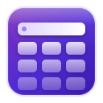
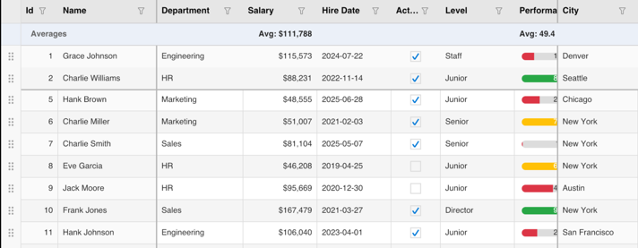

# KumikoUI.Core

[](https://www.nuget.org/packages/KumikoUI.Core)
[](https://www.nuget.org/packages/KumikoUI.Core)
[](https://github.com/TheEightBot/KumikoUI/blob/main/LICENSE)

KumikoUI.Core is the platform-independent engine behind the KumikoUI data grid. It holds the data model, the layout and rendering pipeline, selection, editing and input handling. It has no UI framework or rendering dependency and targets `net10.0`, so it runs anywhere .NET does.

Most apps do not install this package directly. It comes in transitively with the host package for your UI framework.



## Which package do I install?

| You are building | Install |
|---|---|
| A .NET MAUI app | [KumikoUI.Maui](https://www.nuget.org/packages/KumikoUI.Maui) |
| An Uno Platform app | [KumikoUI.Uno](https://www.nuget.org/packages/KumikoUI.Uno) |
| Your own host, or rendering to an image | [KumikoUI.SkiaSharp](https://www.nuget.org/packages/KumikoUI.SkiaSharp) |
| Tests, tooling or a custom renderer with no drawing at all | KumikoUI.Core (this package) |

All four packages share one version. Keep them on the same version.

## What is in this package

- `KumikoSource`: items, columns, sorting, filtering, grouping, summaries and the flattened view the grid draws.
- `KumikoColumn`: column definitions (text, numeric, boolean, date, combo box, picker, image, template) with sizing, freezing and editor options.
- `KumikoRenderer` and `IDrawingContext`: the rendering pipeline over an abstract drawing surface.
- Selection, scrolling, an edit session, drawn editor components, and keyboard and pointer input handling.
- Localization (`KumikoStrings`) and culture-aware comparison (`KumikoComparer`).
- A source generator, shipped as an analyzer in this package, that makes item property access reflection-free. Mark your row type with `[KumikoGridItem]` for Native AOT and trimming.

## Quick start

```csharp
using KumikoUI.Core.Data;
using KumikoUI.Core.Models;

var source = new KumikoSource();
source.SetColumns(new[]
{
    new KumikoColumn { Header = "Name", PropertyName = nameof(Person.Name), Width = 160 },
    new KumikoColumn { Header = "Age", PropertyName = nameof(Person.Age), ColumnType = KumikoColumnType.Numeric },
});
source.SetItems(new[] { new Person("Ada", 36), new Person("Grace", 45) });

// Sort by Age, descending.
source.SetSort(source.Columns[1], KumikoSortDirection.Descending);

for (int row = 0; row < source.RowCount; row++)
{
    Console.WriteLine(
        $"{source.GetCellDisplayText(row, source.Columns[0])}: {source.GetCellDisplayText(row, source.Columns[1])}");
}

[KumikoGridItem]
public record Person(string Name, int Age);
```

This prints `Grace: 45` then `Ada: 36`.

To draw the grid, pair `KumikoRenderer` with an `IDrawingContext`. KumikoUI.SkiaSharp provides one for SkiaSharp.

## Documentation

- [Project README](https://github.com/TheEightBot/KumikoUI#readme): features, column types, editing, theming and more.
- [Architecture](https://github.com/TheEightBot/KumikoUI/blob/main/docs/ARCHITECTURE.md) and [rendering](https://github.com/TheEightBot/KumikoUI/blob/main/docs/RENDERING.md).
- [Text input contract](https://github.com/TheEightBot/KumikoUI/blob/main/docs/TEXT-INPUT.md) for host authors.
- [Changelog](https://github.com/TheEightBot/KumikoUI/blob/main/CHANGELOG.md) and [versioning policy](https://github.com/TheEightBot/KumikoUI/blob/main/docs/VERSIONING.md).
- [Report an issue](https://github.com/TheEightBot/KumikoUI/issues).

## License

MIT. See [LICENSE](https://github.com/TheEightBot/KumikoUI/blob/main/LICENSE).
