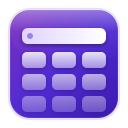
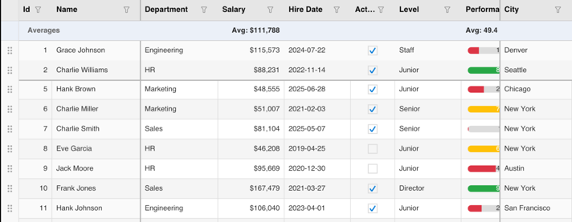
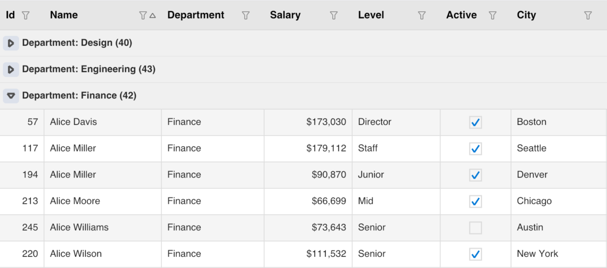

# KumikoUI.Maui

[](https://www.nuget.org/packages/KumikoUI.Maui)
[](https://www.nuget.org/packages/KumikoUI.Maui)
[](https://github.com/TheEightBot/KumikoUI/blob/main/LICENSE)

KumikoUI.Maui is a high-performance data grid control for .NET MAUI. The whole grid is drawn with SkiaSharp on one canvas, with no native cell controls, so it looks and behaves the same on every platform. It includes virtual scrolling, sorting, filtering, grouping, summaries, cell editing, frozen columns and rows, row drag and drop, theming and localization.

It targets .NET 10 on Android, iOS, Mac Catalyst and Windows.





## Which package do I install?

| You are building | Install |
|---|---|
| A .NET MAUI app | KumikoUI.Maui (this package) |
| An Uno Platform app | [KumikoUI.Uno](https://www.nuget.org/packages/KumikoUI.Uno) |
| Your own host, or rendering to an image | [KumikoUI.SkiaSharp](https://www.nuget.org/packages/KumikoUI.SkiaSharp) |
| Only the data model, with your own renderer | [KumikoUI.Core](https://www.nuget.org/packages/KumikoUI.Core) |

Installing KumikoUI.Maui brings in KumikoUI.Core and KumikoUI.SkiaSharp. All four packages share one version.

## Quick start

Install the package in your MAUI app project:

```
dotnet add package KumikoUI.Maui
```

Register the grid in `MauiProgram.cs`. `UseKumikoUI()` also registers SkiaSharp.

```csharp
using KumikoUI.Maui;

public static MauiApp CreateMauiApp()
{
    var builder = MauiApp.CreateBuilder();
    builder
        .UseMauiApp<App>()
        .UseKumikoUI();

    return builder.Build();
}
```

Declare the grid and its columns in XAML:

```xml
<ContentPage xmlns="http://schemas.microsoft.com/dotnet/2021/maui"
             xmlns:x="http://schemas.microsoft.com/winfx/2009/xaml"
             xmlns:dg="clr-namespace:KumikoUI.Maui;assembly=KumikoUI.Maui"
             xmlns:core="clr-namespace:KumikoUI.Core.Models;assembly=KumikoUI.Core"
             x:Class="MyApp.MainPage">

    <dg:KumikoDataGrid ItemsSource="{Binding People}"
                       RowHeight="36"
                       HeaderHeight="40"
                       AllowSorting="True"
                       AllowFiltering="True">
        <core:KumikoColumn Header="Name" PropertyName="Name" Width="160" />
        <core:KumikoColumn Header="Age" PropertyName="Age" ColumnType="Numeric" Width="80" />
        <core:KumikoColumn Header="Active" PropertyName="IsActive" ColumnType="Boolean" Width="80" />
    </dg:KumikoDataGrid>
</ContentPage>
```

Provide the data. Marking the row type with `[KumikoGridItem]` generates reflection-free property access, which Native AOT and trimmed builds need.

```csharp
using System.Collections.ObjectModel;
using KumikoUI.Core.Data;

public partial class MainPage : ContentPage
{
    public ObservableCollection<Person> People { get; } = new()
    {
        new Person { Name = "Ada", Age = 36, IsActive = true },
        new Person { Name = "Grace", Age = 45, IsActive = false },
    };

    public MainPage()
    {
        InitializeComponent();
        BindingContext = this;
    }
}

[KumikoGridItem]
public class Person
{
    public string Name { get; set; } = "";
    public int Age { get; set; }
    public bool IsActive { get; set; }
}
```

`Columns` is the content property of `KumikoDataGrid`, so columns go directly inside the element. Other column types include `Date`, `ComboBox`, `Picker`, `Image` and `Template`.

On iOS and Mac Catalyst, current OS versions require apps to adopt the UIScene lifecycle. The [project README](https://github.com/TheEightBot/KumikoUI#readme) and `samples/SampleApp.Maui` show the setup.

## Documentation

- [Project README](https://github.com/TheEightBot/KumikoUI#readme): column types, editing, validation, theming, fonts and more.
- [MAUI sample app](https://github.com/TheEightBot/KumikoUI/tree/main/samples/SampleApp.Maui).
- [Architecture](https://github.com/TheEightBot/KumikoUI/blob/main/docs/ARCHITECTURE.md) and [rendering](https://github.com/TheEightBot/KumikoUI/blob/main/docs/RENDERING.md).
- [Changelog](https://github.com/TheEightBot/KumikoUI/blob/main/CHANGELOG.md) and [versioning policy](https://github.com/TheEightBot/KumikoUI/blob/main/docs/VERSIONING.md).
- [Report an issue](https://github.com/TheEightBot/KumikoUI/issues).

## License

MIT. See [LICENSE](https://github.com/TheEightBot/KumikoUI/blob/main/LICENSE).
