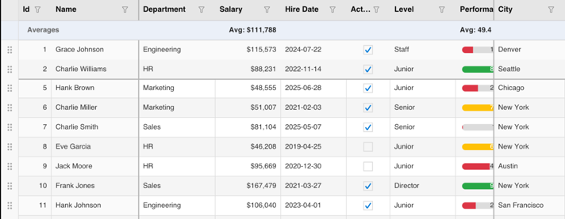

# KumikoUI.SkiaSharp

[](https://www.nuget.org/packages/KumikoUI.SkiaSharp)
[](https://www.nuget.org/packages/KumikoUI.SkiaSharp)
[](https://github.com/TheEightBot/KumikoUI/blob/main/LICENSE)

KumikoUI.SkiaSharp is the SkiaSharp rendering backend for the KumikoUI data grid. It implements the Core drawing abstraction on an `SKCanvas`, with cached typefaces, fonts and paints, so the grid paints the same way on every platform SkiaSharp supports. It targets `net10.0`.

The MAUI and Uno host packages build on it. Install this package directly when you write your own host, or when you want to render a grid to an image, for example a PNG on a server.



## Which package do I install?

| You are building | Install |
|---|---|
| A .NET MAUI app | [KumikoUI.Maui](https://www.nuget.org/packages/KumikoUI.Maui) |
| An Uno Platform app | [KumikoUI.Uno](https://www.nuget.org/packages/KumikoUI.Uno) |
| Your own host, or rendering to an image | KumikoUI.SkiaSharp (this package) |
| Only the data model, with your own renderer | [KumikoUI.Core](https://www.nuget.org/packages/KumikoUI.Core) |

All four packages share one version. Keep them on the same version.

## What is in this package

- `SkiaDrawingContext`: the `IDrawingContext` implementation over an `SKCanvas`.
- `SkiaResourceCache`: a bounded cache of typefaces, fonts and paints, so steady-state frames create no native Skia objects. Keep one per control and dispose it with the control.
- `SkiaFontRegistrar`: registers custom typefaces (CJK, icon fonts) by family name for use in grid styles.

It depends on KumikoUI.Core and SkiaSharp.

## Quick start

This renders a two-row grid to a PNG file.

```csharp
using KumikoUI.Core;
using KumikoUI.Core.Data;
using KumikoUI.Core.Models;
using KumikoUI.SkiaSharp;
using SkiaSharp;

var source = new KumikoSource();
source.SetColumns(new[]
{
    new KumikoColumn { Header = "Name", PropertyName = nameof(Person.Name), Width = 160 },
    new KumikoColumn { Header = "Age", PropertyName = nameof(Person.Age), ColumnType = KumikoColumnType.Numeric },
});
source.SetItems(new[] { new Person("Ada", 36), new Person("Grace", 45) });

var style = new KumikoStyle();
var scroll = new ScrollState { ViewportWidth = 320, ViewportHeight = 160 };
var selection = new KumikoSelectionModel(source);

using var renderer = new KumikoRenderer();
using var bitmap = new SKBitmap(320, 160);
using var canvas = new SKCanvas(bitmap);
canvas.Clear(SKColors.White);

using var ctx = new SkiaDrawingContext(canvas);
renderer.Render(ctx, source, scroll, selection, style);

using var png = SKImage.FromBitmap(bitmap).Encode(SKEncodedImageFormat.Png, 100);
using var file = File.Create("grid.png");
png.SaveTo(file);

[KumikoGridItem]
public record Person(string Name, int Age);
```

In a live control, call `renderer.Render` from the control's paint callback. Create the context with a long-lived cache, `cache.CreateContext(canvas)`, so caching works across frames and a steady-state frame allocates nothing.

Emoji sequences (a skin tone, a family, a flag) are shaped with HarfBuzz so each draws as one glyph. On Linux, add `SkiaSharp.NativeAssets.Linux` and `HarfBuzzSharp.NativeAssets.Linux` next to this package; without HarfBuzz's native library the sequences are drawn glyph by glyph.

## Documentation

- [Project README](https://github.com/TheEightBot/KumikoUI#readme): features, column types, editing, theming and more.
- [Rendering pipeline](https://github.com/TheEightBot/KumikoUI/blob/main/docs/RENDERING.md) and [architecture](https://github.com/TheEightBot/KumikoUI/blob/main/docs/ARCHITECTURE.md).
- [Changelog](https://github.com/TheEightBot/KumikoUI/blob/main/CHANGELOG.md) and [versioning policy](https://github.com/TheEightBot/KumikoUI/blob/main/docs/VERSIONING.md).
- [Report an issue](https://github.com/TheEightBot/KumikoUI/issues).

## License

MIT. See [LICENSE](https://github.com/TheEightBot/KumikoUI/blob/main/LICENSE).
