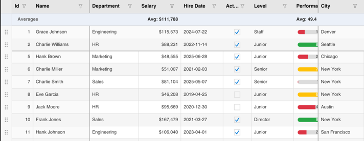
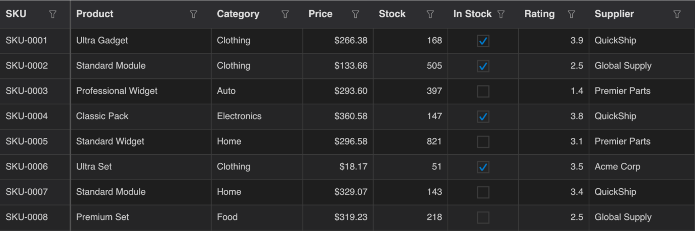

# KumikoUI.Uno

[](https://www.nuget.org/packages/KumikoUI.Uno)
[](https://www.nuget.org/packages/KumikoUI.Uno)
[](https://github.com/TheEightBot/KumikoUI/blob/main/LICENSE)

KumikoUI.Uno is a high-performance data grid control for the Uno Platform. The whole grid is drawn with SkiaSharp on one canvas, with no native cell controls, using the same engine and features as KumikoUI.Maui: virtual scrolling, sorting, filtering, grouping, summaries, cell editing, frozen columns and rows, row drag and drop, theming and localization.

It targets .NET 10 on Windows (WinUI), desktop (Windows, macOS, Linux), WebAssembly, Android and iOS.

> **Preview.** This is `1.0.0-preview.1`, the first 1.0 prerelease of all four KumikoUI packages, and the API may still change before 1.0.0. KumikoUI.Uno is the least verified host. It shares its engine and API with KumikoUI.Maui, and its WebAssembly, iOS and Android heads have been run on the sample app, but not every head has been checked end to end: the desktop head has had no interactive pass, Windows and Linux have not been run, and several input and accessibility problems are open (issues #274 to #280). The per-head results and known issues are in the [Uno verification notes](https://github.com/TheEightBot/KumikoUI/blob/main/docs/uno/verification.md). Install a prerelease with `--prerelease` or an explicit version, and use the same version for every KumikoUI package.





## Which package do I install?

| You are building | Install |
|---|---|
| An Uno Platform app | KumikoUI.Uno (this package) |
| A .NET MAUI app | [KumikoUI.Maui](https://www.nuget.org/packages/KumikoUI.Maui) |
| Your own host, or rendering to an image | [KumikoUI.SkiaSharp](https://www.nuget.org/packages/KumikoUI.SkiaSharp) |
| Only the data model, with your own renderer | [KumikoUI.Core](https://www.nuget.org/packages/KumikoUI.Core) |

Installing KumikoUI.Uno brings in KumikoUI.Core and KumikoUI.SkiaSharp. All four packages share one version.

## Quick start

Install the package in your Uno app project:

```
dotnet add package KumikoUI.Uno --prerelease
```

The app uses the Skia renderer and the SkiaSharp major that KumikoUI is built with (Uno.Sdk defaults to SkiaSharp 3.x, and an app must resolve one SkiaSharp major). In your app's `.csproj`, set `SkiaSharpVersion` and include `SkiaRenderer` in `UnoFeatures`:

```xml
<PropertyGroup>
  <SkiaSharpVersion>4.153.1</SkiaSharpVersion>
  <UnoFeatures>
    SkiaRenderer;
  </UnoFeatures>
</PropertyGroup>
```

On the Windows (WinAppSDK) head, also reference `SkiaSharp.Views.WinUI`, which the `SkiaRenderer` feature does not add there. `samples/SampleApp.Uno` shows the full project setup.

Declare the grid and its columns in XAML:

```xml
<Page x:Class="MyApp.MainPage"
      xmlns="http://schemas.microsoft.com/winfx/2006/xaml/presentation"
      xmlns:x="http://schemas.microsoft.com/winfx/2006/xaml"
      xmlns:kumiko="using:KumikoUI.Uno"
      xmlns:core="using:KumikoUI.Core.Models">

    <kumiko:KumikoDataGrid ItemsSource="{Binding People}"
                           RowHeight="36"
                           HeaderHeight="40"
                           AllowSorting="True"
                           AllowFiltering="True">
        <core:KumikoColumn Header="Name" PropertyName="Name" Width="160" />
        <core:KumikoColumn Header="Age" PropertyName="Age" ColumnType="Numeric" Width="80" />
        <core:KumikoColumn Header="Active" PropertyName="IsActive" ColumnType="Boolean" Width="80" />
    </kumiko:KumikoDataGrid>
</Page>
```

Provide the data. Marking the row type with `[KumikoGridItem]` generates reflection-free property access, which Native AOT, WebAssembly and trimmed builds need.

```csharp
using System.Collections.ObjectModel;
using KumikoUI.Core.Data;
using Microsoft.UI.Xaml.Controls;

public sealed partial class MainPage : Page
{
    public ObservableCollection<Person> People { get; } = new()
    {
        new Person { Name = "Ada", Age = 36, IsActive = true },
        new Person { Name = "Grace", Age = 45, IsActive = false },
    };

    public MainPage()
    {
        InitializeComponent();
        DataContext = this;
    }
}

[KumikoGridItem]
public class Person
{
    public string Name { get; set; } = "";
    public int Age { get; set; }
    public bool IsActive { get; set; }
}
```

`Columns` is the content property of `KumikoDataGrid`, so columns go directly inside the element. To use a custom font, register it before the first grid renders with `KumikoFonts.RegisterFromAppPackageAsync("Family", "ms-appx:///Assets/Fonts/File.ttf")`.

## Documentation

- [Project README](https://github.com/TheEightBot/KumikoUI#readme): column types, editing, validation, theming, fonts and more.
- [Uno sample app](https://github.com/TheEightBot/KumikoUI/tree/main/samples/SampleApp.Uno).
- [Uno user guide](https://github.com/TheEightBot/KumikoUI/blob/main/docs/uno/README.md): setup per head, keyboard and input methods, theming, fonts, images and known limits.
- [Uno verification notes](https://github.com/TheEightBot/KumikoUI/blob/main/docs/uno/verification.md): what was run on each head, and the known issues.
- [Changelog](https://github.com/TheEightBot/KumikoUI/blob/main/CHANGELOG.md) and [versioning policy](https://github.com/TheEightBot/KumikoUI/blob/main/docs/VERSIONING.md).
- [Report an issue](https://github.com/TheEightBot/KumikoUI/issues).

## License

MIT. See [LICENSE](https://github.com/TheEightBot/KumikoUI/blob/main/LICENSE).
