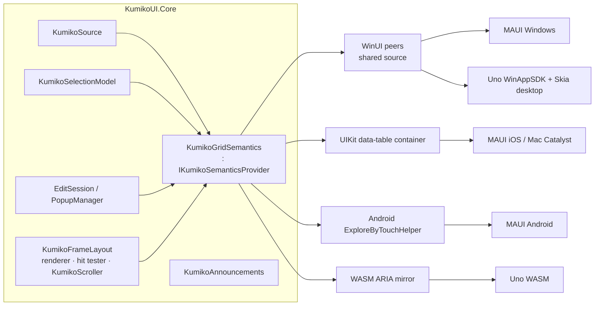

# Spec: virtual accessibility tree with per-cell navigation

| | |
|---|---|
| Issue | [#79](https://github.com/TheEightBot/KumikoUI/issues/79) (plan key L3, Epic L — Accessibility) |
| Milestone | 1.x – Fast follow-ons |
| Status | Draft for review |
| Blocked by | #77 MAUI quick wins (PR #192), #78 Uno quick wins (PR #190) |
| Builds on | #56 programmatic scrolling (PR #198, `KumikoScroller`), #65 Uno render surface (PR #209), #39 text-input contract (shipped), #40–#43 text-input adapters |
| Coordinates with | #108 cell selection unit (spec in progress), #50 column change notification, #80 right-to-left layout, #103 row details, #84 host tests |
| Findings | A11Y-01, MAUI-09, UNO-03, UNO-04, research §4 ([02](../release-readiness/02-core-components-editing-input.md), [03](../release-readiness/03-skiasharp-maui.md), [04](../release-readiness/04-uno.md), [07](../release-readiness/07-external-research.md#4-accessibility-for-a-canvas-drawn-grid)) |

## 1. Summary

KumikoUI draws the whole grid on one SkiaSharp canvas, so every platform sees a single opaque node. #77 and #78 make that node honest: it has a name, a hint with the size and the current cell, the hidden keyboard proxy is hidden from assistive technology, and state changes are announced. They do not let a screen reader user move through headers, rows and cells.

This spec adds that. It has two layers:

1. **Core semantics.** `IKumikoSemanticsProvider` describes the grid as a tree of nodes: grid, group panel, header row, column headers, rows, cells, group header rows, summary rows, in-cell buttons, editors and popups. Each node has a stable id keyed by item and column, a name and value, bounds taken from the same geometry the renderer draws with, states and actions. Only realized nodes exist. A realized node is visible, or holds the current cell. Totals are reported as counts, and any cell can be produced on demand.
2. **Host adapters.** Each platform gets a thin adapter that translates the provider into its native accessibility API:
   - WinUI automation peers implementing `IGridProvider` and `ITableProvider`. One shared source set serves MAUI on Windows, the Uno WinAppSDK head and the Uno Skia heads.
   - On iOS and Mac Catalyst, a `UIAccessibilityContainer` of type data table.
   - On Android, an `ExploreByTouchHelper` with `CollectionInfo`.
   - On WASM, an ARIA grid: either Uno's semantic DOM, or a hidden DOM mirror of our own (decided by a spike).

Delivery is staged: Core first, then Windows, iOS, Android and WASM.

## 2. Current state

| Area | Today (main + #77/#78) | Gap this spec closes |
|---|---|---|
| Core | No semantic surface. `KumikoAnnouncements` (#77/#78) builds the hint text and the announcements from `KumikoStrings` (`AccessibleGridName`, `AccessibleGridHint`, `AnnounceCurrentCell`, …). | No nodes, no bounds, no states, no actions. |
| MAUI | `SemanticProperties.Description/Hint` on the `KumikoDataGrid` ContentView. The proxy `Entry` is excluded with `AutomationProperties.SetIsInAccessibleTree(false)`. Announcements go through `SemanticScreenReader.Announce`, and current-cell announcements are coalesced at 250 ms. | Screen readers see one element. Cell content can only be heard through announcements. |
| Uno | `KumikoDataGridAutomationPeer` (`AutomationControlType.DataGrid`, name, help text). Announcements go through `RaiseNotificationEvent`. The proxy `TextBox` is `AccessibilityView.Raw`. | The peer has no children and no patterns. |
| Uno upstream | Narrator on Win32/Skia, VoiceOver on macOS/Skia and ARIA on WASM/Skia are supported. Android and iOS on Skia are "Work in progress". Linux is planned (research §4). | Uno's Skia mobile heads cannot be fully accessible until Uno finishes that work. |

## 3. Goals and non-goals

### 3.1 Goals

- A screen reader user can do everything below on every supported platform:
  - Find the grid, and hear its name, size, selection mode and sort and filter state.
  - Move cell by cell, and hear the column header, value, position and state of each cell.
  - Read and toggle group headers, and read summary rows.
  - Select rows, sort, filter, edit with validation feedback, and use in-cell buttons, without sighted help.
- Virtualization holds with assistive technology turned on. Cost is proportional to the visible cells, not the row count. A 1,000,000-row grid behaves like a 100-row grid.
- No cost when no assistive technology is running. The steady-state scroll path stays allocation-free in Core when one is running (§12).
- One Core model that four adapters translate. No adapter makes its own layout decisions.
- Keyboard focus and screen reader focus agree with the grid's current cell (§8).

### 3.2 WCAG 2.2 AA criteria addressed

| Criterion | How this spec meets it |
|---|---|
| 1.3.1 Info and Relationships | Grid, row, column header and cell roles. Header association (`ITableItemProvider`, data-table header elements, `CollectionItemInfo` headings, `aria-colindex` plus `columnheader`). Group levels. |
| 1.3.2 Meaningful Sequence | Reading order follows the visual order: left-frozen columns, then scrolling columns, then right-frozen columns, and rows top to bottom (§5.4). |
| 2.1.1 Keyboard | The existing `KumikoInputController.HandleKey` grid keys already match the WAI-ARIA grid pattern. Every action is also reachable through assistive-technology actions (§5.8). |
| 2.1.2 No Keyboard Trap | Owned by #45/#78. Re-verified in the checklists (§14.3). |
| 2.4.3 Focus Order / 2.4.7 Focus Visible | The current cell is the single focus point (§8). Its border (`DrawCurrentCellBorder`) is unchanged. |
| 2.4.11 Focus Not Obscured (Minimum) | Focus and scroll-into-view go through `KumikoScroller` (#56), which accounts for frozen rows, sticky group headers and the pinned footer. Node bounds are clipped to what is visible (§5.6). |
| 2.5.7 Dragging Movements | Column reorder and row reorder get non-drag actions: move left/right and move up/down (§5.8). |
| 3.3.1 Error Identification | The `Invalid` state and the validation message are exposed on the editing cell, besides the #77/#78 announcement. |
| 4.1.2 Name, Role, Value | Every node has a role, a name, a value where it has one, and states. |
| 4.1.3 Status Messages | `KumikoAnnouncements` stays the channel for sort, edit, validation and scroll-range messages (§10). |

### 3.3 Screen readers in scope

| Platform | Host | Screen readers | Notes |
|---|---|---|---|
| Windows 10/11 | MAUI (WinUI), Uno WinAppSDK, Uno Skia Win32 | Narrator, NVDA, JAWS | UIA |
| macOS | MAUI Mac Catalyst, Uno Skia macOS | VoiceOver | UIKit through Catalyst, or Uno's bridge |
| iOS / iPadOS | MAUI | VoiceOver (also Switch Control and Voice Control through the same elements) | |
| Android | MAUI | TalkBack (also Switch Access and Voice Access) | |
| Browser (WASM) | Uno | NVDA and JAWS on Chrome/Edge/Firefox, VoiceOver on Safari, TalkBack on Chrome | ARIA |

### 3.4 Non-goals

- **Uno Skia on iOS and Android, and Uno on Linux.** These depend on upstream work. They are tracked by an issue (§15) and are not blocked on.
- **The UIA Text pattern (`ITextProvider`) and rich text navigation inside editors.**
  - Editors expose Value, and the platform text-input adapters (#40–#43) supply caret and character echo where the platform does it natively.
  - The Text pattern is future work.
- **High-contrast themes, minimum target size (2.5.8) and contrast (1.4.3/1.4.11).** These belong to the theme work and are referenced only.
- **Row details (#103) and right-to-left mirroring (#80).** The model leaves room for them (§5.2, §16) but does not specify them.
- **Accessible charts or custom drawn content beyond cells.** Custom renderers can describe their cells (§5.5) and nothing more.

## 4. Architecture



Principles:

- **Core owns meaning, adapters own vocabulary.** Core decides what exists, what it is called, where it is, what state it is in and what it can do. Adapters only map to platform types and coordinates.
- **Core supplies parts, platforms compose.**
  - Core never concatenates "Name, row 5, column 2" for the tree. Platforms speak positions and headers from structure (`GridItem`, data-table ranges, `CollectionItemInfo`, `aria-*index`).
  - String composition happens only in `KumikoAnnouncements`, and only when an announcement is due.
- **Lazy by construction.**
  - The provider is created when the platform first asks. That is when UIA creates the peer, UIKit calls `accessibilityElementCount`, Android calls `createAccessibilityNodeInfo`, or the WASM mirror is activated (§11.5).
  - `KumikoDataGrid` instances nobody inspects pay nothing.
- **UI thread only.** This follows the threading contract (CORE-05). Every provider call and every adapter callback runs on the UI thread.

## 5. Core semantics model

Namespace: `KumikoUI.Core.Accessibility`. Every public member gets XML docs (#54).

### 5.1 Types

```csharp
public enum KumikoSemanticRole : byte
{
    Grid, GroupPanel, GroupPanelChip, HeaderRow, ColumnHeader,
    Row, Cell, GroupHeaderRow, GroupSummaryRow, TableSummaryRow, SummaryCell,
    CellButton, Editor, Popup, PopupItem
}

[Flags]
public enum KumikoSemanticStates : uint
{
    None = 0,
    Selected = 1 << 0, Current = 1 << 1, Selectable = 1 << 2, MultiSelectable = 1 << 3,
    Expanded = 1 << 4, Collapsed = 1 << 5,
    ReadOnly = 1 << 6, Editable = 1 << 7, Editing = 1 << 8, Invalid = 1 << 9,
    Checked = 1 << 10, Unchecked = 1 << 11, Indeterminate = 1 << 12,
    Sortable = 1 << 13, Filterable = 1 << 14, Filtered = 1 << 15,
    Frozen = 1 << 16, Offscreen = 1 << 17, Disabled = 1 << 18, Busy = 1 << 19
}

[Flags]
public enum KumikoSemanticActions : uint
{
    None = 0,
    Activate = 1 << 0, Focus = 1 << 1,
    Select = 1 << 2, AddToSelection = 1 << 3, RemoveFromSelection = 1 << 4,
    Expand = 1 << 5, Collapse = 1 << 6,
    Sort = 1 << 7, OpenFilter = 1 << 8,
    BeginEdit = 1 << 9, CommitEdit = 1 << 10, CancelEdit = 1 << 11, SetValue = 1 << 12,
    Toggle = 1 << 13, Increment = 1 << 14, Decrement = 1 << 15,
    ScrollIntoView = 1 << 16, ScrollForward = 1 << 17, ScrollBackward = 1 << 18,
    MoveBackward = 1 << 19, MoveForward = 1 << 20,   // column left/right, row up/down (2.5.7)
    Remove = 1 << 21                                  // group panel chip
}

/// Stable identity: role + row key (item, or GroupRowKey) + column + index.
public readonly struct KumikoSemanticId : IEquatable<KumikoSemanticId>
{
    public KumikoSemanticRole Role { get; }
    public object? RowKey { get; }        // compared with RowKeyComparer semantics
    public KumikoColumn? Column { get; }  // compared by reference
    public int Index { get; }             // summary row / chip / popup item / button index
    public bool IsEmpty { get; }
}

public readonly struct KumikoSemanticNode
{
    public KumikoSemanticId Id { get; }
    public KumikoSemanticId Parent { get; }
    public KumikoSemanticRole Role { get; }
    public string? Name { get; }           // header text, cell text, group caption …
    public string? Value { get; }          // editable value, summary value, progress percent …
    public string? Description { get; }    // validation message, filter description …
    public KumikoRect Bounds { get; }      // viewport DIPs, clipped to the visible pane (§5.6)
    public KumikoSemanticStates States { get; }
    public KumikoSemanticActions Actions { get; }
    public int RowIndex { get; }           // absolute semantic row (§5.4), -1 when none
    public int ColumnIndex { get; }        // visual column ordinal (§5.4), -1 when none
    public int RowSpan { get; }
    public int ColumnSpan { get; }
    public int Level { get; }              // group depth, 1-based; 0 when not grouped
    public KumikoSortDirection SortDirection { get; }
    public int SortOrder { get; }          // 1-based multi-sort position, 0 when unsorted
    public int ItemCount { get; }          // group header: items in the group
}

public interface IKumikoSemanticsProvider
{
    KumikoSemanticId Root { get; }
    int Version { get; }                       // bumps on every structural change
    int RowCount { get; }                      // all semantic rows (§5.4)
    int ColumnCount { get; }                   // visible columns
    int HeaderRowCount { get; }                // 1, or 0 when the header is hidden
    int BodyRowStart { get; }                  // absolute index of the first flat-view row
    int BodyRowCount { get; }                  // KumikoSource.RowCount
    KumikoSemanticId Focused { get; }          // the current cell, or the active editor/popup

    bool TryGetNode(in KumikoSemanticId id, out KumikoSemanticNode node);
    void GetChildren(in KumikoSemanticId parent, List<KumikoSemanticId> buffer);  // realized only
    KumikoSemanticId GetRow(int rowIndex);                                         // any row
    KumikoSemanticId GetCell(int rowIndex, int columnIndex);                       // any cell
    KumikoSemanticId GetColumnHeader(int columnIndex);
    KumikoSemanticId HitTest(float x, float y);                                    // viewport DIPs

    bool Perform(in KumikoSemanticId id, KumikoSemanticActions action, string? text = null);
    void Flush();                                                                  // publish pending changes (§7)

    int GetHandle(in KumikoSemanticId id);                                         // §5.3
    bool TryGetId(int handle, out KumikoSemanticId id);

    event KumikoSemanticsChangedHandler? Changed;
}

public delegate void KumikoSemanticsChangedHandler(IKumikoSemanticsProvider sender, in KumikoSemanticsChange change);

[Flags]
public enum KumikoSemanticsChangeKind : byte
{
    None = 0, Structure = 1, Bounds = 2, State = 4, Value = 8, Focus = 16, Selection = 32
}

public readonly struct KumikoSemanticsChange
{
    public KumikoSemanticsChangeKind Kind { get; }
    public KumikoSemanticId Node { get; }      // empty = the whole grid
    public int FirstRow { get; }               // dirty absolute row range, -1 when unknown
    public int LastRow { get; }
    public KumikoChangeOrigin Origin { get; }  // Keyboard, Pointer, AssistiveTechnology, Programmatic, Data
}
```

`KumikoGridSemantics` is the implementation. It is a sealed class in Core and implements `IKumikoSemanticsProvider` and `IDisposable`. Hosts construct it from what they already hold: `KumikoSource`, `KumikoSelectionModel`, `ScrollState`, `KumikoStyle`, `KumikoInputController`, `EditSession`, `PopupManager` and `KumikoRenderer`.

The provider is public, so custom hosts and tests can use it. Its implementation details stay internal. Hosts reach Core only through public API, because `InternalsVisibleTo` names only `KumikoUI.Core.Tests`.

Design notes:

- **Struct ids and nodes.** `KumikoSemanticNode` holds only references to strings that already exist (§5.5), so queries do not allocate.
- **Caller-owned children buffer.** `GetChildren` fills a buffer the caller owns. This is the same pattern as `KumikoLayoutEngine.PopulateVisibleFrozenColumns`.
- **Zero-allocation change events.** `Changed` uses an `in` struct delegate instead of `EventHandler<T>`.

### 5.2 Tree shape

```
Grid                                  (Grid; MultiSelectable when Mode is Multiple/Extended)
├── GroupPanel                        (only while grouping is active)
│   └── GroupPanelChip × n            (Activate = flip GroupSortDirection, Remove; SortDirection)
├── HeaderRow                         (absolute row 0)
│   └── ColumnHeader × visible cols   (Sort, OpenFilter, MoveBackward/Forward; SortDirection, Filtered)
├── TableSummaryRow × top count       (SummaryCell × visible cols)
├── Row | GroupHeaderRow | GroupSummaryRow  × realized body rows (frozen rows first)
│   ├── Cell × visible cols           (Row)
│   │   ├── CellButton × n            (action-button columns)
│   │   └── Editor                    (only on the cell being edited)
│   ├── Cell (ColumnSpan = all)       (GroupHeaderRow: Expand/Collapse, Level, ItemCount)
│   └── SummaryCell × visible cols    (GroupSummaryRow)
├── TableSummaryRow × bottom count
└── Popup                             (filter popup, combo drop-down, date picker; while open)
    └── PopupItem × realized items
```

- **Group header rows** have one cell spanning all columns. Its name comes from `GroupHeaderInfo` (`HeaderText`, `DisplayText`, `ItemCount`) plus `KumikoSource.GetCaptionSummaryText`, formatted by the new `KumikoStrings.AccessibleGroupHeader`. Group header rows can hold the current cell but are never selected. This follows `KumikoSelectionModel`.
- **Sticky group headers** (`KumikoStyle.StickyGroupHeaders`, `PinnedGroupHeaders`) are the same node as the real group header row. While pinned, their bounds are the pinned band. There are never two nodes for one group.
- **The row drag handle** is not a column. Its function is exposed as the `MoveBackward`/`MoveForward` actions on rows when row drag-and-drop is enabled.
- **Room for later features:**
  - #103 row details can add a `RowDetails` role under a row.
  - #80 RTL only changes the visual column order (§5.4).

### 5.3 Identity

- **Row keys.** A row is keyed by the same key `KumikoSource.GetRowKey` produces: the item for data rows, and a `GroupRowKey(GroupPath, SummaryIndex)` for group header and group summary rows. Equality uses `RowKeyComparer`: items by reference, group keys by value.
  - A data row's id survives sort, filter, regroup, insert and remove. `KumikoViewChangedEventArgs.MapRow` already relies on the same keys.
  - Platform focus stays on the same item across a rebuild, which is what users expect when they sort.
- **Columns** are keyed by `KumikoColumn` reference. `KumikoColumn.Id` is the automation id for headers (UIA `AutomationId`, Android `viewIdResourceName`, DOM `data-column-id`).
- **Bands.** Header row, summary rows, group panel and popups are keyed by role plus `Index`.
- **Integer handles.** Android virtual view ids, DOM ids and peer caches need integers. `KumikoSemanticHandleMap` (internal, owned by the provider, exposed through `IKumikoSemanticsProvider.GetHandle(in id)` and `TryGetId(int handle, out id)`) assigns one `int` per id when it is first realized:
  - Handles are never reused while the provider lives.
  - Handles for ids that left realization are released. Their entries go to a free list of dictionary slots, not of handle values.
  - On `int` overflow, which is theoretical, the map resets and raises a whole-tree `Structure` change.
  - The map is a `Dictionary<KumikoSemanticId, int>` with a custom comparer, plus an array from handle to id. Both grow only when the realized set grows.

### 5.4 Indexing

Rows use one absolute index space across bands:

| Absolute rows | Band |
|---|---|
| `0` | Header row (`HeaderRowCount` = 1) |
| `1 … T` | Top table summaries (`KumikoSource.TopSummaryCount` = T) |
| `T+1 … T+N` | Body: flat view row `i` is `BodyRowStart + i` (`N` = `KumikoSource.RowCount`, group rows included) |
| `T+N+1 … T+N+B` | Bottom table summaries (`BottomSummaryCount` = B) |

The group panel, its chips and open popups are outside the row and column coordinates. They are siblings of the header row in the tree.

Each platform uses the part it needs:

- **UIA** `IGridProvider` covers only the body rows (`RowCount = N`), because the header is exposed through `ITableProvider.GetColumnHeaders`. This matches the WinUI Toolkit DataGrid.
- **ARIA, the iOS data table and Android `CollectionInfo`** use the full count, with the header as row 0.

Columns use the **visual ordinal** of visible columns: left-frozen first, then scrolling, then right-frozen, in the same order as `KumikoLayoutEngine.PopulateVisibleFrozenColumns`, `PopulateVisibleScrollableColumns` and `PopulateVisibleRightFrozenColumns`. This can differ from `KumikoSource.Columns` order when a frozen column is not first, and hidden columns are skipped.

The provider keeps a `visualOrdinal ↔ Columns index` map and refreshes it when columns change (§7). Actions translate back, because `KumikoSelectionModel.SetCurrentCell` takes the `Columns` index.

> `KumikoAnnouncements.CurrentCell` and `GridHint` (#77/#78) currently pass the `Columns` index, which counts hidden columns, as the spoken column number. The first Core issue switches them to the visual ordinal so the announcements and the tree agree.

### 5.5 Names, values and descriptions

| Node | Name | Value | Description |
|---|---|---|---|
| Grid | host `GridDescription` ?? `KumikoStrings.AccessibleGridName` | — | host `GridHint` ?? `KumikoAnnouncements.GridHint` |
| ColumnHeader | `KumikoColumn.AccessibleName` (new) ?? `Header` ?? `AnnounceUnnamedColumn` | — | `ActiveFilter` text when filtered |
| Cell (data) | — (platforms read the header) | display text from `KumikoSource.GetCachedCellText` | validation message when `Invalid` |
| Cell (custom renderer) | — | `ICellRenderer.GetAccessibleText(value, column)` (new default interface method, `null` = display text) | — |
| Cell (Boolean) | — | — (state `Checked`/`Unchecked`/`Indeterminate`) | — |
| Cell (ProgressBar) | — | percent text via `KumikoStrings.AccessibleProgress` | — |
| Row | first visible column's text, or a host-supplied `RowAccessibleNameSelector` (open question 1) | — | — |
| GroupHeaderRow cell | `AccessibleGroupHeader` ("{0}: {1}, {2} items") plus caption summary | — | — |
| SummaryCell | `ComputedSummaryValue.Label` | `ComputedSummaryValue.Text` | — |
| CellButton | `IActionButtonDefinition.Label` | — | — |
| GroupPanelChip | group header text | — | — |
| Editor / Popup | §9 | §9 | §9 |

Strings come from places that already exist:

- the display-text cache, `GetCachedCellText`, which is sized at least twice the visible scrolling rows, so visible rows hit it;
- column headers;
- computed summaries;
- per-group strings cached on rebuild.

A query for an unrealized cell (UIA `GetItem` on an off-screen row) uses `GetCellDisplayText` and may allocate. That is acceptable, because it happens only on demand.

New `KumikoStrings` members, all localizable:

- **Group and value text:** `AccessibleGroupHeader`, `AccessibleProgress`.
- **State text:** `AccessibleExpanded`, `AccessibleCollapsed`, `AccessibleSortedAscending`, `AccessibleSortedDescending`, `AccessibleFiltered`, `AccessibleInvalid`.
- **Action labels:** `AccessibleActionSort`, `AccessibleActionFilter`, `AccessibleActionEdit`, `AccessibleActionExpand`, `AccessibleActionCollapse`, `AccessibleActionMoveLeft`, `AccessibleActionMoveRight`, `AccessibleActionMoveUp`, `AccessibleActionMoveDown`, `AccessibleActionRemoveGroup`.
- **Announcements and hints:** `AccessibleScrollStatus` ("Rows {0} to {1} of {2}"), `AccessibleEditHint`.
- **Role name:** `AccessibleCellRoleName` (UIA `LocalizedControlType`).

### 5.6 Bounds and clipping

Bounds are in viewport DIPs relative to the grid surface's top-left. This is the coordinate space of `KumikoPointerEventArgs` and of `KumikoInputController.GetCellScreenBounds`.

The geometry must match the pixels exactly. Today it is computed in four places:

- `KumikoRenderer.Render`, from locals;
- `KumikoHitTester.HitTestCore`;
- `KumikoInputController.GetCellScreenBounds`;
- `KumikoScroller.GetRowY` and `GetColumnX` (#56).

The first Core issue extracts **`KumikoFrameLayout`** (internal sealed), filled once per frame by `Render`. It holds:

- the three column lists with X (the existing `_frozenCols`, `_scrollableCols` and `_rightFrozenCols`);
- `firstRow`/`lastRow` from `GetVisibleRowRangeWithOffset`;
- the frozen row count and height, `groupPanelOffset` and `topSummaryHeight`;
- the drag-handle offsets;
- the data clip, the pinned-footer height and the pinned group headers.

Its `Compute` method can also run without painting, so semantics works before the first frame and in tests. The provider reads the last layout and recomputes only when its inputs changed. Those inputs are the scroll offsets, viewport, style version, column layout version and view version.

Clipping rules:

- A scrolling cell is intersected with the scrolling pane, between the frozen panes.
- A body row is intersected with the data clip: below the header, top summaries, frozen rows and pinned sticky band, and above the pinned footer.
- A node whose clipped bounds are empty is `Offscreen` and is not realized (§6). The exception is the current cell (§8).

The realized set and the platform hit testing therefore never report a cell hidden under a frozen column or a sticky header. This matches the hit tester, which resolves a point to the topmost pane.

`HitTest(x, y)` maps `KumikoHitTester.HitTestCore`, the allocation-free value variant, to a node id:

| `HitRegion` | Node |
|---|---|
| `Cell`, `FrozenColumn` | Cell |
| `HeaderCell`, `HeaderFilterIcon`, `HeaderResizeGrip` | Header |
| `GroupHeaderRow`, `GroupChevron` | Group header cell |
| `GroupSummaryRow`, `TableSummaryRow` | Summary cell |
| `GroupPanelChip`, `GroupPanelChipRemove` | Chip |
| Popup hit | `PopupManager.HitTest` takes priority |

### 5.7 States

| State | Source |
|---|---|
| Selected | `KumikoSelectionModel.IsRowSelected(row)`. With #108's cell unit, a per-cell query (see below). |
| Current | `KumikoSelectionModel.CurrentCell` mapped through the visual ordinal |
| Selectable / MultiSelectable | `KumikoSelectionMode` (`None`, `Single`, `Multiple`, `Extended`) |
| Expanded / Collapsed | `GroupHeaderInfo.IsExpanded` |
| ReadOnly / Editable | `KumikoColumn.IsReadOnly`, grid-level `IsReadOnly` (#53), `EditTriggers`, and `IInteractiveCellRenderer` columns, which never edit |
| Editing / Invalid | `EditSession.IsEditing`, `EditCell`/`EditItem`, `CurrentValidation` |
| Checked / Unchecked / Indeterminate | Boolean column values, `bool?` |
| Sortable / SortDirection / SortOrder | `KumikoColumn.AllowSorting`, `SortDirection`, `SortOrder`, `KumikoSource.IsMultiSortActive` |
| Filterable / Filtered | `KumikoColumn.AllowFiltering`, `ActiveFilter` |
| Frozen | `KumikoColumn.IsFrozen`/`IsFrozenRight`, rows below `EffectiveFrozenRowCount` |
| Offscreen | §5.6 |
| Disabled | action button `CanExecute` false (COMP-04), editor `IsEnabled` false |

**Selection, and #108.** The provider reads selection through one internal seam, `IsSelected(rowIndex, columnIndex)`.

- Today it returns the row's selection for every cell, and only `Row` nodes carry `Selectable`.
- When #108 adds `SelectionUnit.Cell`, the seam answers per cell and `Cell` nodes carry `Selectable`. Adapters then move `SelectionItem`, `aria-selected` and `CollectionItemInfo.selected` from rows to cells without structural change.
- #108's range selection maps to UIA `ISelectionProvider.GetSelection` returning cells, and to `aria-multiselectable` with `aria-selected` on cells.
- The #108 spec should keep this seam.

### 5.8 Actions

Actions run the same Core paths as pointer and keyboard input, so gating, edit commit rules (EDIT-01) and events stay identical. Several of those paths exist today only behind pointer coordinates. The first Core issue adds internal entry points on `KumikoInputController` that the pointer path then calls too: `ActivateCell`, `ActivateColumnHeader`, `OpenColumnFilter`, `BeginEditAt` and `MoveColumn`/`MoveRow`.

| Action | Node(s) | Core call |
|---|---|---|
| Focus | Cell, group header | `KumikoSelectionModel.SetCurrentCell(row, columnsIndex)` + `KumikoScroller.ScrollToRow`/`ScrollToColumn` (`Nearest`) |
| Activate | Cell | `ActivateCell`: the tap path (selection per mode, `IInteractiveCellRenderer.OnCellActivate`, `EditSession.ToggleBooleanCell`, `RowTapped`) |
| Activate | ColumnHeader | `ActivateColumnHeader`: commit or cancel an open edit, then `KumikoSource.ToggleSort` (or `ToggleMultiSort` with the multi-sort modifier semantics) |
| Activate | CellButton | the action button's `Command` (guarded by `CanExecute`) or `Action` |
| Select / AddToSelection / RemoveFromSelection | Row (Cell after #108) | `HandleRowSelection(row, shift: false, ctrl)`, `Select(item)`, `Deselect(item)`; unavailable when `Mode` is `None` |
| Expand / Collapse | GroupHeaderRow | `KumikoSource.ToggleGroupExpansion(row)` when the state differs |
| Sort | ColumnHeader | as Activate |
| OpenFilter | ColumnHeader | `OpenColumnFilter`, the same path as `HitRegion.HeaderFilterIcon` |
| BeginEdit / CommitEdit / CancelEdit | Cell / Editor | `BeginEditAt` (honors `EditTriggers`, read-only), `EditSession.CommitEdit(source)`, `EditSession.CancelEdit()` |
| SetValue(text) | Editable cell, Editor | begin the edit if needed. Then either select all and call `InsertText(text)` on `EditSession.ActiveTextInput`, or set `IValueEditor` from the parsed value. Then `CommitEdit`. A validation failure leaves the edit open with `Invalid` and raises the #77/#78 announcement. |
| Toggle | Boolean cell | `EditSession.ToggleBooleanCell` |
| Increment / Decrement | NumericUpDown editor | the editor's step |
| ScrollIntoView | any body node | `KumikoScroller.ScrollToRow` + `ScrollToColumn` (`Nearest`) |
| ScrollForward / ScrollBackward | Grid | one page: viewport rows minus one, same as `NavigatePageDown`'s page size |
| MoveBackward / MoveForward | ColumnHeader (`AllowReorder`), Row (row drag enabled) | `KumikoSource.ReorderColumn`, `KumikoSource.ReorderRow`, raising `ColumnReordered`/`RowReordered` as the drag does |
| Activate | GroupPanelChip | flips `GroupDescription.GroupSortDirection` and refreshes, the same as a chip tap |
| Remove | GroupPanelChip | `KumikoSource.RemoveGroupDescription(propertyName)` |

Every action that changes the view commits or cancels an open edit first through `CommitEditBeforeViewChange`, which the pointer paths already use.

`Perform` returns false when the action is not in the node's `Actions`, or when Core refused it, for example a canceled `SortColumnsChanging`. Afterwards the provider:

- requests a redraw through `KumikoRenderer.RedrawRequested`, so hosts need no new plumbing;
- queues the matching change with `Origin = AssistiveTechnology` (§7, §8).

## 6. Virtualization

**Core rule.** The realized set is the visible rows times the visible columns, plus the header row, summary rows, group panel and open popup, plus the current cell's row and cell even when scrolled away. Everything else is answered on demand: `GetRow`, `GetCell` and `TryGetNode` work for any index. Counts are always the totals.

Platforms expect virtualized grids to behave differently:

| Platform | Children / elements | Totals | Off-screen access | Scrolling by assistive technology |
|---|---|---|---|---|
| WinUI UIA | `GetChildrenCore` returns the realized rows only | `IGridProvider.RowCount` = body rows, `ColumnCount` = visible columns | `IGridProvider.GetItem(row, col)` returns a cell peer for any coordinate ("a UIA element must still be returned"); `IsOffscreen` true. On WinAppSDK also `IItemContainerProvider.FindItemByProperty` on the grid and `IVirtualizedItemProvider.Realize` on rows. | `IScrollItemProvider.ScrollIntoView`, `IScrollProvider` on the grid |
| iOS / Catalyst | `accessibilityElementCount`/`accessibilityElementAtIndex:` over the realized elements | `UIAccessibilityContainerDataTable.accessibilityRowCount`/`accessibilityColumnCount` = full counts | `accessibilityDataTableCellElementForRow:column:` returns an element for any cell; VoiceOver's table navigation then scrolls it in through `accessibilityElementDidBecomeFocused` | `accessibilityScroll:` on the container + `UIAccessibilityPageScrolledNotification` with `AccessibleScrollStatus` |
| Android | `getVisibleVirtualViews` = realized handles | `CollectionInfo(rowCount, columnCount, hierarchical, selectionMode)` on the host node | TalkBack does not ask for unrealized nodes. It scrolls the collection. | `ACTION_SCROLL_FORWARD/BACKWARD`, `ACTION_SCROLL_TO_POSITION` (row, column), `ACTION_SHOW_ON_SCREEN`; `TYPE_VIEW_SCROLLED` with from/to/item count |
| WASM ARIA | realized rows in the DOM only | `aria-rowcount`/`aria-colcount` on the grid; `aria-rowindex`/`aria-colindex` on rows and cells | none. Screen readers read the DOM. | arrow keys in focus mode move the current cell (Core scrolls); browse mode reads realized rows only (documented limitation) |

Bounded caches outside Core:

- **UIA peers** are cached per id, with capacity = realized nodes + 256 most recently returned. UIA clients may hold a peer after its row scrolls away. A dropped peer answers through the provider, or reports `ElementNotAvailable` when its row no longer exists.
- **iOS elements** are pooled. An element keeps its object identity for as long as its id is realized, because VoiceOver tracks focus by object.

## 7. Change notifications and re-publishing

The provider never pushes from inside the data, selection or render events. It sets dirty flags (no allocation) and publishes one merged `Changed` per **flush**.

**When flushes happen.** The host calls `Flush()`:

- after each frame it renders;
- from its dispatcher for changes that do not redraw.

`Flush()` is a no-op when nothing is dirty or nothing listens.

**Scroll is polled, not subscribed.** `ScrollState.ScrollChanged` allocates its `EventArgs` only when it has a listener. The provider therefore compares `OffsetX`/`OffsetY` at flush time.

| Trigger | Kind | Scope |
|---|---|---|
| Scroll offset or viewport changed (polled) | `Bounds`, plus `Structure` when the realized row or column range changed | grid |
| `KumikoSource.ViewChanged` `Redraw` | `Value` | realized rows |
| `ViewChanged` `Rebuild` / `Insert` / `Remove` | `Structure`; ids survive through row keys, handles of vanished rows are released | grid, row range when `Insert`/`Remove` |
| `SortColumnsChanged` | `State` on headers + `Structure` | headers, grid |
| `FilterChanged` | `State` (`Filtered`) + `Structure` | header, grid |
| `GroupExpandedChanged` | `State` on the row + `Structure` | row, grid |
| `KumikoSelectionModel.SelectionChanged` | `Selection` | changed rows (from the event args) |
| `KumikoSelectionModel.CurrentCellChanged` | `Focus` (origin from the input path) | old and new cell |
| `EditSession.CellBeginEdit` / `CellEndEdit` | `State` (`Editing`) + `Structure` (editor child) + `Focus` | cell |
| `EditSession.ValidationFailed` | `State` (`Invalid`, description) | cell |
| Popup shown or closed (`PopupManager`; a `PopupOpened` event is added beside `PopupClosed`) | `Structure` + `Focus` | grid |
| `ColumnResized`, `ColumnReordered`, column visibility or freeze changes (#50 adds the change notification) | `Bounds` + `Structure`; visual ordinal map refreshed | grid |
| `KumikoStyle.Version` (row height, header height) | `Bounds` | grid |

Adapter throttling:

- **`Focus`, `Selection`, `State` and `Value`** go out on the next flush and are never delayed. They are what the user is waiting to hear.
- **`Structure` and `Bounds` while scrolling continuously** (inertial fling, `KumikoInputController.IsInertialScrolling`) go out at most once per 100 ms, with a trailing publish when scrolling stops.
  - Android throttles `TYPE_WINDOW_CONTENT_CHANGED` the same way (`ViewConfiguration.getSendRecurringAccessibilityEventsInterval`).
  - iOS `LayoutChanged` posts are the expensive case.
- **Nothing is sent while no listener exists:**
  - UIA: `AutomationPeer.ListenerExists`;
  - Android: `AccessibilityManager.isEnabled`;
  - iOS: `UIAccessibility.IsVoiceOverRunning`/`IsSwitchControlRunning`, or a container query in the last 10 s;
  - WASM: mirror not active.

## 8. Focus parity

There is one focus point: `KumikoSelectionModel.CurrentCell`, or the active editor or popup while one is open. `IKumikoSemanticsProvider.Focused` returns it.

**From the grid to the platform.** On a `Focus` change:

| Platform | What the adapter does |
|---|---|
| UIA | Raises `AutomationEvents.AutomationFocusChanged` on the cell peer. The peer of the element holding keyboard focus returns that cell from `GetFocusedElementCore` (see the proxy rule below). |
| iOS | When `Origin` is `Keyboard` or `Programmatic`, posts `LayoutChanged` with the cell element as the argument, so the VoiceOver cursor follows the arrow keys. It does not do this for `AssistiveTechnology`, where VoiceOver already moved. |
| Android | `ExploreByTouchHelper.requestKeyboardFocusForVirtualView(handle)`. Accessibility focus is moved only for `Keyboard` origin (`TYPE_VIEW_ACCESSIBILITY_FOCUSED` via `sendEventForVirtualView`), following Android's "don't steal focus" guidance. |
| WASM | Updates `aria-activedescendant` on the focused grid element (§11.5). |

**From the platform to the grid.**

- These **move the current cell**:
  - UIA `SetFocus`;
  - Android `ACTION_FOCUS`, `ACTION_CLICK` and `ACTION_SELECT`;
  - iOS `accessibilityActivate`;
  - WASM keyboard input.
- **The reading cursor does not move the current cell.** This covers VoiceOver swipes, TalkBack swipes, Narrator scan mode and NVDA browse mode. Reading a table must not change selection or scroll position unexpectedly.
- **A partly obscured target is scrolled clear** (`ScrollIntoView`, `Nearest`, which satisfies 2.4.11):
  - iOS: when an element becomes focused, in `accessibilityElementDidBecomeFocused`;
  - Android: on `ACTION_ACCESSIBILITY_FOCUS`.

**The hidden keyboard proxy.** Keyboard focus sits on a hidden native text field: the MAUI `Entry` on Windows and Android, the `TextBox` on every Uno head, or `KeyInputResponder` on Apple. It is excluded from the tree (#77/#78). Two rules follow:

1. The proxy is never an accessibility node. Its peer or element reports the grid's focused node instead:
   - UIA: a `KumikoInputProxy : TextBox` subclass whose peer returns the current cell peer from `GetFocusedElementCore`.
   - Apple: `KeyInputResponder.isAccessibilityElement = false`. Focus parity comes from the posts above.
2. **Preferred end state, decided by the Windows spike (W0 in §15):** the proxy takes keyboard focus **only while a text editor is open**. Otherwise the grid element itself is the focused element:
   - the `KumikoDataGrid` control on Uno, `IsTabStop`;
   - the canvas on MAUI Windows.
   
   This makes focus parity a property of one peer, matching how UIA and ARIA expect a grid to own its focus. It also aligns with #42 (`CoreTextEditContext` needs no focused `TextBox`) and #43 (Uno composition input). If the spike shows `GetFocusedElementCore` on the proxy is honored by Narrator, NVDA and JAWS, rule 1 alone is enough, and the focus model does not change.

Tab and Shift+Tab exit, `KumikoInputController.WouldHandleTab` and Escape behavior are unchanged.

## 9. Editors, popups and in-cell controls

Editors and popups are `DrawnComponent`s. A new public interface lets them, and custom editors from `KumikoColumn.EditorFactory`/`CustomEditorFactory`, describe themselves:

```csharp
public interface IKumikoSemanticElement
{
    KumikoSemanticRole Role { get; }                 // Editor, Popup, PopupItem
    KumikoEditorKind EditorKind { get; }             // Text, CheckBox, ComboBox, Date, Numeric, Picker, Custom
    string? AccessibleName { get; }
    string? AccessibleValue { get; }
    KumikoSemanticStates States { get; }
    KumikoSemanticActions Actions { get; }
    int ChildCount { get; }                          // popup items, virtualized like rows
    void GetRealizedChildren(List<int> buffer);
    bool TryGetChild(int index, out KumikoSemanticNode node);
    bool Perform(int childIndex, KumikoSemanticActions action, string? text);
}
```

| Component | Role / platform type | Value and actions |
|---|---|---|
| `DrawnTextBox` | Editor, Text (UIA `Edit` + Value, iOS `UIAccessibilityTraitNone` with the value, Android `EditText` class + `isEditable`, ARIA `textbox`) | value = `ITextInputSession.Text`; `SetValue`; selection exposed on Android (`setTextSelection`) |
| `DrawnComboBox` | Editor, ComboBox (UIA `ComboBox` + ExpandCollapse + Selection; ARIA `combobox` + `listbox`) | items as `PopupItem`, virtualized |
| `DrawnDatePicker` | Editor, Date (button + popup grid of days as `PopupItem`) | value = formatted date |
| `DrawnNumericUpDown` | Editor, Numeric (UIA `Spinner` + RangeValue; iOS `Adjustable`; ARIA `spinbutton`) | `Increment`/`Decrement`/`SetValue` |
| `DrawnScrollPicker` | Editor, Picker (iOS `Adjustable`) | `Increment`/`Decrement` |
| `DrawnCheckBox` (Boolean cells) | no editor node: the cell carries the checked state and `Toggle` | |
| `DrawnFilterPopup` | Popup (dialog). Children: search box, sort buttons, value list (virtualized `PopupItem`s, checkable), OK/Cancel | `Focused` moves into the popup when it opens and back to the header when it closes |
| `ActionButtonsCellRenderer` | `CellButton` per definition | `Activate`, `Disabled` from `CanExecute` |

**Text editing with a screen reader.** When the native text-input adapter for a platform has shipped (#40 iOS/Catalyst, #41 Android, #42 MAUI Windows, #43 Uno), caret movement, character echo and IME announcements come from the platform. They come from the adapter's text-input object positioned over `EditSession.ActiveEditor.Bounds`. The editor node then:

- points at that object (iOS: the responder's `accessibilityFrame` and label; Android: the virtual node is `isEditable` with `ACTION_SET_TEXT`/`ACTION_SET_SELECTION`);
- does not duplicate it.

Until those adapters land, editors expose Value and `SetValue` only.

Custom editors that do not implement `IKumikoSemanticElement` become a generic `Editor` node:

- name = column header;
- value from `IValueEditor` when implemented, otherwise none;
- actions `CommitEdit`/`CancelEdit`.

## 10. Announcements

`KumikoAnnouncements` (#77/#78) remains the channel for status messages (4.1.3).

- **Current-cell announcement.** While the tree is active, the host stops the coalesced current-cell announcement (`OnAnnounceTimerTick`). The screen reader already speaks the focused cell, and keeping both would double-speak. While the tree is not active, for example with `AccessibilityTreeMode.Off` or on Uno mobile Skia heads, the announcement stays.
- **Kept:** sort changed, edit started, ended or committed, validation failed, and filter applied (new: `AnnounceFiltered`, "{0} rows shown").
- **Added:** scroll range after an assistive-technology page scroll (`AccessibleScrollStatus`).
  - iOS sends it through `UIAccessibilityPageScrolledNotification`.
  - Android sends it through `TYPE_VIEW_SCROLLED` item counts.
  - UIA and ARIA do not need it.
- **Tree state and announcements agree.** When an announcement describes a state the tree also exposes (sort direction, `Invalid`), the tree state is updated before the announcement is raised. A screen reader that re-reads the node gets the same answer.

## 11. Host adapters

### 11.1 Host surface (both hosts)

```csharp
public enum KumikoAccessibilityTreeMode { Auto, Off }   // host property AccessibilityTreeMode, default Auto
```

- `Auto` builds the tree when the platform asks, which is lazy by construction (§4).
- `Off` keeps the 1.0 behavior from #77/#78: one node, name, hint and announcements. It is an escape hatch for apps that hit a platform bug.

The hosts also expose `SemanticsProvider` (read-only, `IKumikoSemanticsProvider?`, null until created) for tests and custom automation.

New code goes in `KumikoDataGrid.Accessibility.cs`, the partial introduced by #77/#78, plus an `Accessibility/` folder per host.

### 11.2 WinUI peers: MAUI on Windows, Uno WinAppSDK, Uno Skia desktop

**One source set**, `src/Shared/Accessibility/WinUI/*.cs`, linked with `<Compile Include>` into `KumikoUI.Maui` (`net10.0-windows`) and `KumikoUI.Uno` (all heads). Both hosts compile against the `Microsoft.UI.Xaml.Automation.Peers` API. `#if HAS_UNO` covers the few Uno differences: no `IItemContainerProvider`/`IVirtualizedItemProvider`, and `ITableItemProvider` support must be confirmed.

| Peer | Base | Control type | Patterns |
|---|---|---|---|
| `KumikoDataGridAutomationPeer` (#78, extended) | `FrameworkElementAutomationPeer` | `DataGrid` | Grid, Table (`RowOrColumnMajor.RowMajor`, `GetColumnHeaders`), Selection (`CanSelectMultiple` from mode, `IsSelectionRequired` false), Scroll, ItemContainer (WinAppSDK) |
| `KumikoHeaderRowAutomationPeer` | `AutomationPeer` | `Header` | — |
| `KumikoColumnHeaderAutomationPeer` | `AutomationPeer` | `HeaderItem` | Invoke (sort); `ItemStatus` = sort and filter text; `AutomationId` = `KumikoColumn.Id` |
| `KumikoRowAutomationPeer` | `AutomationPeer` | `DataItem` | SelectionItem, ScrollItem, VirtualizedItem (WinAppSDK); group header rows add ExpandCollapse, `Level`, `SizeOfSet`/`PositionInSet` |
| `KumikoCellAutomationPeer` | `AutomationPeer` | `Custom`, `LocalizedControlType` = `AccessibleCellRoleName` (open question 2) | GridItem, TableItem, Value (`IsReadOnly` from state), Invoke, Toggle (Boolean), ScrollItem; SelectionItem after #108 |
| `KumikoSummaryRowAutomationPeer` / cell | `AutomationPeer` | `DataItem` / `Text` | — |
| `KumikoEditorAutomationPeer`, `KumikoPopupAutomationPeer` | `AutomationPeer` | from `KumikoEditorKind` | Value, ExpandCollapse, Selection, RangeValue as applicable |

**Owner element.**

- **Uno:** the peer belongs to `KumikoDataGrid` (#78).
- **MAUI Windows:** the peer belongs to the canvas, which needs subclassing:
  - `UseKumikoUI` (#51, PR #202) registers `KumikoCanvasView : SKCanvasView` → `KumikoCanvasViewHandler : SKCanvasViewHandler`.
  - The handler's `CreatePlatformView` returns `KumikoAccessibleXamlCanvas : SKXamlCanvas`, whose `OnCreateAutomationPeer` returns the shared grid peer.
  - The MAUI ContentView keeps `SemanticProperties` only when `AccessibilityTreeMode` is `Off`. Otherwise the ContentView is excluded and the canvas peer is the grid.

**Peer mechanics.**

- `GetChildrenCore` lists the realized children (§5.2).
- `NavigateCore(Parent)` is overridden on virtual peers so that a cell returned from `GetItem` before it was ever a child still has a parent.
- `GetElementFromPointCore` uses `provider.HitTest`.
- `GetBoundingRectangleCore` converts viewport DIPs to screen pixels through one helper, `KumikoUiaGeometry`: `TransformToVisual(null)` → window client DIPs → × `XamlRoot.RasterizationScale` → + client origin. Uno Skia heads have their own branch, verified per head.
- `IsOffscreenCore` comes from the node state.
- `GetNameCore`, `GetHelpTextCore` and `GetItemStatusCore` come from §5.5.
- Runtime ids are stable, because the peer instance is stable per id (§6).

**Events.**

| Change | Event raised |
|---|---|
| `Focus` | `AutomationFocusChanged` on the cell peer |
| `Selection` | `SelectionItemPatternOnElementSelected` / `ElementAddedToSelection` / `ElementRemovedFromSelection` |
| `State` | `RaisePropertyChangedEvent` for `ExpandCollapseState`, `ToggleState`, `IsReadOnly`, `ItemStatus` |
| `Value` | `ValuePatternIdentifiers.ValueProperty` |
| `Structure` | `RaiseStructureChangedEvent(ChildrenInvalidated)` on the grid peer, plus `LayoutInvalidated` after scrolls |

`ISelectionProvider.GetSelection` returns peers for the selected rows. For very large selections, see open question 5.

**Uno Skia desktop heads (Win32, macOS).** Uno bridges peers to Narrator and VoiceOver (research §4). Uno's support for virtual peers, meaning `AutomationPeer` subclasses with no `UIElement` (`GetChildrenCore` plus `GridItem`), must be verified on each head in its own issue. A gap found there is filed upstream with a minimal repro, and documented.

### 11.3 iOS and Mac Catalyst (MAUI)

- **Container.** The handler's `CreatePlatformView` returns `KumikoAccessibleCanvasView : SkiaSharp.Views.iOS.SKCanvasView`. It implements `IUIAccessibilityContainerDataTable` and exports `accessibilityElementCount`, `accessibilityElementAtIndex:` and `indexOfAccessibilityElement:`.
  - `IsAccessibilityElement = false`.
  - `AccessibilityContainerType = DataTable`.
  - If the MAUI GPU mode uses `SKGLView`, the same is done for its platform view.
- **Elements.** `KumikoAccessibilityElement : UIAccessibilityElement, IUIAccessibilityContainerDataTableCell` is pooled and kept per id while realized. It provides:
  - `accessibilityRowRange`/`accessibilityColumnRange` (absolute index, span);
  - `AccessibilityFrameInContainerSpace` from the bounds, so moving the window does not require a recompute;
  - `AccessibilityLabel` (name), `AccessibilityValue` (value, plus expanded or sort text from `KumikoStrings`);
  - `AccessibilityTraits`: `Header` for headers, `Selected`, `Button` for activatable cells, chips and headers, `NotEnabled`, `Adjustable` for numeric and picker editors;
  - `AccessibilityHint` (`AccessibleEditHint` for editable cells);
  - `AccessibilityCustomActions` for Sort, Filter, Edit, Expand/Collapse, Move and Remove. Each is created once per element and reused.
- **Container methods.**
  - `accessibilityHeaderElementsForColumn:` returns the column header element.
  - `accessibilityDataTableCellElementForRow:column:` returns an element for any cell (§6).
  - `accessibilityScroll:` runs `ScrollForward`/`ScrollBackward` and posts `PageScrolled`.
- **Element callbacks.** `accessibilityActivate` performs Activate. `accessibilityIncrement`/`Decrement` step the editor. `accessibilityElementDidBecomeFocused` runs `ScrollIntoView` when the element is partly obscured.
- **Notifications.**
  - `LayoutChanged` with the focused element as the argument (§8), throttled for scrolls (§7).
  - `ScreenChanged` is never posted.
  - Opening a popup posts `LayoutChanged` with its first element.
- **Mac Catalyst:** the same code. VoiceOver on macOS reads Catalyst data tables through the UIKit bridge. This is verified in the checklist.

### 11.4 Android (MAUI)

- **Helper.** `KumikoExploreByTouchHelper : ExploreByTouchHelper` is attached to whatever platform view the handler created (`SKCanvasView` or `SKGLTextureView`) with `ViewCompat.SetAccessibilityDelegate`.
  - Hover events are forwarded with a hover listener that calls `helper.DispatchHoverEvent`.
  - Focus changes are forwarded to `helper.OnFocusChanged`.
  - No subclass of the SkiaSharp view is needed.
- **`GetVirtualViewAt(x, y)`:** pixels to DIPs (`DisplayMetrics.Density`), then `provider.HitTest`, then a handle.
- **`GetVisibleVirtualViews`:** realized handles in reading order.
- **`OnPopulateNodeForVirtualView`:**
  - `SetBoundsInParent` (DIPs to pixels);
  - `Text` (value) and `ContentDescription` only where the value is not text (images);
  - class name: `TextView` for cells, `Button` for headers, chips and buttons, `EditText` for text editors, `CheckBox` for Boolean cells;
  - `SetHeading(true)` for headers;
  - `CollectionItemInfo(rowIndex, rowSpan, columnIndex, columnSpan, heading, selected)` with `setRowTitle`/`setColumnTitle` on API 33+;
  - `StateDescription` (API 30+) for sort, expanded and filtered;
  - `Checkable`/`Checked`, `Selected`, `Clickable`, `Editable`;
  - actions: `ACTION_CLICK`, `ACTION_SELECT`, `ACTION_EXPAND`/`COLLAPSE`, `ACTION_SET_TEXT`, `ACTION_SHOW_ON_SCREEN`, plus custom actions with `KumikoStrings` labels.
- **`OnPopulateNodeForHost`:**
  - `CollectionInfo` (absolute row count, column count, hierarchical while grouping is active, selection mode);
  - `Scrollable`;
  - `ACTION_SCROLL_FORWARD`/`BACKWARD`/`SCROLL_TO_POSITION`;
  - name and hint from #77.
- **`OnPerformActionForVirtualView`:** calls `provider.Perform` with `Origin = AssistiveTechnology`.
- **Notifications:**

  | Change | Call |
  |---|---|
  | `Structure` | `InvalidateRoot()` (throttled) |
  | `Value` / `State` | `InvalidateVirtualView(handle, CONTENT_CHANGE_TYPE_TEXT / STATE_DESCRIPTION)` |
  | `Selection` | `TYPE_VIEW_SELECTED` |
  | `Focus` | §8 |
  | Scroll | host `TYPE_VIEW_SCROLLED` with from/to indices and item count |

### 11.5 WASM (Uno)

Uno's WASM Skia head builds a semantic DOM from automation peers, with the ARIA role derived from `AutomationControlType`. It activates on the first Tab (research §4).

**Spike first (issue B0).** Does Uno's semantic DOM render the §11.2 virtual peers with `role=grid`, rows, `gridcell`/`columnheader`, `aria-rowcount`/`aria-rowindex`, `aria-selected` and `aria-sort`? Does it follow focus to a virtual cell peer?

- **Option A, if yes:** no WASM-specific code. The shared WinUI peers serve WASM, and the issue only adds the axe-core test.
- **Option B, otherwise (expected):** an ARIA mirror owned by KumikoUI.

**Option B: `KumikoAriaMirror`.**

- **Structure.**
  - A JS module (`kumiko-aria.js`, embedded in `KumikoUI.Uno`) is called through `[JSImport]`/`[JSExport]` on the browser head only.
  - The mirror is a DOM subtree positioned exactly over the grid's canvas element. It is transparent and `pointer-events: none`, so mobile screen-reader touch exploration still finds cells by position. It is not `display:none`, which would remove it from the accessibility tree.
  - Elements:
    - grid: `div[role=grid]`, or `role=treegrid` while grouping is active, with `aria-rowcount`, `aria-colcount`, `aria-multiselectable`, `aria-label` and `aria-activedescendant`;
    - rows: `div[role=row]` with `aria-rowindex`, `aria-selected`, `aria-level` and `aria-expanded`;
    - cells: `div[role=columnheader|gridcell]` with `aria-colindex`, `aria-colspan`, `aria-sort`, `aria-readonly`, `aria-selected` and `aria-invalid`.
  - Ids are `kumiko-{gridId}-{handle}`.
- **Updates.** One interop call per flush carries a compact payload (an `Int32Array` of handles, roles, indices and state bits, plus a string table for names and values). The JS side diffs by id. Bounds are applied as CSS transforms.
- **Focus.** When the grid has focus and no text edit is open, the mirror's grid element holds DOM focus, which matches rule 2 in §8. Its `keydown` handler forwards keys through `[JSExport]` into the same `KumikoInputController.HandleKey` path the proxy uses. While editing, focus moves to the proxy input, labeled by the cell with `aria-labelledby`. Coordinating with Uno's own focus management is part of B0.
- **Activation.** The mirror is created when the grid first receives keyboard focus, or when `AccessibilityTreeMode` is `Auto` and the page's Uno accessibility layer is active. Pointer-only sessions never build it.
- **Browse mode.** Screen-reader browse mode reads only the realized rows (§6). `aria-rowcount` tells the user the total, and arrow keys in focus mode reach every row. This is documented as a known limitation, the same as other virtualized web grids.

### 11.6 Platform support matrix (target at the end of §15)

| Head | Tree | Mechanism |
|---|---|---|
| MAUI Windows | ✅ | WinUI peers (shared) |
| MAUI iOS / Mac Catalyst | ✅ | UIKit data-table container |
| MAUI Android | ✅ | ExploreByTouchHelper |
| Uno WinAppSDK | ✅ | WinUI peers (shared) |
| Uno Skia Win32 / macOS | ✅ if B-spike passes, else partial | Uno peer bridge |
| Uno WASM | ✅ | Uno semantic DOM or `KumikoAriaMirror` |
| Uno Skia iOS / Android | ❌ (upstream "Work in progress"): name, hint and announcements only | tracked |
| Uno Skia Linux | ❌ (upstream "Planned") | tracked |

## 12. Performance and allocation constraints

- **No assistive technology, no cost.** No provider, no subscriptions and no per-frame work exist until the platform asks (§4). `Flush()` is a branch on a null field.
- **Core steady state.** Scrolling by one row, then `Flush`, `GetChildren` on the grid and every realized row, and `TryGetNode` on every realized node, allocates **0 bytes**. A unit test enforces this with `GC.GetAllocatedBytesForCurrentThread` after warm-up, like the #68 frame-allocation tests. It relies on:
  - pooled buffers;
  - struct ids and nodes;
  - cached strings (§5.5);
  - the dirty-flag change model (§7);
  - polled scroll (§7).
- **Rebuilds may allocate** proportionally to the change: group caption strings, and the handle map growing.
- **Budget.** Realizing a 60-row × 20-column viewport costs at most 0.5 ms on the benchmark desktop. A benchmark is added to the #70 BenchmarkDotNet project as `SemanticsBenchmarks`.
- **Adapters.**
  - Platform objects are pooled or cached (§6).
  - Platform notifications are throttled (§7).
  - WASM makes one interop call per flush.
  - Android `AccessibilityNodeInfo` allocation belongs to the framework and is accepted.
- **Never from `Render`.** Adapters never call platform accessibility APIs inside `Render` or `OnPaintSurface`. Flushes run after the frame, through the host dispatcher.

## 13. Public API additions (summary)

| Area | Type / member |
|---|---|
| Core, new namespace `KumikoUI.Core.Accessibility` | `IKumikoSemanticsProvider`, `KumikoGridSemantics`, `KumikoSemanticId`, `KumikoSemanticNode`, `KumikoSemanticRole`, `KumikoSemanticStates`, `KumikoSemanticActions`, `KumikoSemanticsChange`, `KumikoSemanticsChangeKind`, `KumikoSemanticsChangedHandler`, `KumikoChangeOrigin`, `IKumikoSemanticElement`, `KumikoEditorKind` |
| Core, existing types | `KumikoColumn.AccessibleName`; `ICellRenderer.GetAccessibleText` (default interface method); `KumikoStrings` additions (§5.5, §10); `PopupManager.PopupOpened` |
| Hosts | `KumikoDataGrid.AccessibilityTreeMode` (`KumikoAccessibilityTreeMode`), `KumikoDataGrid.SemanticsProvider` |

Internal additions: `KumikoFrameLayout`, `KumikoSemanticHandleMap`, and the `KumikoInputController` entry points listed in §5.8.

## 14. Testing

### 14.1 Unit tests (Core, per PR)

New `KumikoGridSemanticsTests` in `tests/KumikoUI.Core.Tests`:

- **Tree-shape snapshots** for these configurations:
  - plain;
  - frozen left and right columns, with a frozen column declared mid-list;
  - frozen rows;
  - grouped (multi-level, collapsed, sticky header pinned);
  - top and bottom summaries with a pinned footer;
  - drag handle on the left and on the right;
  - hidden columns;
  - empty source.
  
  Snapshots are produced by an internal `KumikoSemanticsTreeDump` (indented text: role, ids, indices, states, rounded bounds) and compared with checked-in expected files.
- **Geometry agreement.** For every realized cell:
  - bounds equal `KumikoInputController.GetCellScreenBounds`, or `KumikoScroller.GetRowY` and `GetColumnX`, clipped;
  - `HitTest(center) == id`;
  - covered cells are `Offscreen`.
- **Id stability** across sort, filter, regroup, `Insert`, `Remove` and `Refresh`. Handles of surviving items are unchanged, and handles of removed items are released and not reused.
- **Indexing.**
  - Absolute rows across bands.
  - Visual ordinal ↔ `Columns` index with frozen and hidden columns.
  - `KumikoAnnouncements` uses the visual ordinal.
- **States** follow selection (every `KumikoSelectionMode`), the current cell, edit, validation, sort (multi), filter and expansion.
- **Actions.** Each row of the §5.8 table:
  - goes through the same path as the pointer or keyboard equivalent, asserting the same events (`SortColumnsChanged`, `RowTapped`, `CellValueChanged`, `ColumnReordered`, …);
  - refuses when gated (read-only, `AllowSorting` false, `Mode` `None`, `CanExecute` false);
  - for `SetValue`, a validation failure leaves `Invalid` set.
- **Change coalescing.** Many mutations between flushes produce one `Changed` with merged flags. There is no `Changed` without a flush. Origin is propagated.
- **Allocation test (§12)** and the benchmark.

### 14.2 Host tests

- **Uno host tests (#84).** These run on the desktop head:
  - create a grid and get `FrameworkElementAutomationPeer.CreatePeerForElement`;
  - query `GetPattern(PatternInterface.Grid)`: `RowCount`, `GetItem(5, 2)` name and value, `ScrollItem.ScrollIntoView` moves `ScrollState`, `SetFocus` moves `CurrentCell`;
  - check that `GetChildren` contains only realized rows.
- **UIA automation on Windows CI.** A new `tests/KumikoUI.UiaTests` project uses FlaUI (UIA3) to launch the MAUI Windows sample and the Uno WinAppSDK sample, and asserts:
  - the DataGrid element exists;
  - `Grid` pattern counts;
  - `Table` column headers;
  - cell names and values;
  - focus follows arrow keys;
  - `Invoke` on a header sorts.
  
  It also runs Accessibility Insights' `AxeWindowsCLI` scan with zero errors. It runs on the `windows-latest` job.
- **iOS / Catalyst.** XCUITest is Swift-only, so .NET apps use Appium's XCUITest driver (nightly, simulator):
  - count cells by accessibility element;
  - read the header and value;
  - swipe and double-tap.
  
  An Accessibility Inspector audit is part of the manual checklist.
- **Android.** Espresso's `AccessibilityChecks` are Java-only, so .NET apps use Appium UiAutomator2 (nightly, emulator):
  - assert that virtual nodes exist with `CollectionItemInfo`;
  - check the scroll action.
  
  An Accessibility Scanner pass is part of the manual checklist.
- **WASM.** Playwright for .NET with `Deque.AxeCore.Playwright` on the WASM sample, per PR once the sample builds in CI (#184): axe reports zero violations for the grid region. An ARIA snapshot of the grid checks `aria-rowcount`, `aria-rowindex`, `aria-sort`, `aria-selected` and `aria-activedescendant` after arrow keys.

### 14.3 Manual screen-reader checklists

The checklists live in `docs/ACCESSIBILITY.md`, one table per screen reader: Narrator, NVDA + Chrome (WASM), JAWS + Edge (WASM), VoiceOver macOS (Catalyst and Uno Skia), VoiceOver iOS, VoiceOver iOS Safari (WASM) and TalkBack. Each is run before the issue for that platform closes, and again before each 1.x release. Scenarios:

1. **Entering the grid:** the name, row and column counts, and the selection mode are spoken. No phantom text field is heard.
2. **Headers:** sort state and filtered state are spoken. Activating a header sorts and announces the result.
3. **Cell navigation:**
   - by table commands (Narrator Ctrl+Alt+arrows, NVDA/JAWS Ctrl+Alt+arrows, VoiceOver table navigation, TalkBack swipes);
   - each cell speaks the header, value and position, and frozen columns appear in visual order.
4. **Arrow keys with a hardware keyboard:** the screen reader follows the current cell, and Tab and Shift+Tab leave the grid.
5. **Group headers:** level and item count, expanded state, toggling, and a sticky header read once.
6. **Summary rows** are read with their labels.
7. **Editing:**
   - starting an edit, typing, committing and canceling;
   - a validation error is spoken and remains discoverable on the cell;
   - ComboBox and date editors.
8. **Filter popup:** focus moves in, the value list is navigable, and focus returns to the header on close.
9. **Selection:** single, multiple and extended, each reported.
10. **Scrolling by assistive technology:** page scroll speaks the range, and focus is never left on a vanished row after sort, filter or collapse.
11. **Scale:** 100,000 rows stay responsive with the screen reader on, with no lag in navigation.
12. **`AccessibilityTreeMode.Off`** restores the #77/#78 behavior.

## 15. Staged delivery: implementation issues for 1.x

Each issue is one branch and one PR, following the repository workflow. XML docs are required on every public member (#54).

| # | Title | Depends on | Acceptance criteria |
|---|---|---|---|
| C1 | Core: shared frame layout for renderer, hit testing, scrolling and semantics (`KumikoFrameLayout`) | #56 | `Render`, `KumikoHitTester.HitTestCore`, `GetCellScreenBounds` and `KumikoScroller` read one layout; no behavior change (existing render, hit-test and scroller tests pass unchanged); `Compute` works without a paint; frame stays allocation-free (#68 test) |
| C2 | Core: semantic tree provider (`IKumikoSemanticsProvider`, ids, indexing, bounds, states, actions, change flushing) | C1, #77, #78 | §5–§7 implemented; `KumikoInputController` entry points used by both pointer and semantics paths; `KumikoAnnouncements` uses visual ordinals; `KumikoStrings` additions; all §14.1 tests including zero-allocation and benchmark; public API documented |
| C3 | Core: semantics for editors, popups and in-cell controls (`IKumikoSemanticElement`) | C2, #46, #49 | every `Drawn*` editor and `DrawnFilterPopup` implements it; action buttons expose `CellButton`; generic fallback for custom editors; `SetValue` round-trips through validation; popup focus handoff tested |
| W0 | Spike: Windows focus ownership and virtual peers (MAUI Windows + Uno WinAppSDK + Uno Skia Win32/macOS) | C2 | written result in this spec: whether `GetFocusedElementCore` on the proxy is honored by Narrator, NVDA and JAWS, or the grid must own focus outside edits (§8 rule 2); whether Uno Skia bridges virtual peers; the cell control type decided (open question 2) |
| W1 | Windows: WinUI automation peers with Grid, Table, Selection and Scroll patterns (shared by MAUI Windows and Uno) | W0, C3, #42, #43 | §11.2 implemented in `src/Shared/Accessibility/WinUI`; MAUI canvas handler registered by `UseKumikoUI`; Uno peer extended; focus parity per W0; FlaUI tests and AxeWindows scan green in CI; Narrator, NVDA and JAWS checklists signed off |
| W2 | Uno Skia desktop: verify and adapt the shared peers on Win32 and macOS heads | W1 | Narrator (Win32 Skia) and VoiceOver (macOS Skia) checklists signed off, or gaps filed upstream with repros and documented in `docs/ACCESSIBILITY.md` |
| I1 | iOS and Mac Catalyst (MAUI): UIAccessibilityContainer data-table adapter | C3, #40 | §11.3 implemented; element identity stable across scroll; LayoutChanged throttled; VoiceOver iOS and macOS checklists signed off; Appium smoke test nightly |
| A1 | Android (MAUI): ExploreByTouchHelper adapter with CollectionInfo | C3, #41 | §11.4 implemented for `SKCanvasView` and the GPU view; TalkBack checklist (explore by touch, swipe, scroll, actions) signed off; Appium UiAutomator2 smoke test nightly |
| B0 | Spike: Uno WASM semantic DOM vs KumikoUI ARIA mirror | W1 | written decision (Option A or B) with evidence from NVDA + Chrome and VoiceOver + Safari |
| B1 | WASM (Uno): ARIA grid (Uno semantic DOM or `KumikoAriaMirror`) with axe-core CI | B0, #184 | §11.5 implemented per B0; axe zero violations; ARIA snapshot test; NVDA, JAWS and VoiceOver Safari checklists signed off; mirror never built in pointer-only sessions |
| D1 | Docs: `docs/ACCESSIBILITY.md` (support matrix, checklists, known limitations) and README accessibility statement | W1 (updated by I1, A1, B1) | matrix from §11.6 kept current; `AccessibilityTreeMode`, `KumikoColumn.AccessibleName` and `ICellRenderer.GetAccessibleText` documented with compiled snippets (#87) |
| U1 | Tracking: Uno Skia iOS and Android screen-reader support once Uno ships it | upstream | issue links upstream work; when Uno ships, run the VoiceOver and TalkBack checklists against the shared peers and close or file gaps |

Order: C1 → C2 → C3 → W0 → W1 → W2 → I1 → A1 → B0 → B1. D1 runs alongside W1 and onward. U1 stays open as tracking. I1 and A1 can run in parallel once C3 lands, if capacity allows. The issue order still puts Windows first.

## 16. Open questions

1. **Row names.** UIA `DataItem` rows and iOS and Android rows need a name. Should it be the first visible column's text (proposed), a host `RowAccessibleNameSelector` (`Func<object, string?>`), or both?
2. **UIA cell control type.** Should cells be `Custom` with a localized "cell" type, as the WinUI Toolkit DataGrid does, or `DataItem`, as Excel does? This is decided in W0 by testing Narrator, NVDA and JAWS reading.
3. **Reading cursor and the current cell.** Proposed: VoiceOver, TalkBack and browse-mode reading never moves the current cell (§8). Confirm with screen-reader users before W1.
4. **Focus ownership.** Is it acceptable for #42 and #43 that the grid, not the proxy, holds keyboard focus outside text edits (§8 rule 2)? This affects IME readiness and the Uno WASM keyboard path.
5. **`ISelectionProvider.GetSelection` after Select All on 1,000,000 rows.** Should it return every selected row peer, or cap the list (for example at the first 1,000) and expose the total in `ItemStatus`?
6. **Grouping on the web and on Android.** Should grouping use `treegrid` with `aria-level` and a hierarchical `CollectionInfo` (proposed), or stay a flat `grid` with group header rows as plain rows?
7. **Row headers.** Should a column be designatable as the row header, through a new `KumikoColumn.IsRowHeader` that maps to ARIA `rowheader`, `ITableProvider.GetRowHeaders` and data-table row header elements? It would improve speech ("Alice, Salary, 50,000"). It is deferred unless reviewers want it in C2.
8. **iOS data-table row 0.** Does VoiceOver handle the header row better as part of the data table's row range (proposed), or only through `accessibilityHeaderElementsForColumn:`? This is verified in I1.
9. **Uno native-renderer mobile heads.** Should the MAUI iOS and Android adapters also be linked into `KumikoUI.Uno` for apps that do not use Uno's Skia renderer on mobile? This adds a test matrix for a shrinking configuration.
10. **Public surface.** Should `IKumikoSemanticsProvider` and its types be public in 1.x, as proposed for custom hosts and tests? Or should they start internal, behind a host-only `SemanticsProvider` for tests? Once public API tracking lands, the types are frozen.
11. **Column resize alternative (2.5.7).** Resizing has no non-drag path except double-click auto-fit, which is itself pointer-only. Should headers get "Widen" and "Narrow" actions?

## 17. Risks

| Risk | Impact | Mitigation |
|---|---|---|
| Uno Skia heads may not bridge virtual (non-`UIElement`) peers | Uno desktop and WASM trees incomplete | W0/W2/B0 spikes come before the bulk of the work; Option B mirror for WASM; upstream issues with repros |
| Uno Skia iOS and Android accessibility is "Work in progress" upstream | No per-cell support on those heads | Declared non-goal; U1 tracking; #77/#78 behavior remains |
| Focus through a hidden proxy confuses screen readers | Focus parity broken on Windows and WASM | W0 decides; rule 2 (grid owns focus outside edits) is the fallback and is coordinated with #42/#43 |
| SkiaSharp view classes or `SKCanvasViewHandler.CreatePlatformView` are sealed or change | MAUI adapters cannot subclass | Fallback: a transparent sibling overlay view per platform (UIKit container view, WinUI element) hosting the same adapters; Android needs no subclass |
| Scroll-time notification storms | Screen-reader lag, battery | Dirty flags, flush per frame, 100 ms structural throttle, nothing sent without listeners (§7) |
| Geometry drift between renderer and semantics | Touch exploration lands on the wrong cell | C1 single geometry source; hit-test round-trip tests (§14.1) |
| DPI and multi-monitor coordinate conversion bugs (UIA screen rects) | Narrator highlight boxes misplaced | One conversion helper per platform with tests; checklist includes a moved and rescaled window |
| Four adapters drift from Core features over time (new column types, #103 row details, #108) | Silent accessibility regressions | Tree-dump snapshot tests in Core; every new feature spec must add a "Semantics" section; adapters only map roles and states generically |
| Screen-reader behavior differs (NVDA vs JAWS vs Narrator) | Inconsistent speech | Prefer standard patterns (Toolkit DataGrid shape, APG grid); per-reader checklists |
| New strings are not localized | Mixed-language speech | All text through `KumikoStrings` (§5.5); `LocalizationTests` cover new members |

## 18. References

- Findings: A11Y-01 ([02](../release-readiness/02-core-components-editing-input.md)), MAUI-09 ([03](../release-readiness/03-skiasharp-maui.md)), UNO-03 and UNO-04 ([04](../release-readiness/04-uno.md)), platform research ([07 §4](../release-readiness/07-external-research.md#4-accessibility-for-a-canvas-drawn-grid)).
- Repository docs: [ARCHITECTURE.md](../ARCHITECTURE.md), [TEXT-INPUT.md](../TEXT-INPUT.md), [uno/plan/04-input-keyboard-focus.md](../uno/plan/04-input-keyboard-focus.md), [ROADMAP.md](../ROADMAP.md).
- Code:
  - `KumikoRenderer.Render`;
  - `KumikoLayoutEngine` (`GetVisibleRowRangeWithOffset`, `Populate*Columns`);
  - `KumikoHitTester.HitTestCore`, `HitRegion`;
  - `KumikoInputController` (`HandleKey`, `GetCellScreenBounds`, `WouldHandleTab`);
  - `KumikoSelectionModel` (`CurrentCell`, `CurrentCellChanged`, `SelectionChanged`);
  - `KumikoSource` (`ViewChanged`, `GetRowKey`, `GetCachedCellText`, `ToggleSort`, `ToggleGroupExpansion`);
  - `EditSession`, `PopupManager`, `ITextInputSession`, `IValueEditor`, `IInteractiveCellRenderer`, `PinnedGroupHeaders`;
  - `KumikoScroller` (#56);
  - `KumikoAnnouncements` (#77/#78);
  - `KumikoDataGridAutomationPeer` (#78);
  - `IKumikoSurface` (#65).
- Platform:
  - [WinUI custom automation peers](https://learn.microsoft.com/en-us/windows/apps/design/accessibility/custom-automation-peers);
  - [UIA Grid pattern](https://learn.microsoft.com/en-us/windows/win32/winauto/uiauto-implementinggrid) and [Table pattern](https://learn.microsoft.com/en-us/windows/win32/winauto/uiauto-implementingtable);
  - [Apple accessibility for custom containers](https://developer.apple.com/library/archive/documentation/UserExperience/Conceptual/iPhoneAccessibility/Making_Application_Accessible/Making_Application_Accessible.html);
  - [ExploreByTouchHelper](https://developer.android.com/reference/androidx/customview/widget/ExploreByTouchHelper);
  - [WAI-ARIA APG grid pattern](https://www.w3.org/WAI/ARIA/apg/patterns/grid/);
  - [Uno automation peers](https://platform.uno/docs/articles/features/accessibility/automation-peers.html) and [Uno accessibility status](https://platform.uno/docs/articles/features/accessibility/index.html);
  - [WCAG 2.2](https://www.w3.org/TR/WCAG22/).
